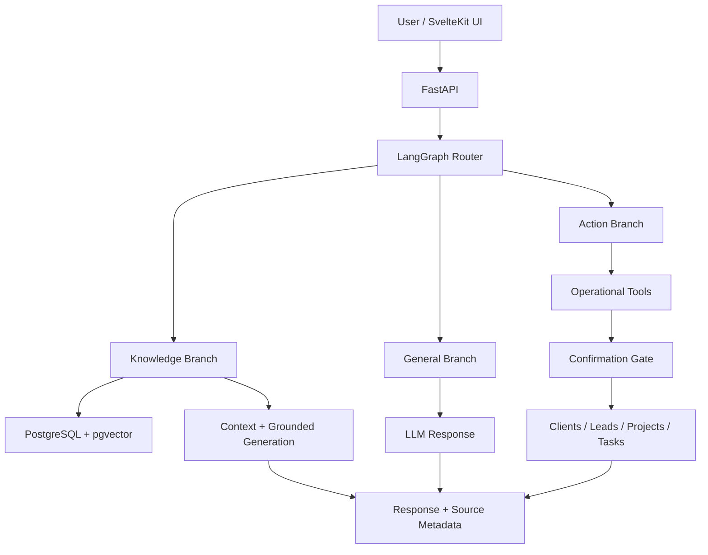
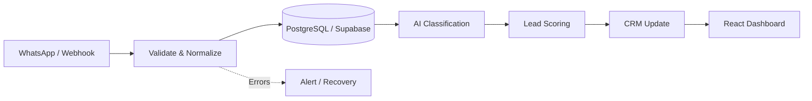

 <div align="center">

<!-- ═══════════════════════ HERO ═══════════════════════ -->


<a href="https://github.com/Aravindan-001">
  
</a>

<br/>

<a href="https://github.com/Aravindan-001">
  
</a>
<a href="https://www.linkedin.com/in/aravindansingaram">
  
</a>
<a href="mailto:aravindansingaram@gmail.com">
  
</a>
<a href="https://www.instagram.com/nexoralabs_tech/">
  
</a>

<br/><br/>


</div>

---

<div align="center">

## `01 / THE ENGINEERING MINDSET`

### I don't just build features. I engineer systems.

*From backend services and data pipelines to AI-powered workflows, mobile applications, and cloud deployments.*

</div>

I'm **Aravindan Singaram**, an Information Technology undergraduate at **NPR College of Engineering and Technology**, focused on building reliable, maintainable, and production-oriented software.

My work spans the complete engineering lifecycle — understanding a problem, designing the architecture, implementing APIs and data models, integrating intelligent workflows, testing critical paths, and preparing applications for deployment.

```text
PROBLEM
   │
   ▼
ARCHITECTURE ──► BACKEND APIs ──► DATA & INTEGRATIONS
                                      │
                                      ▼
                              AI / AUTOMATION
                                      │
                                      ▼
                           TESTING & SECURITY
                                      │
                                      ▼
                           DEPLOYMENT & DELIVERY
```

<table>
<tr>
<td width="50%" valign="top">

### ☁️ Cloud & Data Engineering

- Relational and vector database design
- Data pipelines and event-driven workflows
- Docker-based application environments
- Cloud storage, deployment, and delivery
- Infrastructure-aware application development

</td>
<td width="50%" valign="top">

### 🧠 AI & Agent Engineering

- Retrieval-Augmented Generation (RAG)
- LangGraph-based intent routing
- Tool-calling and action workflows
- Conversational context and memory
- Grounded responses and controlled mutations

</td>
</tr>
<tr>
<td width="50%" valign="top">

### ⚙️ Backend Engineering

- REST API design and implementation
- Service / repository architecture
- Authentication and role-based access
- Database migrations and query optimization
- Automated API and integration testing

</td>
<td width="50%" valign="top">

### 📱 Product & Mobile Engineering

- Flutter and cross-platform applications
- React / Next.js application development
- Secure session and integration workflows
- Responsive interfaces and user journeys
- Release preparation and deployment debugging

</td>
</tr>
</table>

---

<div align="center">

## `02 / ENGINEERING SIGNALS`

*Selected implementation and testing milestones from my projects.*

</div>

<table>
<tr>
<td align="center" width="25%">


**NORA**

AI platform test suite

</td>
<td align="center" width="25%">


**ebaConnect**

Flutter tests passing

</td>
<td align="center" width="25%">


**Backend**

Router → Service → Repository

</td>
<td align="center" width="25%">


**Data Pipeline**

Webhook → AI → CRM

</td>
</tr>
</table>

> These are project-specific implementation details, not claims about production traffic, commercial scale, or user counts.

---

<div align="center">

## `03 / FEATURED ENGINEERING PROJECTS`

*Systems built around real application workflows, explicit architecture, and measurable implementation.*

</div>

### 01 — NORA | AI Agency Operations & Knowledge Platform

<a href="https://github.com/Aravindan-001">

</a>

**A backend-first platform combining agency operations, knowledge retrieval, conversational context, and controlled AI actions.**

**Core engineering**
- FastAPI backend with SQLAlchemy 2.x, Pydantic, and Alembic.
- PostgreSQL with pgvector for entity-aware knowledge retrieval.
- LangGraph workflow routing across **Knowledge, Action, and General** branches.
- Persistent conversational context and entity-aware follow-up resolution.
- Retrieval → context assembly → structured generation → grounded response with source metadata.
- Action tools for operational CRUD workflows, with confirmation-gated mutations using `action_id`.
- SvelteKit and Svelte 5 frontend with an ORBIT conversational interface.

**Architecture**



**Engineering emphasis:** separation of concerns, retrieval quality, persisted context, safe mutation flows, database migrations, and automated testing.

**Test suite:** 303 tests reported for the project.

**Stack:** `Python` `FastAPI` `PostgreSQL` `pgvector` `LangGraph` `SQLAlchemy` `Alembic` `SvelteKit` `Pytest` `HTTPX`

---

### 02 — ebaConnect / iCore ESS | Employee Self-Service Mobile App

<a href="https://github.com/Aravindan-001/icore-ess">

</a>

**A mobile application concept focused on employee workflows, attendance, and enterprise service integration.**

**Core engineering**
- Flutter and Dart application architecture.
- GPS-based attendance with a 50-metre geofence.
- Location-accuracy checks and mock-location detection using platform signals.
- SOAP/XML integration architecture for enterprise services.
- Secure session storage and structured error handling.
- Environment configuration for Dev, UAT, and Production.
- Android release preparation, app icons, splash screen, R8 shrinking, and ProGuard configuration.

**Validation**
- `42/42` Flutter tests passing at the reported test stage.
- `flutter analyze` clean at the reported validation stage.
- Debug and release APKs verified during development.

**Stack:** `Flutter` `Dart` `REST / SOAP Integration` `XML` `Secure Storage` `Android`

**Repository:** [Aravindan-001/icore-ess](https://github.com/Aravindan-001/icore-ess)

---

### 03 — Svaraa Jewels | E-commerce & Operations Platform

<a href="https://github.com/nexoralabs-website/svaraa-jewels">

</a>

**A commerce-oriented web application with payment workflows, administration, search, and containerized infrastructure.**

**Core engineering**
- Laravel 12, PHP 8.2+, and MySQL 8.
- Redis-backed background processing with Supervisor.
- Payment confirmation through Razorpay webhook workflows.
- Invoice generation and Filament administration.
- Bulk catalogue import and PDF parsing workflows.
- Laravel Scout with Meilisearch integration.
- Dockerized application, MySQL, and Redis services.
- Nginx configuration, deployment preparation, AWS S3 integration, and Cloudflare DNS/CDN.
- Security headers and Content Security Policy considerations.

**Engineering emphasis:** transaction-aware workflows, background processing, searchable catalogues, operational administration, and deployment configuration.

**Stack:** `Laravel` `PHP` `MySQL` `Redis` `Docker` `Nginx` `Filament` `Razorpay` `AWS S3` `Cloudflare`

**Repository:** [svaraa-jewels](https://github.com/nexoralabs-website/svaraa-jewels)

---

### 04 — MeMotion | AI-Assisted Brand & Social Analytics

**A backend-oriented analytics project exploring structured data processing and AI-generated reports.**

- FastAPI and Uvicorn service layer.
- Pydantic Settings for configuration management.
- SQLAlchemy 2.x and PostgreSQL data access.
- Alembic database migrations.
- Gemini-powered report generation workflows.
- Pytest-based API and data-layer validation.
- SvelteKit frontend integration.

**Stack:** `FastAPI` `PostgreSQL` `SQLAlchemy` `Alembic` `Gemini` `SvelteKit` `Pytest`

---

### 05 — WhatsApp Lead Engagement & CRM Data Pipeline

**An event-driven workflow for capturing, classifying, and organizing business leads.**



**Core engineering**
- Webhook-based event ingestion.
- Payload validation and normalized data storage.
- PostgreSQL / Supabase as the operational data layer.
- Gemini-assisted lead classification.
- Lead scoring and CRM record updates.
- React dashboard integration.
- Error handling and alerting considerations.

**Stack:** `n8n` `Webhooks` `Supabase` `PostgreSQL` `Gemini` `React`

---

### 06 — Shri Vishwakarma Matrimony | Cross-Platform Application

**A Flutter application concept built around profile discovery and membership workflows.**

- Flutter and Dart with Provider state management.
- Repository Pattern for separation of data access.
- PHP / MySQL backend integration through REST APIs.
- Tamil and English language support.
- Profile management, search, membership, and interest workflows.
- JWT authentication and role-based access control.
- Chat restrictions based on application rules.

**Stack:** `Flutter` `Dart` `Provider` `PHP` `MySQL` `REST APIs` `JWT` `RBAC`

---

### 07 — Nexora Labs | Interactive Digital Agency Platform

<a href="https://www.instagram.com/nexoralabs_tech/">

</a>

**The digital presence for a student-led product engineering studio based in Dindigul, Tamil Nadu.**

- Next.js, React, and TypeScript application development.
- Tailwind CSS and responsive interface design.
- Three.js and React Three Fiber for interactive 3D environments.
- Scroll-driven visual transitions and procedural scene elements.
- Framer Motion animations and glassmorphism-inspired UI.
- Product positioning across web applications, mobile apps, SaaS, AI, Agentic AI, and automation.

**Stack:** `Next.js` `React` `TypeScript` `Tailwind CSS` `Three.js` `React Three Fiber` `Framer Motion`

**Connect:** [Nexora Labs on Instagram](https://www.instagram.com/nexoralabs_tech/)

---

### 08 — CampusIQ | Placement Readiness Platform

**A student-focused concept for assessing placement preparation and eligibility.**

- React Native and Expo.
- Supabase Auth, PostgreSQL, Row-Level Security, and storage.
- Resume skill extraction and gap identification workflows.
- Placement-readiness scoring on a 0–100 scale.
- Eligibility prediction and realtime data integration.

**Stack:** `React Native` `Expo` `Supabase` `PostgreSQL` `RLS` `NLP`

---

<div align="center">

## `04 / TECHNOLOGY UNIVERSE`

*Tools selected to solve different engineering problems — from data persistence to deployment.*

</div>

### Languages

<p>

</p>

### Backend & API Engineering

<p>

</p>

`REST APIs` · `Pydantic` · `SQLAlchemy 2.x` · `Alembic` · `Eloquent ORM` · `Prisma` · `Drizzle` · `Webhooks` · `JWT` · `RBAC`

### Databases & Data Engineering

<p>

</p>

`pgvector` · `Vector Search` · `Embedding Pipelines` · `ETL / ELT` · `Data Normalization` · `Database Migrations` · `Query Optimization` · `Row-Level Security`

### AI, Agents & Automation

<p>

</p>

`LangGraph` · `LangChain` · `RAG` · `OpenAI API` · `Gemini` · `Claude` · `MCP` · `OpenAI Agents SDK` · `Tool Calling` · `ReAct` · `Prompt Engineering` · `Structured Generation` · `n8n` · `Zapier`

### Web & Frontend

<p>

</p>

`Next.js App Router` · `React` · `SvelteKit` · `Svelte 5` · `Tailwind CSS` · `shadcn/ui` · `Framer Motion` · `React Three Fiber` · `Responsive UI`

### Mobile Engineering

<p>

</p>

`Flutter` · `Dart` · `Provider` · `Repository Pattern` · `React Native` · `Expo` · `Secure Storage` · `GPS / Geofencing` · `Android Release Engineering`

### Cloud, DevOps & Security

<p>

</p>

`AWS S3` · `Render` · `Docker Compose` · `Nginx` · `Cloudflare DNS / CDN` · `CSP` · `R8` · `ProGuard` · `GitHub Actions` · `Deployment Debugging`

### Testing & Quality

<p>

</p>

`Pytest` · `HTTPX` · `Flutter Test` · `Flutter Analyze` · `API Validation` · `Integration Testing` · `Type Checking` · `Build Verification`

---

<div align="center">

## `05 / HOW I ENGINEER`

</div>

| Engineering layer | My approach |
|---|---|
| Architecture | Separate routing, business logic, data access, and external integrations |
| Data | Model entities carefully, manage schema changes, validate inputs, and preserve data integrity |
| AI workflows | Route intents, retrieve relevant context, constrain tools, and return grounded responses |
| Security | Apply authentication, authorization, server-side validation, and controlled state transitions |
| Reliability | Test critical paths, handle errors explicitly, and make asynchronous workflows observable |
| Delivery | Use version control, environment-specific configuration, reproducible builds, and deployment checks |

### Typical backend architecture

```text
┌──────────────────────────────────────┐
│           Client / Frontend          │
└──────────────────┬───────────────────┘
                   ▼
┌──────────────────────────────────────┐
│       API Routes / Controllers       │
│       Validation · Authentication    │
└──────────────────┬───────────────────┘
                   ▼
┌──────────────────────────────────────┐
│           Service Layer              │
│       Business Rules · Workflows     │
└──────────────┬───────────┬───────────┘
               ▼           ▼
┌────────────────────┐  ┌───────────────────┐
│ Repository / ORM   │  │ External Services │
└──────────┬─────────┘  └───────────────────┘
           ▼
┌──────────────────────────────────────┐
│ PostgreSQL · MySQL · Redis · Vectors │
└──────────────────────────────────────┘
```

---

<div align="center">

## `06 / GITHUB ANALYTICS`

*Live widgets are provided by third-party services and may occasionally be unavailable.*

</div>

<div align="center">


<br/>


<br/>


</div>

---

<div align="center">

## `07 / CERTIFICATIONS & CONTINUOUS LEARNING`

</div>

<table>
<tr>
<td width="50%" valign="top">

### 🟢 Neo4j

**Neo4j Certified Professional**

Graph data modeling and graph database fundamentals.

</td>
<td width="50%" valign="top">

### 🍃 MongoDB

**MongoDB Basics for Students**

Document databases and NoSQL fundamentals.

</td>
</tr>
<tr>
<td width="50%" valign="top">

### 🤖 GitHub Copilot

**Prompt Engineering with GitHub Copilot**

Prompt design and AI-assisted development concepts.

</td>
<td width="50%" valign="top">

### ☁️ Oracle AI

**Oracle Agentic AI Foundations**

Agentic AI concepts and related Oracle AI learning modules.

</td>
</tr>
</table>

*Certification titles and completion status should match the corresponding issued credentials before publishing.*

---

<div align="center">

## `08 / LEADERSHIP & COMMUNITY`

</div>

- **Smart India Hackathon:** Participated in the internal selection process and project development activities.
- **Technical coordination:** Involved in college incubation, IPR, student coordination, and technical event activities.
- **Project collaboration:** Worked on cross-functional app, web, backend, and AI workflow development.
- **Knowledge sharing:** Supported junior developers with React Native, Laravel, and Supabase integration concepts.
- **Engineering documentation:** Focused on technical documentation, implementation clarity, and reproducible project workflows.

---

<div align="center">

## `09 / CURRENT ENGINEERING DIRECTION`


</div>

I am interested in engineering opportunities and collaborations involving:

- Cloud infrastructure and deployment workflows
- Data engineering, databases, and reliable pipelines
- Backend services and API architecture
- AI agents, RAG systems, and business automation
- Mobile and web products with real operational workflows

---

<div align="center">

## `10 / LET'S BUILD SOMETHING USEFUL`

### Ideas are the starting point. Engineering makes them real.

**Open to:** Engineering opportunities · Product collaborations · AI automation · Backend and cloud projects

<br/>

<a href="mailto:aravindansingaram@gmail.com">
  
</a>
<a href="https://www.linkedin.com/in/aravindansingaram">
  
</a>
<a href="https://github.com/Aravindan-001">
  
</a>
<a href="https://www.instagram.com/nexoralabs_tech/">
  
</a>

<br/><br/>

*Engineering with intent. Building with curiosity. Improving through iteration.*


</div>
