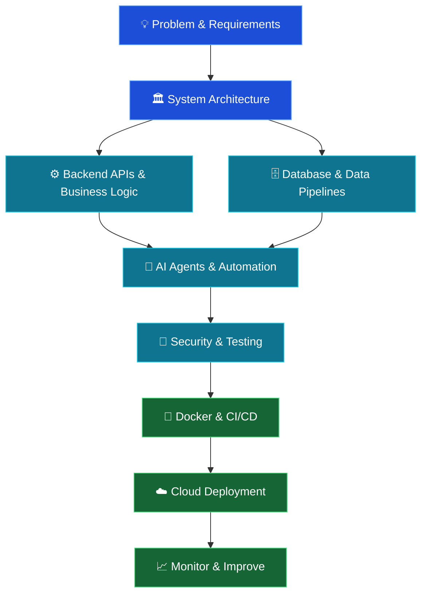
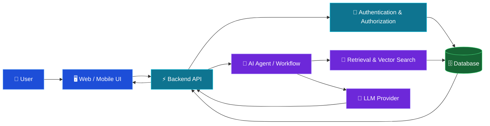

# 👋 Hey, I'm Aravindan S

  

  
  
  

  <b>Building intelligent systems, production-ready applications, and cloud-native solutions.</b>

---

## 🧭 About Me

I'm an Information Technology engineering student interested in building practical software systems that combine **backend engineering, agentic AI, data engineering, and cloud infrastructure**.

- 🧠 Exploring AI agents, RAG pipelines, and LLM-powered workflows.
- ⚙️ Building backend APIs, authentication systems, and database-driven applications.
- ☁️ Working with cloud deployment, Docker, CI/CD, and DevOps workflows.
- 🔐 Interested in application security, penetration testing, and secure system design.
- 🛠️ Developing web applications, mobile apps, SaaS products, and automation tools.
- 🎯 Career interests: **Backend Engineering · AI & Agent Engineering · Cloud & DevOps**

---

## 📊 GitHub at a Glance

  
  

  

---

## 🧩 Technical Skill Map

<table>
  <tr>
    <td width="50%" valign="top">

### 💻 Programming & Web

  

**Frameworks**
- Next.js · React
- Node.js · FastAPI · Laravel
- Flutter · SvelteKit

    </td>
    <td width="50%" valign="top">

### 🗄️ Data & Databases

  

**Data technologies**
- PostgreSQL · MySQL · MongoDB
- Redis · Firebase · Supabase
- Neo4j · pgvector
- Data modelling and API integration

    </td>
  </tr>
  <tr>
    <td width="50%" valign="top">

### 🤖 AI & Agent Engineering

  

- Agentic AI and AI agents
- Retrieval-Augmented Generation (RAG)
- LangChain · LangGraph
- Model Context Protocol (MCP)
- OpenAI · Gemini · Claude
- Vector search and AI workflows

    </td>
    <td width="50%" valign="top">

### ☁️ Cloud, DevOps & Security

  

- Docker and containerization
- Cloud deployment and CI/CD
- AWS · Cloudflare · Vercel · Render
- API security and authentication
- Security testing and access control

    </td>
  </tr>
</table>

### 🧰 Tools & Automation

  

  
  
  
  

---

## 🏗️ How I Build Systems

  
  
  
  
  

---

## 🚀 Featured Projects

<table>
  <tr>
    <td width="50%" valign="top">

### 🧠 NORA

**AI-powered agency operations and knowledge graph platform**

- FastAPI backend and PostgreSQL.
- pgvector-based retrieval capabilities.
- LangGraph workflow orchestration.
- SvelteKit frontend.
- Router → Service → Repository architecture.

**Focus:** AI systems · RAG · Backend engineering

    </td>
    <td width="50%" valign="top">

### 💎 Svaraa Jewels

**E-commerce application with a deployment-focused architecture**

- Laravel 12 and PHP.
- MySQL and Redis.
- Filament administration.
- Docker and Nginx.
- CI/CD and deployment workflows.

**Focus:** Web engineering · Databases · Cloud & DevOps

    </td>
  </tr>
  <tr>
    <td width="50%" valign="top">

### 📱 iCore ESS

**Employee self-service mobile application**

- Flutter and Dart.
- SOAP/XML service integration.
- Firebase integration.
- Mobile application workflows.

**Focus:** Mobile engineering · API integration

[View Repository](https://github.com/Aravindan-001/icore-ess)

    </td>
    <td width="50%" valign="top">

### ☁️ Cloud & DevOps Platform

**Infrastructure and deployment-focused engineering**

- Cloud deployment workflows.
- Containerization and automation.
- Development and delivery practices.

**Focus:** Cloud engineering · DevOps

[Explore My GitHub Repositories](https://github.com/Aravindan-001?tab=repositories)

    </td>
  </tr>
</table>

### 🔬 Other Engineering Work

- **PerceptionIQ** — hackathon project focused on AI-assisted capabilities and application workflows.
- **Client CRM** — lead management interface and responsive sales CRM workflows.
- **PYP — Pick Your Photographer** — photographer marketplace app with booking, payment, and role-based workflows.

> Project descriptions represent different stages of development. Explore individual repositories for available source code and implementation details.

---

## 🧠 AI & Backend Architecture

**Engineering principles I value**

- Modular architecture and separation of concerns.
- Secure authentication and authorization.
- Database integrity and server-side validation.
- Reusable APIs and maintainable code.
- Automated testing and deployment.
- Practical AI integrations with clear application value.

---

## 🏅 Certifications & Learning Milestones

  
  

- **Neo4j Certified Professional** — graph database concepts and graph technology.
- **Oracle Agentic AI Foundations 2026** — agentic AI foundations and related AI technologies.
- **OpenAI Responses API & Agents SDK** — completed learning module.
- **Model Context Protocol (MCP)** — completed learning module.
- **OCI Enterprise AI / Oracle AI Database & Vector Search** — completed learning modules.
- **MongoDB Basics for Students** — database learning milestone.
- **Prompt Engineering with GitHub Copilot** — developer productivity learning milestone.

---

## 📈 Contribution Activity

  

  

---

## 🎯 Current Focus

  
  
  
  
  

I enjoy connecting software engineering with AI and infrastructure to build systems that are useful, secure, and deployable.

---

## 🤝 Let's Connect

  

  <b>Build. Automate. Deploy. Improve.</b>

  

