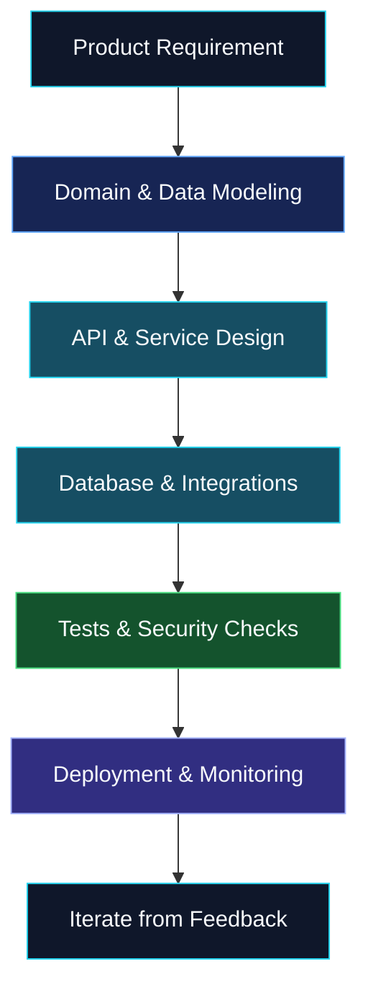
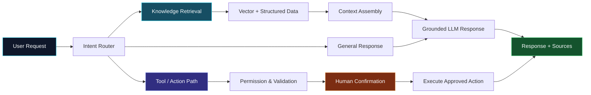
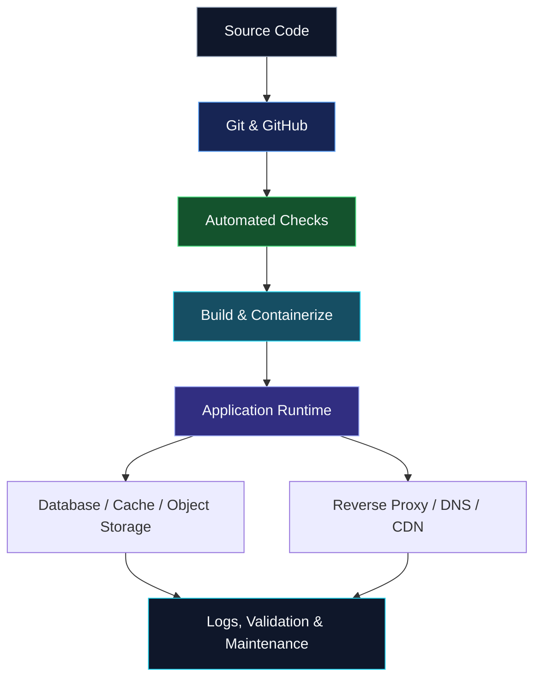

 

 

  

---

## `01 / ENGINEERING IDENTITY`

<table>
<tr>
<td width="62%" valign="top">

### Building systems, not just screens.

I'm **Aravindan Singaram**, a B.Tech Information Technology student at **NPR College of Engineering and Technology**, focused on building practical software systems across backend engineering, cloud infrastructure, data platforms, mobile applications, and AI-powered workflows.

My approach combines structured backend architecture, database design, API integrations, automation, and AI capabilities to build systems that are easier to test, maintain, and extend.

- Designing backend APIs and service-oriented workflows.
- Building retrieval-augmented generation (RAG) and tool-using AI systems.
- Working with relational databases, vector search, and data pipelines.
- Developing Flutter applications and modern web platforms.
- Exploring cloud deployment, containerization, observability, and security.
- Turning product requirements into implementable engineering workflows.

</td>
<td width="38%" valign="top">

### CURRENT FOCUS

 
 
 
 

**Education:** B.Tech — Information Technology  
**Institution:** NPR College of Engineering and Technology  
**Expected graduation:** 2028  
**Location:** Tamil Nadu, India

</td>
</tr>
</table>

---

## `02 / TECHNOLOGY AT A GLANCE`

### My engineering toolkit

*Logos represent technologies I work with or explore; proficiency varies by tool and project.*

### Languages and application development

| Area | Technologies |
|---|---|
| Programming | Python, TypeScript, JavaScript, PHP, Dart, C |
| Backend | FastAPI, Laravel, Node.js, Express.js, REST APIs |
| Web | Next.js, React, SvelteKit, Svelte 5, Tailwind CSS |
| Mobile | Flutter, Dart, React Native, Expo |
| API engineering | Validation, authentication, authorization, pagination, webhooks |
| Architecture | Layered architecture, service/repository patterns, modular design |

### Databases and data systems

- Relational schema design, constraints, indexing, migrations, and query optimization.
- Vector embeddings, similarity retrieval, and knowledge-grounded responses.
- Authentication, row-level security, and application-level authorization.
- Data ingestion, normalization, validation, and webhook-driven pipelines.

### AI, agent engineering and automation

- Retrieval-Augmented Generation (RAG).
- Agent state management, routing, and tool calling.
- Context-aware retrieval and structured LLM outputs.
- Human-confirmation gates for sensitive write operations.
- Workflow automation, API integrations, and event-driven processing.
- Prompt design, embedding pipelines, and provider abstractions.

### Cloud, DevOps and quality engineering

- Dockerized application and supporting-service workflows.
- Deployment configuration, environment variables, and release checks.
- Reverse proxy, DNS/CDN, and application security configuration.
- Automated tests, API checks, static analysis, and build verification.
- Cloud fundamentals, object storage, and deployment troubleshooting.

---

## `03 / FEATURED ENGINEERING WORK`

*Selected projects and engineering work. Repository links are included where a public repository is available.*

<table>
<tr>
<td width="50%" valign="top">

### 01 — NORA
**AI operations and knowledge-graph platform**

An AI-assisted operations platform designed around structured business data, contextual retrieval, and controlled tool execution.

**Engineering highlights**
- FastAPI backend with a PostgreSQL data layer.
- pgvector-backed semantic retrieval.
- LangGraph-based knowledge, action, and general-response paths.
- Context-aware follow-up resolution.
- Confirmation-gated write actions.
- Modular router → service → repository architecture.

**Stack:** Python · FastAPI · PostgreSQL · pgvector · LangGraph · SvelteKit

</td>
<td width="50%" valign="top">

### 02 — iCore ESS / ebaConnect
**Enterprise employee self-service mobile application**

Flutter-based employee workflows with enterprise service integration and location-aware attendance functionality.

**Engineering highlights**
- SOAP/XML integration architecture.
- GPS-based attendance and geofence checks.
- Location accuracy and mock-location checks.
- Secure session handling and structured error handling.
- Environment-specific configuration and Android release preparation.

**Stack:** Flutter · Dart · SOAP/XML · Firebase

[**View public repository →**](https://github.com/Aravindan-001/icore-ess)

</td>
</tr>
<tr>
<td width="50%" valign="top">

### 03 — Svaraa Jewels
**E-commerce and operations platform**

A commerce-oriented application combining catalog workflows, payment processing, administrative tooling, and deployment infrastructure.

**Engineering highlights**
- Laravel application with MySQL and Redis.
- Payment webhook integration.
- Background jobs and queue processing.
- Filament administration workflows.
- Product search and catalog import workflows.
- Docker, Nginx, object storage, and deployment configuration.

**Stack:** Laravel · PHP · MySQL · Redis · Docker · Filament

[**View public repository →**](https://github.com/nexoralabs-website/svaraa-jewels)

</td>
<td width="50%" valign="top">

### 04 — MeMotion
**AI-assisted social and brand analytics**

An analytics-oriented application that combines backend data handling with AI-generated reporting.

**Engineering highlights**
- FastAPI endpoints and typed configuration.
- SQLAlchemy data access and Alembic migrations.
- PostgreSQL-backed persistence.
- Gemini-assisted report generation.
- Pytest coverage for API and data workflows.

**Stack:** Python · FastAPI · PostgreSQL · SQLAlchemy · Gemini · SvelteKit

</td>
</tr>
<tr>
<td width="50%" valign="top">

### 05 — WhatsApp Lead Engagement Pipeline
**Automation and CRM data processing**

A workflow connecting inbound lead events to normalized records, AI-assisted classification, and CRM updates.

**Pipeline**

`Webhook → Validation → PostgreSQL → AI Classification → CRM Update → Dashboard`

**Engineering focus**
- Event-driven automation.
- Data normalization and validation.
- AI-assisted lead categorization.
- Database-backed workflow state.
- Failure handling and operational alerts.

**Stack:** n8n · Supabase · PostgreSQL · Gemini · React · Webhooks

</td>
<td width="50%" valign="top">

### 06 — Shri Vishwakarma Matrimony
**Multilingual mobile application**

A mobile application concept supporting profile discovery and membership-driven user workflows.

**Engineering highlights**
- Flutter application structure.
- Provider state management and repository pattern.
- REST API integration.
- Tamil and English experiences.
- Membership, interest, and chat access workflows.
- JWT/RBAC-oriented authorization design.

**Stack:** Flutter · Dart · Provider · PHP · MySQL · REST APIs

</td>
</tr>
<tr>
<td width="50%" valign="top">

### 07 — CampusIQ
**Placement-readiness and career-support platform**

A platform concept for organizing student skills and supporting placement preparation.

**Engineering highlights**
- Resume-skill extraction and gap analysis.
- Placement-readiness scoring concept.
- Eligibility prediction workflows.
- Authentication and database access controls.
- Realtime-enabled backend capabilities.

**Stack:** React Native · Expo · Supabase · PostgreSQL · NLP

</td>
<td width="50%" valign="top">

### 08 — Nexora Labs
**Student-led product engineering studio**

A product engineering initiative exploring web applications, mobile apps, SaaS workflows, AI systems, and business automation.

**Engineering focus**
- Product discovery and requirements.
- API and application architecture.
- AI-enabled workflows.
- Automation and integration.
- Deployment-oriented delivery.

**Stack:** Next.js · React · TypeScript · Tailwind CSS · AI · Automation

[**Visit Nexora Labs on Instagram →**](https://www.instagram.com/nexoralabs_tech/)

</td>
</tr>
</table>

---

## `04 / HOW I DESIGN SYSTEMS`

### Engineering principles

| Principle | What it means in practice |
|---|---|
| **Clear boundaries** | Keep API routes, business logic, and persistence responsibilities separated. |
| **Data integrity** | Validate inputs, define constraints, and make state transitions explicit. |
| **Secure by design** | Apply least privilege, authorization checks, protected secrets, and server-side validation. |
| **Testable systems** | Verify important behavior with automated tests and reproducible checks. |
| **Observable workflows** | Make failures diagnosable with structured errors, logs, and meaningful status information. |
| **Controlled AI actions** | Separate model-generated decisions from validated tools and sensitive write operations. |
| **Deployable software** | Treat configuration, migrations, containers, and release checks as part of implementation. |

---

## `05 / AI SYSTEM DESIGN`

Areas I explore in AI application engineering:

- Retrieval-Augmented Generation with vector and structured data.
- Agent workflows with explicit state and routing.
- Tool calling with validated inputs and controlled execution.
- Context management for multi-turn interactions.
- Structured outputs and source-aware response generation.
- Human approval for operations that modify application state.
- Automation workflows that connect AI capabilities to real APIs.

---

## `06 / CLOUD & DELIVERY WORKFLOW`

**Practices I work with:** environment-based configuration, migration discipline, containerized dependencies, deployment verification, API testing, access control, and practical release troubleshooting.

---

## `07 / GITHUB ACTIVITY`

 

 

These cards are generated by third-party services and may be temporarily unavailable. Language percentages reflect repository contents, not a formal measure of proficiency.

---

## `08 / CERTIFICATIONS & CONTINUOUS LEARNING`

**Ongoing technical exploration**
- AWS cloud fundamentals and infrastructure concepts.
- Oracle enterprise AI and agent engineering.
- MCP, tool integrations, and agent orchestration.
- Database design, vector retrieval, and data engineering.
- Secure backend development and deployment practices.

*Keep the certification labels aligned with the exact credentials and completion status shown on your official learning profiles.*

---

## `09 / BEYOND THE CODE`

Alongside technical development, I participate in student innovation and engineering activities, including incubation initiatives, technical event coordination, IPR awareness, and hackathon-oriented product development.

I value collaboration, clear documentation, thoughtful architecture, and shipping software that addresses a real user or business need.

---

## `10 / LET'S BUILD SOMETHING USEFUL`

### Have a product idea, an engineering challenge, or an AI workflow to build?

I'm interested in backend systems, cloud and data engineering, AI-powered products, mobile applications, SaaS platforms, and practical automation.

  

**Backend Engineering · Cloud & Data Engineering · AI & Agent Engineering · Mobile & Web**

