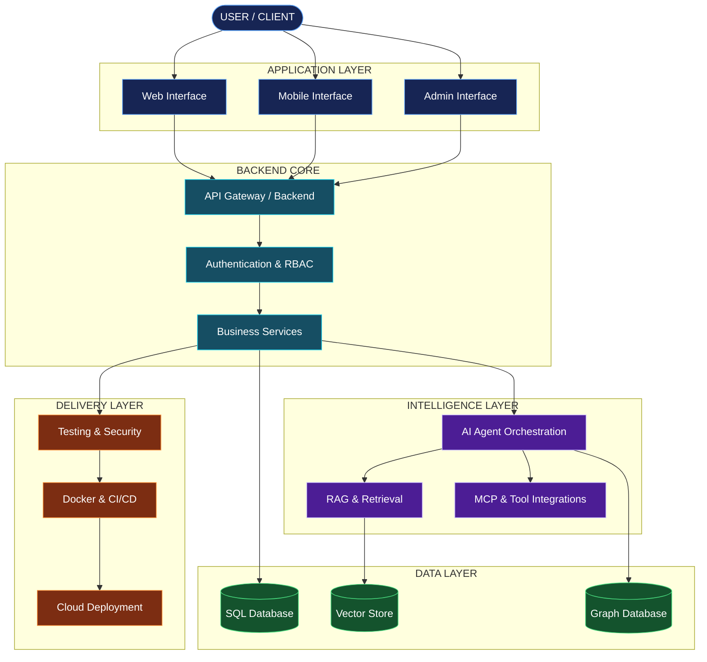
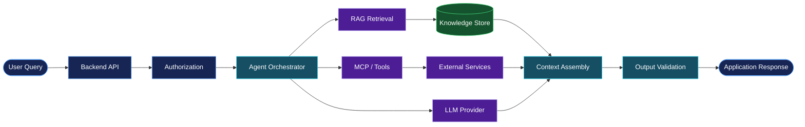

<div align="center">


<br/>


<br/><br/>

<a href="https://github.com/Aravindan-001">
  
</a>


<br/><br/>

**Engineering the bridge between backend systems, intelligent automation, and cloud infrastructure.**

</div>

---

## `01` / THE ENGINEER

<table>
<tr>
<td width="58%" valign="top">

### About Me

I'm an Information Technology engineering student interested in building real-world software that connects applications, data, AI, and infrastructure.

I focus on understanding how complete systems work — from API contracts and database design to AI integrations, application security, testing, and deployment.

**What I build**
- ⚙️ Backend APIs and application workflows
- 🤖 AI agents, RAG systems, and tool integrations
- ☁️ Cloud-ready applications and deployment pipelines
- 🗄️ Database-driven and data-intensive systems
- 🔐 Secure authentication and access-control workflows
- 📱 Web and mobile applications

</td>
<td width="42%" valign="top">

### Engineering Compass

```text
01  DESIGN
    └── Architecture & data models

02  BUILD
    └── APIs, applications & AI

03  VALIDATE
    └── Tests, security & integrity

04  DELIVER
    └── Containers & deployment

05  IMPROVE
    └── Debugging & iteration
```

**Engineering mindset:** maintainable code, clear boundaries, practical solutions, and repeatable delivery.

</td>
</tr>
</table>

---

## `02` / TECHNOLOGY MAP

<div align="center">

### Languages


### Application Engineering


### Databases & Data Systems


### Cloud, DevOps & Tooling


### AI & Automation


</div>

---

## `03` / SYSTEM ARCHITECTURE

<div align="center">

**How application engineering, AI, data, and deployment connect**

</div>



### System Design Principles

| Area | Priority |
|:--|:--|
| Architecture | Modular components and separation of concerns |
| Backend | Clear API contracts and validated inputs |
| Security | Server-side authorization and least privilege |
| Data | Appropriate schemas, constraints, and retrieval strategies |
| AI | Controlled tool access and contextual retrieval |
| Delivery | Automated testing and repeatable deployments |

---

## `04` / FEATURED ENGINEERING WORK

<table>
<tr>
<td width="50%" valign="top">

### 🧠 NORA

**AI Agency Operations & Knowledge Platform**


- FastAPI backend with modular architecture.
- PostgreSQL and pgvector retrieval.
- LangGraph workflow orchestration.
- SvelteKit frontend.
- Router → Service → Repository structure.

**Focus:** backend architecture, RAG, AI workflows.

</td>
<td width="50%" valign="top">

### 💎 Svaraa Jewels

**E-commerce & DevOps Engineering**


- Laravel and PHP application.
- MySQL and Redis integration.
- Filament administration.
- Docker and Nginx deployment setup.
- CI/CD workflows.

**Focus:** web engineering, databases, cloud delivery.

</td>
</tr>
<tr>
<td width="50%" valign="top">

### 📱 iCore ESS

**Employee Self-Service Mobile Application**


- Flutter and Dart.
- SOAP/XML service integration.
- Firebase integration.
- Employee self-service workflows.

**Focus:** mobile engineering and enterprise integration.

[↗ View Repository](https://github.com/Aravindan-001/icore-ess)

</td>
<td width="50%" valign="top">

### 📊 Client CRM

**Sales & Lead Management**


- Sales CRM and lead workflows.
- Responsive web interface.
- Browser automation and testing.
- Type checking, linting, and build validation.

**Focus:** full-stack development and quality assurance.

</td>
</tr>
<tr>
<td width="50%" valign="top">

### 📸 PYP — Pick Your Photographer

**Photographer Marketplace**

- Customer booking and photographer acceptance.
- Payment and confirmation workflows.
- Role-based access control.
- Server-side marketplace fee calculation.

**Focus:** marketplace systems and secure transactions.

</td>
<td width="50%" valign="top">

### 🔬 PerceptionIQ

**Hackathon Engineering Project**

- AI-assisted application workflows.
- Frontend and backend integration.
- Quality assurance and testing.

**Focus:** rapid prototyping and full-stack delivery.

</td>
</tr>
</table>

<div align="center">

<a href="https://github.com/Aravindan-001?tab=repositories">

</a>

</div>

---

## `05` / AI AGENT WORKFLOW



**Goal:** connect models, application data, and external tools through controlled workflows with clear authorization and validation boundaries.

---

## `06` / CERTIFICATIONS & LEARNING

<div align="center">

<a href="https://neo4j.com/">

</a>

<a href="https://education.oracle.com/">

</a>

</div>

<table>
<tr>
<td width="50%" valign="top">

### AI & Agent Engineering

- Oracle Agentic AI Foundations 2026.
- OpenAI Responses API & Agents SDK learning module.
- Model Context Protocol learning module.
- OCI Enterprise AI learning module.
- Oracle AI Database & Vector Search learning module.

</td>
<td width="50%" valign="top">

### Data & Developer Tools

- Neo4j Certified Professional.
- MongoDB Basics for Students.
- Prompt Engineering with GitHub Copilot.

</td>
</tr>
</table>

---

## `07` / GITHUB ANALYTICS

<div align="center">

<a href="https://github.com/Aravindan-001">

</a>
<a href="https://github.com/Aravindan-001">

</a>

<br/><br/>


<br/><br/>


<br/><br/>


</div>

---

## `08` / ENGINEERING DIRECTION

<div align="center">

| ENGINEERING TRACK | AREAS OF FOCUS |
|:--|:--|
| ⚙️ Backend | APIs, architecture, authentication |
| 🤖 AI Engineering | Agents, RAG, MCP, LLM integration |
| ☁️ Cloud & DevOps | AWS, containers, CI/CD |
| 🗄️ Data Engineering | SQL, vector search, graph databases |
| 🔐 Security | Access control, validation, secure workflows |

</div>

---

<div align="center">

## LET'S BUILD SOMETHING USEFUL.

**Design thoughtfully. Engineer reliably. Automate intelligently.**

<a href="https://github.com/Aravindan-001">

</a>

<br/><br/>


<br/><br/>


</div>

<!-- END OF README -->
