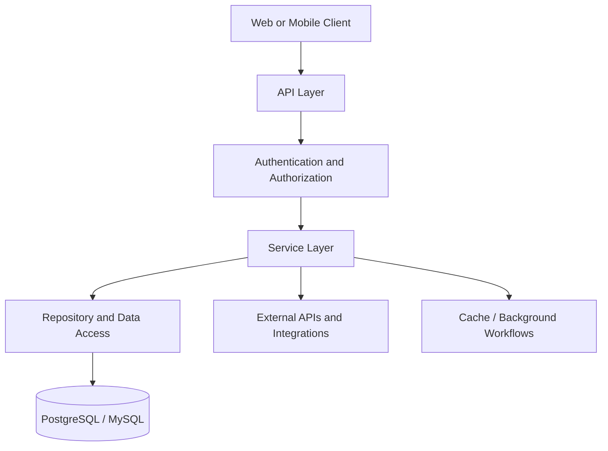
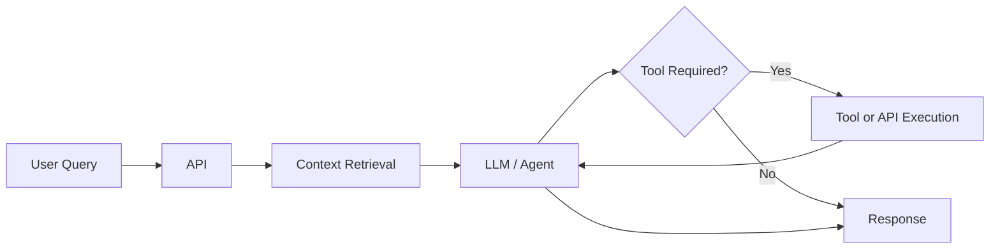

 <div align="center">


<p>
  <a href="https://github.com/Aravindan-001">
    
  </a>
  <a href="https://www.instagram.com/nexoralabs_tech/">
    
  </a>
  <a href="https://wa.me/917339559072">
    
  </a>
</p>


**Information Technology Student · Backend Engineer in Progress · AI & Cloud Builder**

*Building practical software systems at the intersection of backend engineering, AI agents, and cloud infrastructure.*

</div>

---

## `01` — About Me

```python
class Aravindan:
    def __init__(self):
        self.role = "Information Technology Student"
        self.focus = [
            "Backend Engineering",
            "Agentic AI & RAG",
            "Cloud & DevOps",
            "Application Security",
        ]
        self.building = "Production-minded software projects"
        self.studio = "Nexora Labs"

    def current_mindset(self):
        return "Build. Test. Secure. Automate. Improve."
```

- Building backend APIs, web applications, and mobile application workflows.
- Exploring **AI agents, retrieval-augmented generation (RAG), tool calling, and MCP**.
- Working with databases, authentication, authorization, and API integrations.
- Interested in cloud infrastructure, Docker, CI/CD, deployment, and observability.
- Exploring application security and secure-by-design development.
- Building digital products and client solutions through **Nexora Labs**, a student-led product engineering studio.

> My goal is to build software that is not only functional, but also secure, maintainable, testable, and deployable.

---

## `02` — Engineering Focus

<table>
<tr>
<td width="50%" valign="top">

### ⚙️ Backend Engineering

- REST API design
- Service and repository architecture
- Authentication and role-based access
- PostgreSQL and relational data modelling
- Redis and caching fundamentals
- Testing and API integration

</td>
<td width="50%" valign="top">

### 🧠 AI & Agent Engineering

- Agentic AI workflows
- Retrieval-augmented generation
- Embeddings and vector search
- LangGraph and tool calling
- Model and API integrations
- Model Context Protocol (MCP)

</td>
</tr>
<tr>
<td width="50%" valign="top">

### ☁️ Cloud & DevOps

- Docker and containerisation
- CI/CD fundamentals
- Cloud deployment workflows
- AWS learning and exploration
- Environment configuration
- Deployment troubleshooting

</td>
<td width="50%" valign="top">

### 🛡️ Security & Automation

- Secure authentication patterns
- Role and permission boundaries
- Input validation
- Security testing fundamentals
- Workflow automation
- Integration-driven applications

</td>
</tr>
</table>

---

## `03` — Technology Stack

<div align="center">

### Languages


### Frontend & Mobile


### Backend & Frameworks


### Databases & Data


### Cloud, DevOps & Tools


</div>

**Additional technologies and platforms**


---

## `04` — Featured Projects

*Explore the repositories on my GitHub profile for source code, implementation details, and project documentation.*

<table>
<tr>
<td width="50%" valign="top">

### 🧠 NORA

**AI-powered agency operations and knowledge platform**

- FastAPI backend with a layered architecture
- PostgreSQL and pgvector integration
- LangGraph-oriented workflow design
- Client, lead, project, and task modules
- SvelteKit frontend

**Focus:** Backend systems · AI workflows · Knowledge retrieval

</td>
<td width="50%" valign="top">

### 📱 iCore ESS

**Employee self-service application**

- Flutter and Dart application
- SOAP/XML integration
- Firebase integration
- Employee-focused mobile workflows

**Focus:** Mobile engineering · Enterprise integration

[Explore repository](https://github.com/Aravindan-001/icore-ess)

</td>
</tr>
<tr>
<td width="50%" valign="top">

### 💎 Svaraa Jewels

**E-commerce application engineering**

- Laravel and PHP
- MySQL data layer
- Redis and Docker-based infrastructure
- Nginx and deployment configuration
- Admin workflows with Filament

**Focus:** Backend development · Infrastructure · Deployment

</td>
<td width="50%" valign="top">

### 📊 Client CRM

**Sales and lead-management application**

- Next.js and React
- Lead-management workflows
- Responsive interface
- WhatsApp-oriented contact flow
- Browser-based testing with Playwright

**Focus:** Business workflows · Full-stack engineering · QA

</td>
</tr>
<tr>
<td width="50%" valign="top">

### 🤖 PerceptionIQ

**Hackathon project**

- AI-oriented product concept
- Backend and frontend integration
- Testing and integration troubleshooting
- External data extraction constraints

**Focus:** Rapid prototyping · Product engineering

</td>
<td width="50%" valign="top">

### 🚀 Nexora Labs

**Student-led product engineering studio**

- Web and mobile application development
- SaaS product concepts
- AI-powered applications
- Agentic AI and workflow automation

**Focus:** Product development · Client solutions

[Visit Instagram](https://www.instagram.com/nexoralabs_tech/)

</td>
</tr>
</table>

<div align="center">

<a href="https://github.com/Aravindan-001?tab=repositories">
  
</a>

</div>

---

## `05` — System Design & Engineering

### Typical backend architecture



### AI-powered application flow



*These diagrams illustrate common patterns I explore in software projects; they are conceptual architecture examples, not claims that every project implements every component.*

### Engineering principles

- **Separation of concerns:** keep routing, business logic, and data access organised.
- **Security first:** validate inputs and enforce permissions on the server.
- **Testability:** verify important behaviours before deployment.
- **Maintainability:** use clear naming, consistent structure, and useful documentation.
- **Deployment awareness:** treat environment variables, secrets, migrations, and runtime configuration as part of the product.
- **Honest engineering:** document implemented functionality separately from planned features.

---

## `06` — GitHub Analytics

<div align="center">

<a href="https://github.com/Aravindan-001">
  
</a>
<a href="https://github.com/Aravindan-001">
  
</a>


</div>

### Contribution calendar

<div align="center">


</div>

### 🐍 Contribution Snake — enable after workflow succeeds

The animated snake needs the GitHub Actions workflow to generate files in the `output` branch. Until then, the contribution calendar above can serve as the visual alternative.

**Once the workflow succeeds:**

1. Open the [`output` branch](https://github.com/Aravindan-001/Aravindan-001/tree/output).
2. Confirm these files exist:
   - `github-contribution-grid-snake.svg`
   - `github-contribution-grid-snake-dark.svg`
3. Uncomment the block below and commit the README.

```html
<!-- Uncomment after both SVG files exist in the output branch.

<picture>
  <source
    media="(prefers-color-scheme: dark)"
    srcset="https://raw.githubusercontent.com/Aravindan-001/Aravindan-001/output/github-contribution-grid-snake-dark.svg"
  />
  <source
    media="(prefers-color-scheme: light)"
    srcset="https://raw.githubusercontent.com/Aravindan-001/Aravindan-001/output/github-contribution-grid-snake.svg"
  />
  
</picture>

-->
```

---

## `07` — Certifications & Learning

- **Neo4j Certified Professional**
- **Oracle Agentic AI Foundations 2026** — completed learning covering agentic AI concepts, MCP, OpenAI Responses API and Agents SDK, OCI Enterprise AI, and Oracle AI Database / Vector Search.
- **AWS Skill Builder** — studying cloud fundamentals and AWS services, including compute, load balancing, and messaging concepts.

*Learning credentials and completed courses are listed separately from professional work experience.*

---

## `08` — Currently Exploring

<table>
<tr>
<td align="center" width="25%">

<br/><sub>Agent workflows, RAG, tools and MCP</sub>
</td>
<td align="center" width="25%">

<br/><sub>Cloud services and architecture</sub>
</td>
<td align="center" width="25%">

<br/><sub>Containers, pipelines and deployment</sub>
</td>
<td align="center" width="25%">

<br/><sub>Authentication, access control and testing</sub>
</td>
</tr>
</table>

---

## `09` — Beyond the Code

- Coordinating and contributing to college technical activities.
- Participating in hackathons and project-based development.
- Exploring product ideas and client requirements through Nexora Labs.
- Interested in the intersection of **AI engineering, cloud platforms, and reliable backend systems**.

---

## `10` — Connect

<div align="center">

**Have a project idea, collaboration opportunity, or engineering discussion?**

<a href="https://github.com/Aravindan-001">
  
</a>
<a href="https://www.instagram.com/nexoralabs_tech/">
  
</a>
<a href="https://wa.me/917339559072">
  
</a>

*Build useful things. Keep learning. Engineer with purpose.*


</div>
