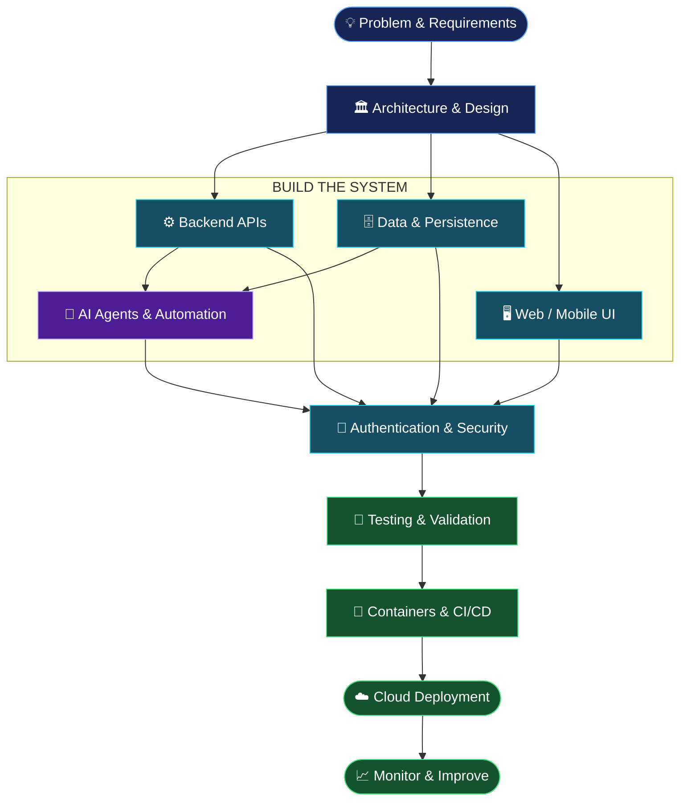
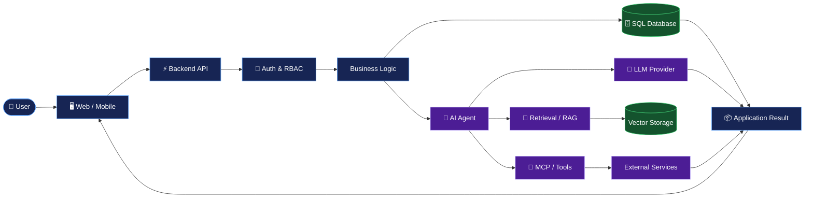

 

  

  
</a>

  

**I build software at the intersection of intelligent automation, backend systems, data, and cloud infrastructure.**

---

<table>
<tr>
<td align="center" width="25%">

**⚙️ BACKEND**

API Engineering

</td>
<td align="center" width="25%">

**🤖 AI SYSTEMS**

Agents & RAG

</td>
<td align="center" width="25%">

**☁️ CLOUD**

Deploy & Automate

</td>
<td align="center" width="25%">

**🗄️ DATA**

SQL & Vector Search

</td>
</tr>
</table>

## `01` — Engineering Profile

<table>
<tr>
<td width="58%" valign="top">

### Who I Am

I'm an Information Technology engineering student focused on building practical, maintainable software systems.

My engineering interests span backend development, AI agents, data engineering, cloud infrastructure, and application security.

I enjoy connecting different layers of a system — from user-facing applications and backend APIs to databases, AI workflows, automated tests, and deployment pipelines.

**What drives my engineering work**
- Building useful, real-world software.
- Designing modular and secure backend systems.
- Integrating AI into application workflows.
- Automating repetitive development and deployment tasks.
- Learning through implementation, testing, and iteration.

</td>
<td width="42%" valign="top">

### Engineering Focus

 

**Preferred workflow**

`Design` → `Build` → `Test` → `Secure` → `Deploy`

</td>
</tr>
</table>

---

## `02` — Technology Radar

### Programming Languages

### Web, Backend & Mobile

### Databases & Data Platforms

### Cloud, DevOps & Developer Tools

### AI, Agent Frameworks & Automation

---

## `03` — How I Engineer a System

### Core Engineering Principles

| Principle | Implementation mindset |
|:--|:--|
| Architecture | Separate responsibilities into maintainable modules |
| Security | Validate input and enforce server-side authorization |
| Data integrity | Use appropriate schemas, constraints, and validation |
| Reliability | Test important application flows and edge cases |
| Automation | Make repeatable tasks easier to execute consistently |
| Delivery | Keep build and deployment processes reproducible |

---

## `04` — Project Portfolio

<table>
<tr>
<td width="50%" valign="top">

### 🧠 NORA

**AI Agency Operations & Knowledge Platform**

- FastAPI backend and modular architecture.
- PostgreSQL with pgvector retrieval.
- LangGraph workflow orchestration.
- SvelteKit application interface.
- Router → Service → Repository separation.

`AI Engineering` · `RAG` · `Backend Architecture`

</td>
<td width="50%" valign="top">

### 💎 Svaraa Jewels

**E-commerce & Deployment Engineering**

- Laravel and PHP application.
- MySQL persistence and Redis integration.
- Filament administration.
- Docker and Nginx setup.
- CI/CD and deployment workflows.

`Web Engineering` · `Databases` · `Cloud & DevOps`

</td>
</tr>
<tr>
<td width="50%" valign="top">

### 📱 iCore ESS

**Employee Self-Service Mobile Application**

- Flutter and Dart application.
- SOAP/XML service integration.
- Firebase integration.
- Employee self-service workflows.

`Mobile Engineering` · `API Integration`

[↗ View Repository](https://github.com/Aravindan-001/icore-ess)

</td>
<td width="50%" valign="top">

### 📊 Client CRM

**Sales & Lead Management Interface**

- Lead management and sales workflows.
- Responsive user interface.
- Browser-based automated testing.
- Type checking, linting, and build validation.

`Full-Stack Development` · `Testing`

</td>
</tr>
<tr>
<td width="50%" valign="top">

### 📸 PYP — Pick Your Photographer

**Photographer Marketplace**

- Customer booking and photographer acceptance.
- Payment and confirmation workflow design.
- Role-based access and booking validation.
- Server-side marketplace fee calculations.

`Marketplace Engineering` · `Payments` · `RBAC`

</td>
<td width="50%" valign="top">

### 🔬 PerceptionIQ

**Hackathon Engineering Project**

- AI-assisted application workflows.
- Frontend and backend integration.
- Quality assurance and testing.

`Rapid Prototyping` · `Full-Stack Engineering`

</td>
</tr>
</table>

---

## `05` — AI & Backend Architecture

**Design objective:** build applications where APIs, authorization, persistence, AI integrations, and external tools work together through clearly defined boundaries.

---

## `06` — Certifications & Learning Milestones

<table>
<tr>
<td width="50%" valign="top">

### 🤖 AI & Agent Engineering

- Oracle Agentic AI Foundations 2026.
- OpenAI Responses API & Agents SDK learning module.
- Model Context Protocol (MCP) learning module.
- OCI Enterprise AI learning module.
- Oracle AI Database & Vector Search learning module.

</td>
<td width="50%" valign="top">

### 🗄️ Data & Developer Productivity

- Neo4j Certified Professional.
- MongoDB Basics for Students.
- Prompt Engineering with GitHub Copilot.

</td>
</tr>
</table>

---

## `07` — GitHub Analytics

  

  

  

---

## `08` — Current Engineering Direction

| TRACK | DIRECTION |
|:---|:---|
| ⚙️ Backend | APIs, authentication, application architecture |
| 🤖 AI Engineering | Agents, RAG, MCP, LLM integrations |
| ☁️ Cloud & DevOps | AWS fundamentals, Docker, CI/CD, deployment |
| 🗄️ Data Engineering | Databases, vector search, graph technologies |
| 🔐 Security | Access control, validation, secure workflows |

---

## `09` — Connect

**Engineering intelligent software. Automating workflows. Deploying useful products.**

  

  

### `DESIGN  →  BUILD  →  SECURE  →  AUTOMATE  →  DEPLOY`

<!-- END OF PROFILE README -->
