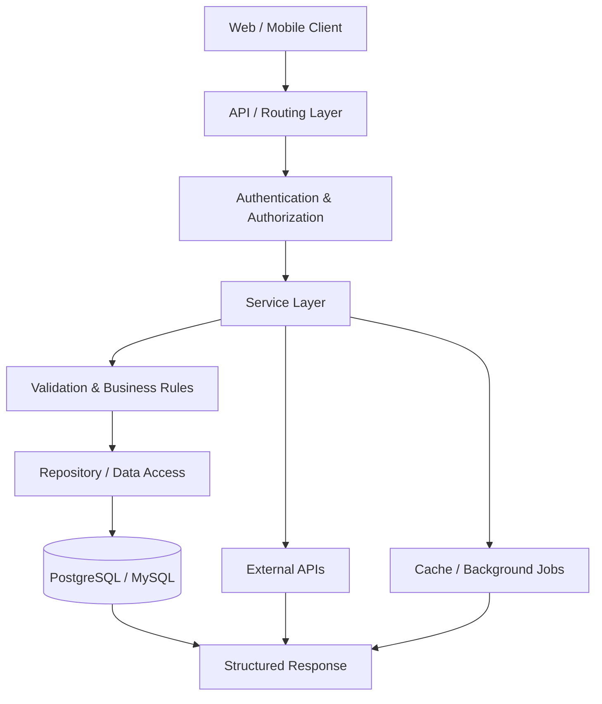
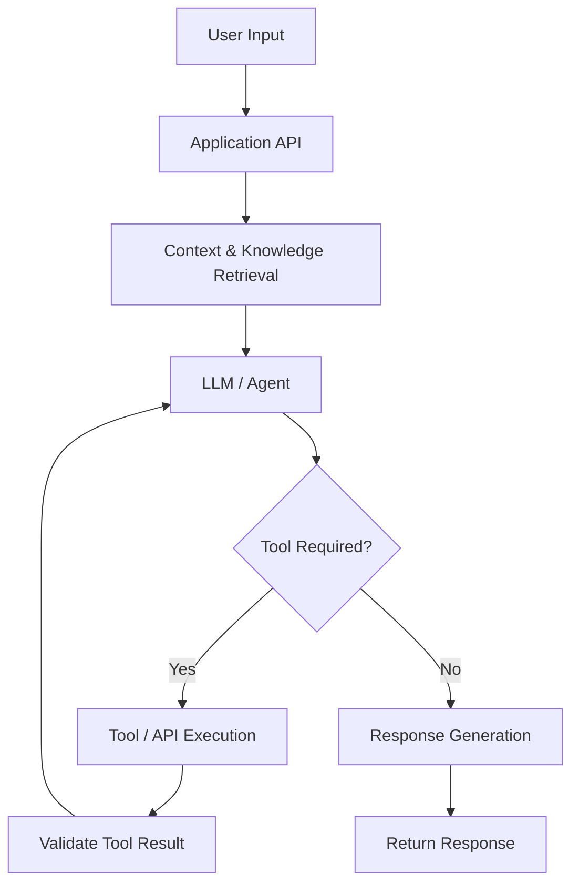

 <div align="center">


<br/>

<a href="https://github.com/Aravindan-001"></a>
<a href="https://www.instagram.com/nexoralabs_tech/"></a>
<a href="https://wa.me/917339559072"></a>

<br/><br/>


**Information Technology Student | Backend Engineering | AI & Cloud**

*Designing, building, testing and securing practical software systems.*

</div>

---

## `01` / ENGINEERING PROFILE

```python
class Aravindan:
    def __init__(self):
        self.role = "Information Technology Student"
        self.focus = [
            "Backend Engineering",
            "AI Agents, RAG & MCP",
            "Cloud & DevOps",
            "Application Security",
        ]
        self.studio = "Nexora Labs"
        self.approach = "Build. Test. Secure. Automate."

    def objective(self):
        return "Engineer reliable, maintainable software."
```

I'm interested in the engineering behind applications: how APIs are structured, how data flows through systems, how AI models use tools, and how software is tested, secured and deployed.

- ⚙️ **Backend:** REST APIs, layered architecture, authentication and data modelling.
- 🧠 **AI Engineering:** Agentic workflows, RAG, vector search, tool calling and MCP.
- ☁️ **Cloud & DevOps:** Docker, deployment workflows, CI/CD fundamentals and AWS.
- 🛡️ **Security:** Access control, input validation, database policies and security testing.
- 🚀 **Product Engineering:** Building applications and exploring SaaS ideas through Nexora Labs.

> My engineering philosophy: functionality is the starting point. Reliability, security, testability and maintainability make software useful.

---

## `02` / ENGINEERING DOMAINS

<table>
<tr>
<td width="50%" valign="top">

### ⚙️ Backend Systems

- API design and integration
- Service and repository patterns
- Authentication and RBAC
- PostgreSQL and relational modelling
- Redis and caching
- Automated testing

</td>
<td width="50%" valign="top">

### 🧠 AI & Agent Engineering

- Agentic AI workflows
- Retrieval-augmented generation
- Embeddings and vector search
- LangGraph and tool calling
- Model and API integrations
- Model Context Protocol (MCP)

</td>
</tr>
<tr>
<td width="50%" valign="top">

### ☁️ Cloud & DevOps

- Docker and containerisation
- CI/CD fundamentals
- AWS cloud services
- Deployment and configuration
- Environment and secret management
- Runtime troubleshooting

</td>
<td width="50%" valign="top">

### 🛡️ Security & Quality

- Role and permission boundaries
- Server-side validation
- Database access policies
- Regression and integration tests
- Secure API design
- Browser-based QA with Playwright

</td>
</tr>
</table>

---

## `03` / TECHNOLOGY UNIVERSE

<div align="center">

**LANGUAGES**


**FRONTEND & MOBILE**


**BACKEND & FRAMEWORKS**


**DATABASES & STORAGE**


**CLOUD, INFRASTRUCTURE & TOOLS**


</div>

**AI, DATA & AUTOMATION**


<sub>Technologies shown represent tools used across projects and technical exploration; not every tool is used in every project.</sub>

---

## `04` / FEATURED ENGINEERING PROJECTS

### 🧠 NORA — AI Operations & Knowledge Platform

**Stack:** FastAPI · PostgreSQL · pgvector · LangGraph · SvelteKit

- Backend organised around router, service and repository layers.
- Client, lead, project and task management modules.
- Vector database integration for knowledge retrieval workflows.
- AI workflow architecture designed around specialised processing paths.

`BACKEND` `AI WORKFLOWS` `VECTOR SEARCH`

---

### 📸 PYP — Pick Your Photographer

**Stack:** Flutter · Dart · Supabase · PostgreSQL · Firebase

- Photographer discovery and booking workflow.
- Booking lifecycle with photographer acceptance and customer confirmation.
- Server-side payment-state and commission handling.
- Role-based access controls and protected administrative workflows.
- Invoice generation and portfolio storage policies.
- Regression tests for booking, payment, access control and database security.

`MOBILE` `MARKETPLACE` `DATABASE SECURITY`

---

### 💎 Svaraa Jewels — E-Commerce Engineering

**Stack:** Laravel · PHP · MySQL · Redis · Docker · Nginx · Filament

- Backend and database integration for an e-commerce application.
- Administrative workflows with Filament.
- Container-oriented infrastructure and web-server configuration.
- Deployment-focused configuration and application security practices.

`LARAVEL` `INFRASTRUCTURE` `DEPLOYMENT`

---

### 📱 iCore ESS — Employee Self-Service

**Stack:** Flutter · Dart · SOAP/XML · Firebase

- Mobile application development with Flutter.
- SOAP/XML service integration.
- Firebase-connected application workflows.
- Employee-focused application functionality.

[**Explore repository →**](https://github.com/Aravindan-001/icore-ess)

`MOBILE ENGINEERING` `ENTERPRISE INTEGRATION`

---

### 📊 Client CRM — Sales & Lead Management

**Stack:** Next.js · React · TypeScript · Tailwind CSS · Playwright

- Responsive CRM interface for lead-management workflows.
- Contact-oriented business processes.
- Browser automation and UI regression testing.
- Type checking, linting and production-build validation.

`FULL STACK` `BUSINESS WORKFLOWS` `QUALITY ENGINEERING`

---

### 🤖 PerceptionIQ — Hackathon Project

**Focus:** AI-oriented product development · Backend/frontend integration · QA

- Rapid product prototyping in a hackathon environment.
- Integration testing and cross-layer troubleshooting.
- Investigation of external data extraction limitations.

`PROTOTYPING` `INTEGRATION` `HACKATHON`

---

### 🚀 Nexora Labs — Product Engineering Studio

**Focus:** Web · Mobile · SaaS · AI · Agentic AI · Automation

- Exploring and developing digital product concepts.
- Web and mobile application engineering.
- AI-powered application and automation ideas.
- Client-oriented product development through a student-led studio.

[**Follow Nexora Labs on Instagram →**](https://www.instagram.com/nexoralabs_tech/)

`PRODUCT ENGINEERING` `SAAS` `AI AUTOMATION`

---

<div align="center">

<a href="https://github.com/Aravindan-001?tab=repositories"></a>

</div>

---

## `05` / SYSTEM ARCHITECTURE

### Backend request lifecycle



### AI agent execution lifecycle



<sub>These are conceptual reference architectures illustrating engineering patterns, not claims that every component is implemented in every featured project.</sub>

### Engineering principles

| Principle | Implementation mindset |
|---|---|
| Separation of concerns | Keep API routing, business logic and data access distinct. |
| Security by design | Enforce validation and permissions on the server. |
| Testability | Verify critical behaviour with focused regression tests. |
| Data integrity | Protect important state transitions and database constraints. |
| Deployment readiness | Manage configuration, secrets, migrations and runtime settings. |
| Maintainability | Document implemented functionality and known limitations clearly. |

---

## `06` / GITHUB ANALYTICS

<div align="center">

<a href="https://github.com/Aravindan-001">

</a>
<a href="https://github.com/Aravindan-001">

</a>

<br/><br/>


<br/><br/>


<br/><br/>


</div>

<sub>Analytics and third-party image services may occasionally be unavailable or display delayed data. Language statistics reflect repository composition, not necessarily overall proficiency.</sub>

### 🐍 Contribution Snake

To enable the animated contribution snake, configure a GitHub Actions workflow that generates the SVG files and publishes them to the `output` branch.

Once the files exist, add:

```html
<picture>
  <source
    media="(prefers-color-scheme: dark)"
    srcset="https://raw.githubusercontent.com/Aravindan-001/Aravindan-001/output/github-contribution-grid-snake-dark.svg"
  />
  <source
    media="(prefers-color-scheme: light)"
    srcset="https://raw.githubusercontent.com/Aravindan-001/Aravindan-001/output/github-contribution-grid-snake.svg"
  />
  
</picture>
```

Workflow reference: [Platane/snk](https://github.com/Platane/snk)

---

## `07` / CERTIFICATIONS & TECHNICAL LEARNING

<table>
<tr>
<td width="50%" valign="top">

### 🏅 Neo4j

**Neo4j Certified Professional**

Graph database concepts and graph-based data modelling.

</td>
<td width="50%" valign="top">

### 🧠 Oracle

**Oracle Agentic AI Foundations 2026**

Completed learning covering agentic AI, MCP, OpenAI Responses API and Agents SDK, OCI Enterprise AI, and Oracle AI Database / Vector Search.

</td>
</tr>
<tr>
<td colspan="2" valign="top">

### ☁️ AWS Skill Builder

Cloud fundamentals and AWS service concepts, including compute, load balancing and messaging.

</td>
</tr>
</table>

<sub>Certifications and completed learning are distinguished from employment history and professional experience.</sub>

---

## `08` / CURRENT TECHNICAL PRIORITIES

<div align="center">

| Domain | Areas of focus |
|:---|:---|
| AI Engineering | Agents · RAG · Tool Calling · MCP |
| Backend | API Architecture · PostgreSQL · Data Integrity |
| Cloud | AWS · Docker · Deployment |
| DevOps | CI/CD · Configuration · Build Validation |
| Security | RBAC · RLS · Input Validation · Regression Tests |

</div>

---

## `09` / BEYOND THE CODE

- Participating in technical activities, project development and hackathons.
- Contributing to college initiatives and technical coordination.
- Exploring software products and client requirements through Nexora Labs.
- Interested in the intersection of AI engineering, cloud platforms and reliable backend systems.

---

## `10` / LET'S CONNECT

<div align="center">

**Have an engineering idea, collaboration opportunity or software project?**

Let's connect and build something useful.

<br/>

<a href="https://github.com/Aravindan-001"></a>
<a href="https://www.instagram.com/nexoralabs_tech/"></a>
<a href="https://wa.me/917339559072"></a>

<br/><br/>

*Build useful things. Keep learning. Engineer with purpose.*


</div>
