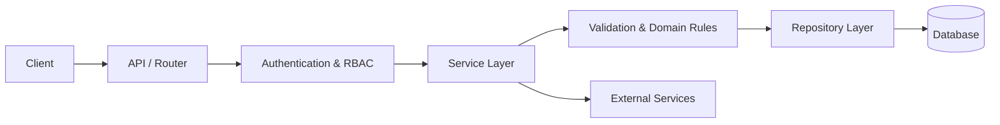
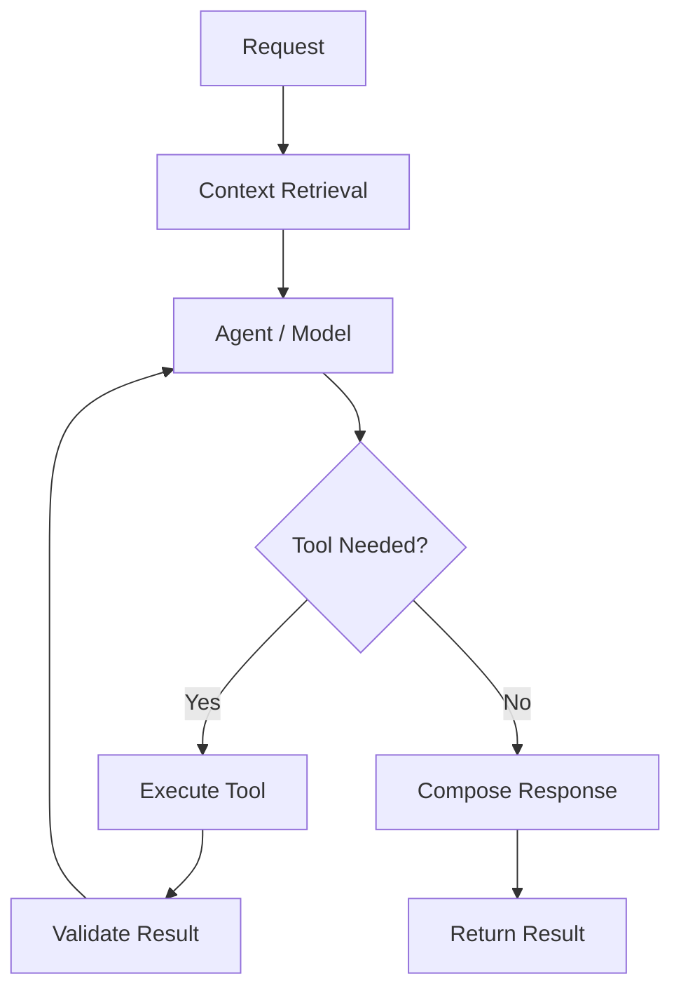

 

 

# Building systems that work beyond the demo.

**Backend Engineering · AI & Agent Engineering · Cloud & DevOps**

*B.Tech Information Technology · Product Engineering · Security-minded Development*

 

  

`SYSTEM DESIGN` &nbsp; / &nbsp; `BACKEND` &nbsp; / &nbsp; `AI SYSTEMS` &nbsp; / &nbsp; `INFRASTRUCTURE`

---

## 01 — Engineering identity

I build software with an emphasis on the systems behind the interface: APIs, data models, business logic, AI orchestration, security boundaries, automated tests and deployment workflows.

My work spans backend services, mobile products, business applications and AI-enabled platforms. I care about making features understandable, testable and maintainable—not just making a demo run.

<pre>
  ARAVINDAN.S
  ├── 01  Backend systems
  │   ├── API design
  │   ├── Business logic
  │   └── Data integrity
  ├── 02  AI engineering
  │   ├── RAG & vector search
  │   ├── Agents & tool calling
  │   └── MCP integrations
  ├── 03  Cloud & DevOps
  │   ├── Containers & deployment
  │   ├── CI/CD workflows
  │   └── Infrastructure configuration
  └── 04  Quality & security
      ├── Authentication & RBAC
      ├── Regression testing
      └── Secure data access
</pre>

## 02 — Technology landscape

LANGUAGES

  

APPLICATION ENGINEERING

  

DATA SYSTEMS

  

CLOUD · INFRASTRUCTURE · DELIVERY

### AI & automation

| Engineering area | Technologies / concepts |
|---|---|
| Agent orchestration | LangGraph, LangChain |
| Retrieval systems | RAG, embeddings, pgvector |
| Model integration | OpenAI, Gemini, Claude |
| Agent connectivity | Model Context Protocol (MCP) |
| Workflow automation | n8n, Apps Script, Zapier |
| Analytics | Power BI |

Technologies listed reflect tools used across projects and technical work; they are not a claim of equal proficiency in every technology.

---

## 03 — Selected engineering work

PROJECTS · IMPLEMENTATION · SYSTEM DESIGN

<table>
<tr>
<td width="50%" valign="top">

### 01 / NORA

**AI operations & knowledge platform**

  

A backend platform for agency operations and knowledge workflows.

- Router → Service → Repository architecture.
- Client, lead, project and task workflows.
- PostgreSQL and vector-search integration.
- AI workflow orchestration.

**Focus:** Maintainable backend architecture and retrieval-oriented AI systems.

</td>
<td width="50%" valign="top">

### 02 / PYP

**Pick Your Photographer**

  

A photography marketplace built around booking and confirmation workflows.

- Photographer acceptance and booking states.
- Commission and invoice workflows.
- Role-protected administration.
- Portfolio storage policies and regression testing.

**Focus:** Mobile product engineering, access control and transaction-state integrity.

</td>
</tr>
<tr>
<td width="50%" valign="top">

### 03 / Svaraa Jewels

**E-commerce platform**

  

- Laravel application development.
- MySQL and Redis integration.
- Administrative workflows with Filament.
- Docker and Nginx deployment configuration.

**Focus:** Application infrastructure and operational readiness.

</td>
<td width="50%" valign="top">

### 04 / Client CRM

**Sales operations interface**

  

- Lead-management interface.
- Responsive layout implementation.
- Browser regression testing.
- Type-check and production-build validation.

**Focus:** Full-stack delivery and UI quality assurance.

</td>
</tr>
<tr>
<td width="50%" valign="top">

### 05 / iCore ESS

**Employee self-service application**

  

Mobile application workflows involving enterprise service integration.

[**Explore repository →**](https://github.com/Aravindan-001/icore-ess)

</td>
<td width="50%" valign="top">

### 06 / PerceptionIQ

**Hackathon product engineering**

AI-oriented prototyping, frontend/backend integration, quality checks and external data-source troubleshooting.

**Focus:** Rapid engineering iteration under practical integration constraints.

</td>
</tr>
</table>

---

## 04 — System design lab

### Backend architecture

### AI agent lifecycle

### Engineering release gates

| `DESIGN` | `BUILD` | `VERIFY` | `RELEASE` |
|---|---|---|---|
| Contracts & models | Code & integration | Tests & security checks | Configuration & deployment |

Architecture diagrams illustrate reusable engineering patterns; they do not imply that every component is implemented in every listed project.

---

## 05 — Engineering telemetry

  

  

GitHub metrics are provided by third-party services and may be temporarily unavailable. Repository language distribution is not a measure of individual proficiency.

---

## 06 — Credentials

<table>
<tr>
<td width="50%" valign="top">

**Neo4j**

Neo4j Certified Professional.

Graph database concepts and graph-based data modelling.

</td>
<td width="50%" valign="top">

**Oracle**

Oracle Agentic AI Foundations 2026.

Completed learning covering agentic AI, MCP, OpenAI Responses API and Agents SDK, OCI Enterprise AI, and Oracle AI Database / Vector Search.

</td>
</tr>
<tr>
<td colspan="2">

**AWS Skill Builder**

Cloud fundamentals, compute, load balancing and messaging-service concepts.

</td>
</tr>
</table>

---

## 07 — Nexora Labs

### Ideas into engineered products.

A student-led product engineering studio working across web applications, mobile products, SaaS, AI agents and automation.

`WEB` &nbsp; `MOBILE` &nbsp; `SAAS` &nbsp; `AGENTIC AI` &nbsp; `AUTOMATION`

 

---

## 08 — Connect

  

THINK IN SYSTEMS. BUILD WITH INTENT. VERIFY THE RESULT.

  

