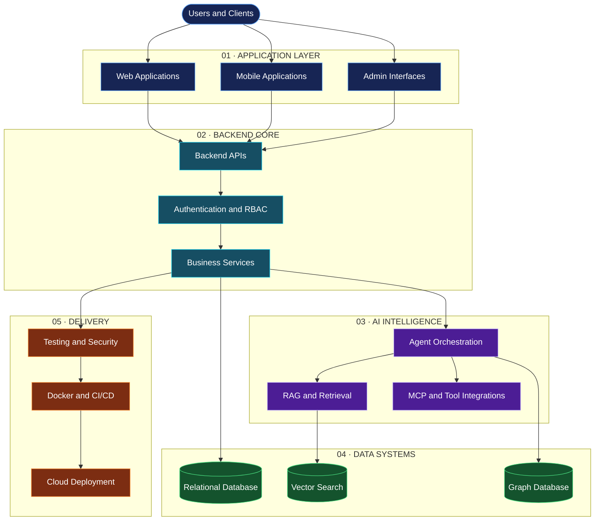
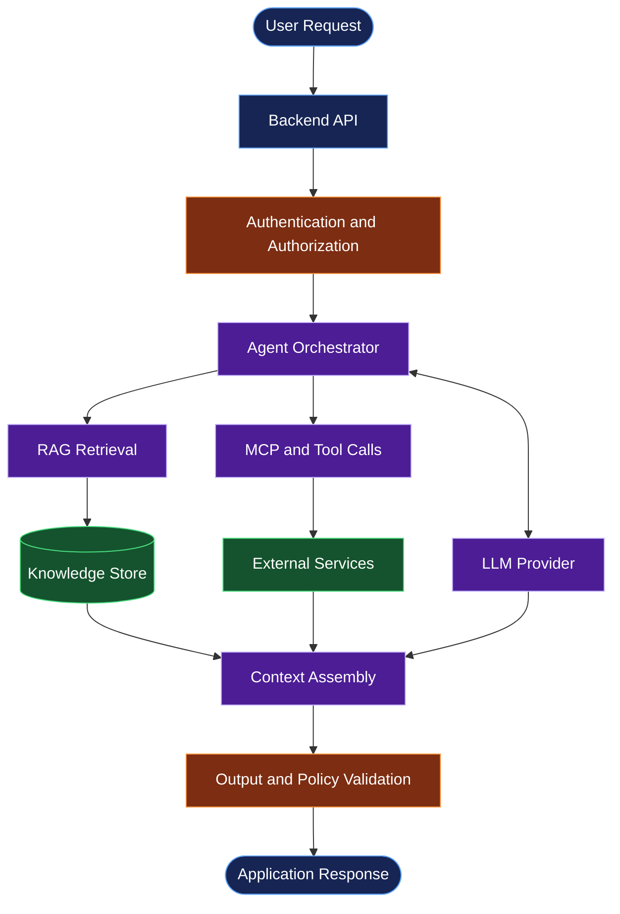

 

 

  

  

**I build systems where software engineering meets intelligent automation.**

Backend Systems &nbsp;•&nbsp; Agentic AI &nbsp;•&nbsp; Cloud & DevOps &nbsp;•&nbsp; Data Engineering

 

---

## `00` — ENGINEERING PROFILE

<table>
<tr>
<td width="62%" valign="top">

### About Me

I'm an Information Technology engineering student focused on designing, building, testing, and deploying practical software systems.

My interests span backend development, AI agent engineering, data systems, application security, and cloud infrastructure.

I enjoy exploring how individual components — APIs, databases, models, tools, and deployment pipelines — come together to form reliable products.

- ⚙️ **Backend Engineering** — APIs, services, business logic and system design.
- 🤖 **AI & Agent Engineering** — LLM integrations, RAG, tool calling and orchestration.
- ☁️ **Cloud & DevOps** — Docker, deployment workflows and CI/CD.
- 🗄️ **Data Engineering** — SQL, vector search and graph databases.
- 🔐 **Application Security** — Authentication, authorization and secure workflows.
- 📱 **Product Engineering** — Web, mobile and business applications.

</td>
<td width="38%" valign="top">

### Engineering Principles

| Principle | Approach |
|:--|:--|
| Architecture | Modular by design |
| Backend | Explicit contracts |
| Data | Integrity first |
| AI | Controlled tool access |
| Security | Least privilege |
| Testing | Validate before delivery |
| Deployment | Repeatable workflows |

 

**Current direction**

Building stronger foundations in backend architecture, AWS, cloud deployment, data systems and production-oriented AI applications.

</td>
</tr>
</table>

---

## `01` — TECHNOLOGY LANDSCAPE

<b>Languages & Application Development</b>

 

<b>Databases & Data Infrastructure</b>

 

<b>Cloud, DevOps & Developer Tooling</b>

 

<b>AI, Agents & Automation</b>

 

> Technology familiarity varies by project. The stack above represents technologies I work with, integrate, or explore — not a claim of equal proficiency across every tool.

---

## `02` — SYSTEM ARCHITECTURE

### From user interaction to production delivery

<b>Architecture decisions I care about</b>

 

- **Separation of concerns:** keep routes, business logic, persistence, and integrations independently maintainable.
- **Data integrity:** validate inputs, define constraints, and use appropriate transaction boundaries.
- **Authorization:** enforce permissions at the server and data-access layers.
- **AI reliability:** validate tool inputs and model outputs; apply access controls and explicit failure handling.
- **Testing:** cover business rules, API behavior, integration points, and critical user journeys.
- **Delivery:** make builds and deployments reproducible through version control and automation.

---

## `03` — FEATURED ENGINEERING PROJECTS

The projects below highlight different areas of engineering: AI systems, backend architecture, mobile integration, marketplaces, business workflows, and quality assurance.

<table>
<tr>
<td width="50%" valign="top">

### 🧠 NORA

**AI Agency Operations & Knowledge Platform**

An AI-oriented operations platform combining structured business data, retrieval, and agent workflows.

**Engineering stack**

`FastAPI` `PostgreSQL` `pgvector` `LangGraph` `SvelteKit`

**Architecture highlights**

- Router → Service → Repository separation.
- PostgreSQL-backed business entities.
- Vector retrieval capabilities.
- LangGraph workflow orchestration.
- Modular backend design and automated tests.

**Engineering focus:** backend architecture, AI orchestration, retrieval and maintainability.

</td>
<td width="50%" valign="top">

### 💎 Svaraa Jewels

**E-commerce & Deployment Engineering**

A commerce-oriented application focused on backend workflows, administration, and deployment infrastructure.

**Engineering stack**

`Laravel 12` `PHP` `MySQL` `Redis` `Docker` `Nginx`

**Architecture highlights**

- Server-side application development.
- Relational data management.
- Filament administration.
- Container and web-server configuration.
- Deployment and security configuration.

**Engineering focus:** application architecture, infrastructure, operational reliability and delivery.

</td>
</tr>
<tr>
<td width="50%" valign="top">

### 📱 iCore ESS

**Employee Self-Service Mobile Application**

A mobile application concept centered on employee-facing workflows and enterprise service integration.

**Engineering stack**

`Flutter` `Dart` `SOAP/XML` `Firebase`

**Architecture highlights**

- Cross-platform mobile development.
- SOAP/XML service communication.
- Firebase integration.
- Employee self-service workflows.

**Engineering focus:** mobile engineering, external service integration and enterprise workflows.

 

</td>
<td width="50%" valign="top">

### 📸 PYP — Pick Your Photographer

**Photographer Booking Marketplace**

A marketplace application designed around customer requests, photographer acceptance, payments, and booking confirmation.

**Engineering focus**

- Customer and photographer workflows.
- Booking and confirmation state transitions.
- Server-side marketplace fee calculation.
- Role-based access control.
- Payment-state validation and protected interactions.
- Post-confirmation communication workflows.

**Engineering stack:** Flutter, Supabase, PostgreSQL and payment integration workflows.

**Engineering focus:** marketplace architecture, transaction integrity and access control.

</td>
</tr>
<tr>
<td width="50%" valign="top">

### 📊 Client CRM

**Sales & Lead Management Interface**

A CRM-oriented web application for organizing sales leads and business follow-up workflows.

**Engineering stack**

`Next.js` `React` `TypeScript` `Tailwind CSS` `Playwright`

**Engineering highlights**

- Lead management interface.
- Responsive layouts.
- Browser-based quality assurance.
- Type checking, linting and production build validation.
- Automated interaction testing.

**Engineering focus:** frontend engineering, usability and test-driven validation.

</td>
<td width="50%" valign="top">

### 🔬 PerceptionIQ

**Hackathon Engineering Project**

A rapid-prototyping project combining frontend and backend development with application testing.

**Engineering highlights**

- Frontend/backend integration.
- AI-assisted application workflows.
- Quality assurance and defect investigation.
- Iterative development under hackathon constraints.

**Engineering focus:** product prototyping, integration and delivery under time constraints.

</td>
</tr>
</table>

---

## `04` — AI AGENTS & RETRIEVAL ENGINEERING

### An architecture for grounded, tool-enabled AI applications

### Engineering priorities

| Area | Implementation goal |
|---|---|
| Retrieval | Supply relevant context from appropriate knowledge sources |
| Tool calling | Expose explicitly permitted operations |
| Authorization | Check user permissions before protected actions |
| Reliability | Handle tool errors, timeouts and invalid responses |
| Validation | Verify structured outputs before downstream use |
| Observability | Record useful events without exposing sensitive data |

The objective is not simply to connect an LLM to an API. It is to build a controlled application workflow around model reasoning, retrieval, tool execution, and validation.

---

## `05` — CLOUD & DEVOPS ENGINEERING

### The path from source code to deployment

**Areas of focus**

- Docker-based development and deployment.
- Environment configuration and secret management.
- Reverse-proxy and web-server fundamentals.
- CI/CD automation with GitHub Actions.
- AWS fundamentals and cloud deployment concepts.
- Application health checks, logs and troubleshooting.
- Secure configuration and least-privilege access.

My goal is to understand not just how to build an application, but how to package, validate, deploy, and maintain it reliably.

---

## `06` — ENGINEERING QUALITY & SECURITY

<table>
<tr>
<td width="50%" valign="top">

### Quality Engineering

- Unit and integration testing.
- API contract validation.
- Type checking and static analysis.
- Browser automation with Playwright.
- Regression testing for critical workflows.
- Reproducible build verification.

</td>
<td width="50%" valign="top">

### Secure Application Design

- Authentication and session handling.
- Role-based access control.
- Server-side authorization.
- Input validation and output encoding.
- Database access controls.
- Secret and environment management.
- Security testing within authorized environments.

</td>
</tr>
</table>

> A successful build is only one signal of quality. Reliable software also needs correct business rules, appropriate access controls, meaningful tests, and predictable failure handling.

---

## `07` — CERTIFICATIONS & TECHNICAL LEARNING

<table>
<tr>
<td width="50%" valign="top">

### AI & Agent Engineering

- Oracle Agentic AI Foundations 2026.
- OpenAI Responses API and Agents SDK.
- Model Context Protocol (MCP).
- OCI Enterprise AI.
- Oracle AI Database and Vector Search.
- LLM integration and agent orchestration.

</td>
<td width="50%" valign="top">

### Data & Infrastructure

- Neo4j Certified Professional.
- PostgreSQL and vector search.
- SQL data modeling.
- Docker and CI/CD workflows.
- AWS cloud fundamentals.
- Application security and deployment practices.

</td>
</tr>
</table>

*Credential names and learning areas are listed for reference. Use the issuing provider's credential page to verify current certification status.*

---

## `08` — GITHUB COMMAND CENTER

  

  

<b>Analytics notes</b>

 

- Language statistics reflect detected repository languages, not actual engineering proficiency.
- GitHub activity depends on public contributions and the statistics provider.
- Third-party cards may occasionally be unavailable or delayed.
- Contribution statistics should not be interpreted as a direct measure of software quality.

---

## `09` — ENGINEERING ROADMAP

| Track | Engineering direction |
|:--|:--|
| Backend | Robust APIs, modular services, system design |
| AI Engineering | Agents, RAG, MCP, tool orchestration |
| Cloud & DevOps | AWS, Docker, CI/CD, deployment |
| Data Engineering | SQL, data modeling, vector and graph systems |
| Security | Authorization, secure workflows, threat modeling |
| Product Engineering | Reliable web and mobile applications |

### What I want to build

Systems that combine useful AI capabilities with sound software architecture, trustworthy data handling, and reliable deployment practices.

---

## `10` — CONNECT & COLLABORATE

  

**Design thoughtfully. Engineer reliably. Automate intelligently.**

Interested in backend systems, AI applications, developer tools, cloud engineering, and meaningful product collaborations.

 

  

  

<!-- END OF README -->
