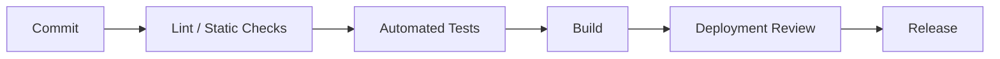

<div align="center">

<br/>
<a href="https://github.com/Aravindan-001?tab=repositories">
  
</a>
<a href="https://www.instagram.com/nexoralabs_tech/">
  
</a>
<br/><br/>
Cloud & DevOps · Data Systems · Backend Engineering · AI Infrastructure
B.Tech Information Technology student building practical software systems, backend services, data workflows and deployment-ready applications.
</div>
---
`01` — Engineering profile
I’m an Information Technology student interested in how applications are built, secured, operated and connected to data. My project work spans backend APIs, mobile applications, database-backed business systems, AI-oriented workflows, testing and deployment configuration.
My primary direction is Cloud, DevOps and Data Engineering, supported by backend development and AI systems.
```text
ENGINEERING FOCUS
├── Cloud & DevOps
│   ├── Containers and deployment configuration
│   ├── CI/CD workflows and version control
│   └── Cloud service fundamentals
├── Data Engineering foundations
│   ├── Relational and document databases
│   ├── Data modelling and application integration
│   └── Graph and vector data exploration
├── Backend engineering
│   ├── APIs and service-layer architecture
│   ├── Authentication, authorisation and validation
│   └── Database-backed business workflows
└── AI systems
    ├── Retrieval-augmented generation
    ├── Agent orchestration and tool integrations
    └── Model Context Protocol (MCP)
```
`02` — Technology map
<div align="center">
Languages

Application engineering

Data systems

Infrastructure and delivery

</div>
Engineering layer	Tools and concepts
Cloud & infrastructure	AWS fundamentals, Docker, Nginx, Cloudflare, deployment configuration
CI/CD & collaboration	Git, GitHub, GitHub Actions
Relational data	PostgreSQL, MySQL, schema design, data integrity
Other data platforms	MongoDB, Redis, Neo4j, Supabase, Firebase, pgvector
Backend	FastAPI, Node.js, Laravel, API design, service/repository patterns
AI & automation	LangGraph, LangChain, RAG, MCP, model APIs, n8n, Apps Script
Testing	pytest, Playwright, API and regression testing
Analytics	Power BI
<sub>This map reflects technologies used across projects and technical work; it is not a claim of equal proficiency in every tool.</sub>
---
`03` — Infrastructure blueprint

The diagram is a reference architecture, not a claim that every component is deployed in every project. I use these boundaries to reason about how applications are structured and delivered.
Data workflow blueprint

Areas I’m building experience in:
Moving and validating data between application components.
Designing schemas and preserving data integrity.
Connecting APIs, databases and external services.
Containerising applications and preparing deployment configurations.
Automating repeatable repository workflows with GitHub Actions.
---
`04` — Selected projects
<table>
<tr>
<td width="50%" valign="top">
`SYS-01` / NORA
AI operations & knowledge platform
`FastAPI` · `PostgreSQL` · `pgvector` · `LangGraph` · `SvelteKit`
Client, lead, project and task workflows.
Router → Service → Repository architecture.
PostgreSQL-backed application data.
Vector-enabled knowledge retrieval and AI workflow design.
Engineering lens: Backend structure, data access and AI-enabled workflows.
</td>
<td width="50%" valign="top">
`SYS-02` / PYP
Pick Your Photographer marketplace
`Flutter` · `Supabase` · `PostgreSQL` · `Firebase`
Booking request and photographer acceptance lifecycle.
Booking status, commission and invoice workflows.
Role-protected administration.
Portfolio storage policies and security/regression tests.
Engineering lens: Mobile delivery, database policies and business-state integrity.
</td>
</tr>
<tr>
<td width="50%" valign="top">
`SYS-03` / Svaraa Jewels
E-commerce application
`Laravel` · `MySQL` · `Redis` · `Docker` · `Nginx`
Backend application and database integration.
Administrative workflows using Filament.
Container and web-server configuration.
Deployment-oriented development.
Engineering lens: Application operations and infrastructure configuration.
</td>
<td width="50%" valign="top">
`SYS-04` / Client CRM
Sales and lead management interface
`Next.js` · `React` · `TypeScript` · `Playwright`
Lead-management UI and responsive layouts.
Browser-based regression testing.
Type-check and production-build validation during development.
Engineering lens: Delivery quality and repeatable verification.
</td>
</tr>
<tr>
<td width="50%" valign="top">
`SYS-05` / iCore ESS
Employee self-service application
`Flutter` · `SOAP/XML` · `Firebase`
Mobile application workflows.
Enterprise service integration using SOAP/XML.
Firebase-connected application functionality.
View repository →
</td>
<td width="50%" valign="top">
`SYS-06` / PerceptionIQ
Hackathon product engineering
AI-oriented product prototyping.
Frontend and backend integration.
Quality checks and integration troubleshooting.
Work within external data-source constraints.
Engineering lens: Iterative product development and integration.
</td>
</tr>
</table>
Product engineering outside individual projects
Nexora Labs — a student-led product engineering studio working across web, mobile, SaaS, AI agents and automation.
Nexora Labs on Instagram
My GitHub repositories
---
`05` — Delivery and quality principles
Gate	What I check
Design	Data model, API contract and component boundaries
Security	Authentication, authorisation, input validation and data-access policies
Verification	Unit, integration and regression tests relevant to the change
Delivery	Environment configuration, migrations, build checks and deployment readiness
Documentation	Clear setup steps, known limitations and accurate implementation claims
Example release pipeline

This is a general delivery pattern. Actual stages vary by repository and project.
---
`06` — Certifications and structured learning
Neo4j Certified Professional — graph database concepts and graph data modelling.
Oracle Agentic AI Foundations 2026 — completed learning covering agentic AI, MCP, OpenAI Responses API and Agents SDK, OCI Enterprise AI, and Oracle AI Database / Vector Search.
AWS Skill Builder — cloud fundamentals and introductory concepts covering compute, load balancing and messaging services.
---
`07` — GitHub activity
<div align="center">

<br/><br/>
<a href="https://github.com/Aravindan-001">
  
</a><a href="https://github.com/Aravindan-001">
  
</a>
<br/><br/>

</div>
<sub>Statistics are supplied by external services and may be unavailable or rate-limited. Language distribution represents repository code, not individual proficiency.</sub>
Contribution snake
The workflow in `.github/workflows/profile-assets.yml` generates the snake SVG and publishes it to the `output` branch. After the workflow has run successfully, this image should resolve:
<div align="center">
<picture>
  <source media="(prefers-color-scheme: dark)" srcset="https://raw.githubusercontent.com/Aravindan-001/Aravindan-001/output/github-contribution-grid-snake-dark.svg"/>
  <source media="(prefers-color-scheme: light)" srcset="https://raw.githubusercontent.com/Aravindan-001/Aravindan-001/output/github-contribution-grid-snake.svg"/>
  
</picture>
</div>
---
`08` — Connect
<div align="center">
Interested in cloud infrastructure, data systems, backend engineering or AI-enabled products?
<a href="https://github.com/Aravindan-001?tab=repositories"></a>
<a href="https://www.instagram.com/nexoralabs_tech/"></a>
<a href="https://wa.me/917339559072"></a>
<br/><br/>
<sub>DESIGN CLEARLY · AUTOMATE REPEATED WORK · VERIFY BEFORE RELEASE</sub>
</div>
