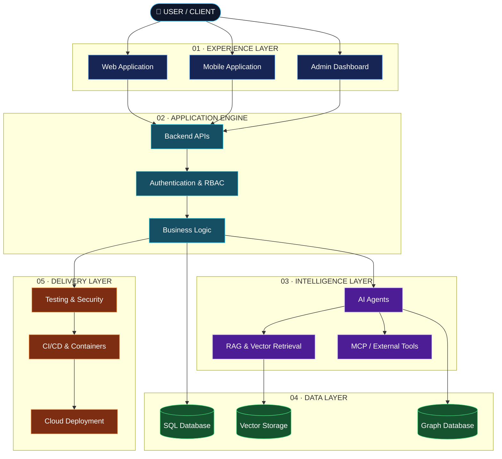
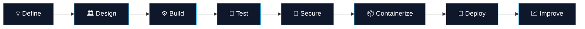

<!-- ========================================================= -->
<!-- ARAVINDAN S | GITHUB PROFILE README -->
<!-- ========================================================= -->

### `BACKEND ENGINEERING` · `AI AGENTS` · `CLOUD & DEVOPS`

 

  

**I turn ideas into software systems — from backend architecture and AI workflows to cloud deployment.**

---

## ◈ 01 — ENGINEERING OVERVIEW

<table>
<tr>
<td width="60%" valign="top">

### `WHO AM I?`

I'm an Information Technology engineering student focused on building practical, scalable software.

My interests sit at the intersection of **backend systems, agentic AI, data engineering, cloud infrastructure, and application security**.

I enjoy working across the stack: designing APIs, modelling data, integrating AI capabilities, securing application workflows, and deploying software.

### `ENGINEERING PRINCIPLES`

- Architecture before complexity
- Security by design
- Automation over repetitive work
- Testable and maintainable code
- AI with practical application value

</td>
<td width="40%" valign="top">

### `ENGINEERING DNA`

| Domain | Focus |
|:--|:--|
| ⚙️ Backend | APIs & business logic |
| 🤖 AI Engineering | Agents, RAG & MCP |
| ☁️ Cloud | Deployment & CI/CD |
| 🗄️ Data | SQL, vector & graph DBs |
| 🔐 Security | Auth & secure workflows |
| 📱 Applications | Web & mobile systems |

 

</td>
</tr>
</table>

---

## ◈ 02 — TECHNOLOGY LANDSCAPE

### `01` · LANGUAGES

### `02` · APPLICATION ENGINEERING

### `03` · DATA & STORAGE

### `04` · CLOUD, DEVOPS & TOOLING

### `05` · AI & AUTOMATION ECOSYSTEM

---

## ◈ 03 — SYSTEM ARCHITECTURE

### `FROM USER REQUEST TO DEPLOYED SYSTEM`

> **Architecture mindset:** keep application logic modular, validate data at trust boundaries, enforce authorization on the server, and make deployment repeatable.

---

## ◈ 04 — PROJECT SHOWCASE

### `SELECTED ENGINEERING WORK`

<table>
<tr>
<td width="50%" valign="top">

### 🧠 NORA

**AI Agency Operations Platform**

- Agency operations and knowledge graph concepts.
- FastAPI backend with modular architecture.
- PostgreSQL and vector retrieval.
- LangGraph workflow orchestration.
- SvelteKit frontend.

**Engineering focus:** AI workflows, retrieval, backend architecture.

</td>
<td width="50%" valign="top">

### 💎 SVARAA JEWELS

**E-commerce & Deployment Engineering**

- Laravel and PHP application architecture.
- MySQL persistence and Redis integration.
- Filament administration.
- Docker and Nginx deployment setup.
- CI/CD workflow integration.

**Engineering focus:** application delivery, databases, DevOps.

</td>
</tr>
<tr>
<td width="50%" valign="top">

### 📱 iCORE ESS

**Employee Self-Service Mobile App**

- Employee self-service workflows.
- Flutter and Dart application development.
- SOAP/XML service integration.
- Firebase integration.

**Engineering focus:** mobile applications and enterprise integration.

[↗ Explore Repository](https://github.com/Aravindan-001/icore-ess)

</td>
<td width="50%" valign="top">

### 📊 CLIENT CRM

**Sales & Lead Management**

- Sales CRM interface and lead workflows.
- Responsive web application design.
- Automated browser testing.
- Type checking, linting, and build validation.

**Engineering focus:** frontend integration, usability, testing.

</td>
</tr>
<tr>
<td width="50%" valign="top">

### 📸 PYP — Pick Your Photographer

**Photographer Marketplace**

- Booking and confirmation workflows.
- Photographer and customer roles.
- Payment integration planning.
- Server-side fee and booking validation.

**Engineering focus:** marketplace logic and secure transactions.

</td>
<td width="50%" valign="top">

### 🔬 PerceptionIQ

**Hackathon Engineering Project**

- AI-assisted application workflows.
- Frontend and backend integration.
- Quality assurance and testing.

**Engineering focus:** rapid prototyping and full-stack delivery.

</td>
</tr>
</table>

---

## ◈ 05 — ENGINEERING WORKFLOW

| PHASE | ENGINEERING PRIORITY |
|:---:|:---|
| `01` | Requirements, architecture and data modelling |
| `02` | Maintainable backend and frontend implementation |
| `03` | API contracts, validation and database integrity |
| `04` | Testing, access control and security checks |
| `05` | Containerization, CI/CD and deployment |
| `06` | Monitoring, debugging and iterative improvement |

---

## ◈ 06 — CERTIFICATIONS & MILESTONES

<table>
<tr>
<td width="50%" valign="top">

### 🤖 AI & Agent Engineering

- Oracle Agentic AI Foundations 2026
- OpenAI Responses API & Agents SDK learning module
- Model Context Protocol (MCP) learning module
- OCI Enterprise AI learning module
- Oracle AI Database & Vector Search learning module

</td>
<td width="50%" valign="top">

### 🗄️ Data & Developer Productivity

- Neo4j Certified Professional
- MongoDB Basics for Students
- Prompt Engineering with GitHub Copilot

</td>
</tr>
</table>

---

## ◈ 07 — GITHUB ANALYTICS

  

  

 

---

## ◈ 08 — CURRENT ENGINEERING DIRECTION

<table>
<tr>
<td align="center" width="25%">

### ⚙️

**BACKEND**

API design  
System architecture  
Authentication

</td>
<td align="center" width="25%">

### 🤖

**AI SYSTEMS**

Agentic workflows  
RAG pipelines  
Tool integrations

</td>
<td align="center" width="25%">

### ☁️

**CLOUD**

Docker  
CI/CD  
Deployment

</td>
<td align="center" width="25%">

### 🗄️

**DATA**

SQL databases  
Vector search  
Graph databases

</td>
</tr>
</table>

---

## ◈ 09 — CONNECT & EXPLORE

**Interested in software engineering, AI-powered applications, and cloud infrastructure.**

  

  

### `BUILD → AUTOMATE → SECURE → DEPLOY`

<!-- End of README -->
