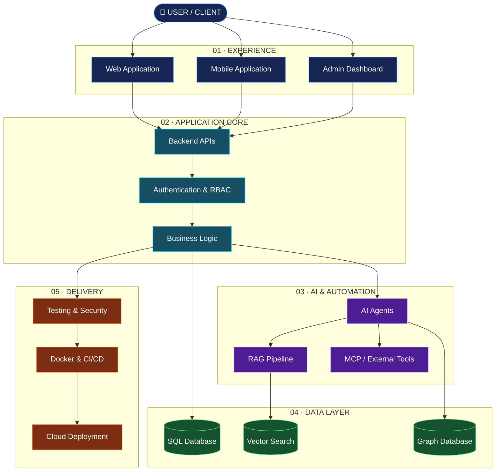
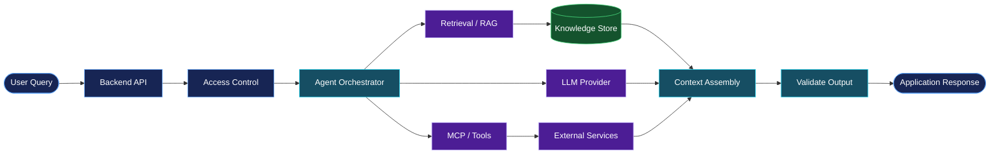

  

  

**Information Technology student building backend systems, AI-powered applications, and cloud-ready software.**

---

<table>
<tr>
<td align="center" width="25%">

**BACKEND**

APIs · Architecture

</td>
<td align="center" width="25%">

**AI SYSTEMS**

Agents · RAG · MCP

</td>
<td align="center" width="25%">

**CLOUD**

Docker · CI/CD

</td>
<td align="center" width="25%">

**DATA**

SQL · Vector Search

</td>
</tr>
</table>

## `01 / PROFILE`

<table>
<tr>
<td width="60%" valign="top">

### Engineering Mindset

I enjoy engineering complete software workflows — from understanding a problem and designing its architecture to implementing APIs, integrating AI, validating security, and deploying applications.

My focus is on building **useful, maintainable, and secure systems** rather than isolated demonstrations.

- ⚙️ Backend services and REST APIs
- 🤖 Agentic AI, RAG, and LLM integrations
- ☁️ Cloud deployment and DevOps automation
- 🗄️ Database architecture and data workflows
- 🔐 Authentication, authorization, and application security
- 📱 Web and mobile application engineering

</td>
<td width="40%" valign="top">

### Engineering Identity

 

**Approach**

`Understand → Architect → Implement → Validate → Deploy`

</td>
</tr>
</table>

---

## `02 / TECHNOLOGY ECOSYSTEM`

### `LANGUAGES`

### `APPLICATION ENGINEERING`

### `DATABASES & STORAGE`

### `CLOUD & DEVOPS`

### `AI & AUTOMATION`

---

## `03 / SYSTEM DESIGN`

### From Request to Reliable Software

### Architecture Principles

| Layer | Design Priority |
|:--|:--|
| Interface | Accessible, responsive user experiences |
| Backend | Modular services and clear API contracts |
| Security | Server-side authorization and input validation |
| Data | Appropriate schemas, constraints, and retrieval patterns |
| AI | Controlled tool access and grounded retrieval |
| Delivery | Repeatable builds, testing, and deployment |

---

## `04 / PROJECT PORTFOLIO`

<table>
<tr>
<td width="50%" valign="top">

### 🧠 NORA

**AI Agency Operations & Knowledge Platform**

- FastAPI backend and modular service architecture.
- PostgreSQL with pgvector retrieval.
- LangGraph workflow orchestration.
- SvelteKit frontend.
- Router → Service → Repository structure.

**Focus:** AI engineering, RAG, backend architecture.

</td>
<td width="50%" valign="top">

### 💎 Svaraa Jewels

**E-commerce & Deployment Engineering**

- Laravel and PHP application.
- MySQL and Redis integration.
- Filament administration.
- Docker and Nginx setup.
- CI/CD and deployment workflows.

**Focus:** Web engineering, databases, cloud delivery.

</td>
</tr>
<tr>
<td width="50%" valign="top">

### 📱 iCore ESS

**Employee Self-Service Mobile App**

- Flutter and Dart application.
- SOAP/XML service integration.
- Firebase integration.
- Employee self-service workflows.

**Focus:** Mobile engineering, enterprise integration.

[↗ View Repository](https://github.com/Aravindan-001/icore-ess)

</td>
<td width="50%" valign="top">

### 📊 Client CRM

**Sales & Lead Management Interface**

- Sales CRM and lead management workflows.
- Responsive application interface.
- Automated browser testing.
- Type checking, linting, and build validation.

**Focus:** Full-stack engineering, UI quality, testing.

</td>
</tr>
<tr>
<td width="50%" valign="top">

### 📸 PYP — Pick Your Photographer

**Photographer Marketplace**

- Customer booking and photographer acceptance.
- Booking confirmation and payment workflows.
- Role-based access and server-side validation.
- Marketplace fee calculation design.

**Focus:** Marketplace systems, payments, RBAC.

</td>
<td width="50%" valign="top">

### 🔬 PerceptionIQ

**Hackathon Engineering Project**

- AI-assisted application workflows.
- Frontend and backend integration.
- Quality assurance and testing.

**Focus:** Rapid prototyping, full-stack engineering.

</td>
</tr>
</table>

---

## `05 / AI ENGINEERING WORKFLOW`

**Engineering objective:** connect language models to application data and tools through controlled, validated workflows.

---

## `06 / CERTIFICATIONS & LEARNING`

<table>
<tr>
<td width="50%" valign="top">

### 🤖 AI & Agent Technologies

- Oracle Agentic AI Foundations 2026.
- OpenAI Responses API & Agents SDK learning module.
- Model Context Protocol (MCP) learning module.
- OCI Enterprise AI learning module.
- Oracle AI Database & Vector Search learning module.

</td>
<td width="50%" valign="top">

### 🗄️ Data & Developer Tools

- Neo4j Certified Professional.
- MongoDB Basics for Students.
- Prompt Engineering with GitHub Copilot.

</td>
</tr>
</table>

---

## `07 / GITHUB COMMAND CENTER`

  

  

  

---

## `08 / ENGINEERING ROADMAP`

<table>
<tr>
<td align="center" width="25%">

### ⚙️

**BACKEND**

APIs  
Architecture  
Auth & RBAC

</td>
<td align="center" width="25%">

### 🤖

**AI**

Agents  
RAG  
MCP & Tools

</td>
<td align="center" width="25%">

### ☁️

**CLOUD**

AWS  
Docker  
CI/CD

</td>
<td align="center" width="25%">

### 🗄️

**DATA**

SQL  
Vector Search  
Graph Databases

</td>
</tr>
</table>

---

## `09 / LET'S CONNECT`

**Building practical software. Integrating intelligent workflows. Engineering reliable delivery.**

  

  

<!-- END OF README -->
