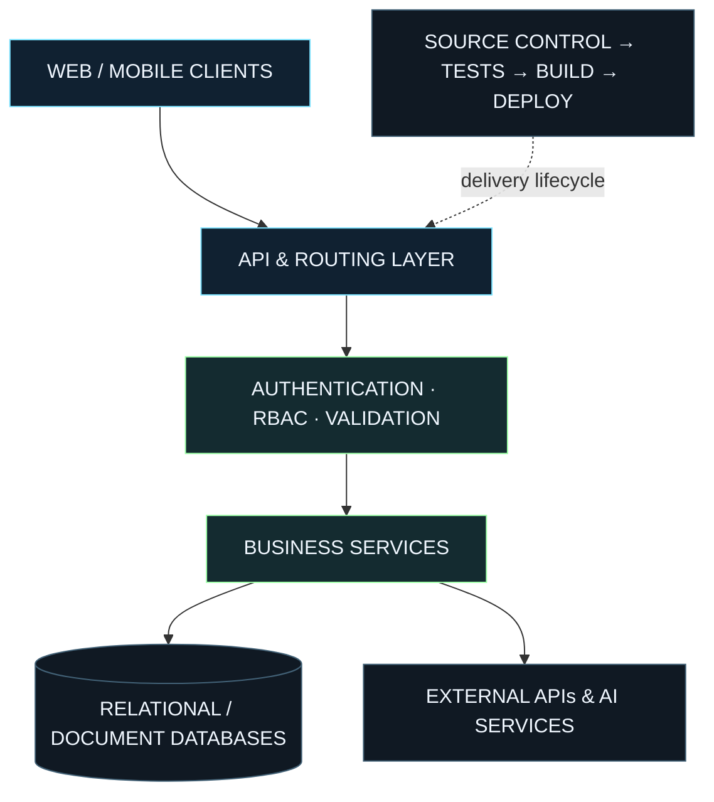
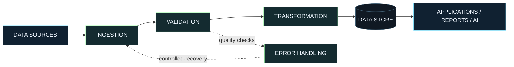

 <div align="center">


<br/>


# ARAVINDAN S

### Engineering reliable systems. Connecting applications, data and infrastructure.

**Cloud & DevOps · Data Engineering · Backend Engineering · AI Systems**

B.Tech Information Technology · Software Development · Product Engineering

<br/>

<a href="https://github.com/Aravindan-001?tab=repositories"></a>
<a href="https://www.instagram.com/nexoralabs_tech/"></a>

<br/><br/>

   

</div>

---

## `00` / ENGINEERING PROFILE

I am an Information Technology student focused on building practical software systems and understanding the infrastructure behind them.

My work spans backend services, database-backed applications, mobile products, AI-enabled workflows, automated testing and deployment configuration. My primary career direction is **Cloud, DevOps and Data Engineering**, supported by backend engineering and application security.

I approach projects from an engineering perspective:

- **Build:** design APIs, services, data models and application workflows.
- **Integrate:** connect databases, external services and AI capabilities.
- **Verify:** test critical behaviour, access controls and business rules.
- **Deliver:** manage source control, environment configuration and deployment readiness.

```text
ARAVINDAN.S
│
├── CLOUD & DEVOPS
│   ├── Containerisation
│   ├── Deployment configuration
│   ├── CI/CD fundamentals
│   └── Cloud service concepts
│
├── DATA ENGINEERING
│   ├── Relational data modelling
│   ├── SQL databases
│   ├── Data validation and integrity
│   └── Graph and vector data exploration
│
├── BACKEND ENGINEERING
│   ├── API design
│   ├── Service-layer architecture
│   ├── Authentication and authorisation
│   └── Database-backed workflows
│
└── AI SYSTEMS
    ├── Retrieval-augmented generation
    ├── Agent orchestration
    └── Tool and protocol integrations
```

---

## `01` / TECHNOLOGY BLUEPRINT

<div align="center">

### Programming languages


### Backend and application platforms


### Databases and data platforms


### Cloud and infrastructure


</div>

### Engineering stack

| Domain | Technologies and concepts |
|---|---|
| Cloud infrastructure | AWS fundamentals, Docker, Nginx, Cloudflare |
| DevOps | Git, GitHub, GitHub Actions, deployment configuration |
| Data platforms | PostgreSQL, MySQL, MongoDB, Redis, Neo4j |
| Managed data services | Supabase, Firebase |
| Vector search | pgvector |
| Backend | FastAPI, Node.js, Laravel |
| Web & mobile | Next.js, React, Flutter |
| AI & agents | LangGraph, LangChain, RAG, MCP, model APIs |
| Automation | n8n, Apps Script, Zapier |
| Quality engineering | pytest, Playwright, API and regression testing |
| Analytics | Power BI |

<sub>Technology lists describe tools used across projects and technical work. They do not imply equal proficiency or production-scale experience in every technology.</sub>

---

## `02` / INFRASTRUCTURE ARCHITECTURE

### Application delivery architecture



### Data engineering workflow



### Release lifecycle


<sub>These are reference architectures used to communicate engineering principles, not claims that every component is implemented or deployed in each project.</sub>

---

## `03` / FEATURED ENGINEERING PROJECTS

<table>
<tr>
<td width="50%" valign="top">

### `SYS-01` — NORA

**AI Operations & Knowledge Platform**

`FastAPI` · `PostgreSQL` · `pgvector` · `LangGraph` · `SvelteKit`

- Client, lead, project and task workflows.
- Router → Service → Repository architecture.
- PostgreSQL-backed application data.
- Vector-enabled knowledge retrieval and AI workflow design.

**Engineering focus:** Backend architecture, data access and AI integration.

</td>
<td width="50%" valign="top">

### `SYS-02` — PYP

**Pick Your Photographer Marketplace**

`Flutter` · `Supabase` · `PostgreSQL` · `Firebase`

- Booking request and photographer acceptance lifecycle.
- Confirmation, commission and invoice workflows.
- Role-protected administration.
- Portfolio storage policies and regression testing.

**Engineering focus:** Mobile delivery, data integrity and access control.

</td>
</tr>
<tr>
<td width="50%" valign="top">

### `SYS-03` — Svaraa Jewels

**E-Commerce Application**

`Laravel` · `MySQL` · `Redis` · `Docker` · `Nginx`

- Backend application and database integration.
- Administrative workflows using Filament.
- Infrastructure and web-server configuration.
- Deployment-oriented development.

**Engineering focus:** Backend operations and infrastructure configuration.

</td>
<td width="50%" valign="top">

### `SYS-04` — Client CRM

**Sales & Lead Management**

`Next.js` · `React` · `TypeScript` · `Playwright`

- Lead-management interface.
- Responsive UI development.
- Browser-based regression testing.
- Type-check and production-build validation during development.

**Engineering focus:** Application quality and delivery verification.

</td>
</tr>
<tr>
<td width="50%" valign="top">

### `SYS-05` — iCore ESS

**Employee Self-Service Application**

`Flutter` · `SOAP/XML` · `Firebase`

- Mobile application workflows.
- Enterprise service integration using SOAP/XML.
- Firebase-connected application functionality.

[**Explore repository →**](https://github.com/Aravindan-001/icore-ess)

</td>
<td width="50%" valign="top">

### `SYS-06` — PerceptionIQ

**Hackathon Product Engineering**

- AI-oriented product prototyping.
- Frontend and backend integration.
- Quality checks and integration troubleshooting.
- Work within external data-source constraints.

**Engineering focus:** Product iteration and integration engineering.

</td>
</tr>
</table>

---

## `04` / CLOUD & DEVOPS PRACTICE

My project work connects application development with the operational concerns that come with shipping software.

| Area | Engineering considerations |
|---|---|
| Containerisation | Reproducible application environments with Docker |
| Web infrastructure | Nginx configuration and application routing |
| CI/CD | Automated checks, test execution and build workflows |
| Configuration | Environment-specific settings and secret handling |
| Database delivery | Schema migrations, constraints and access policies |
| Reliability | Error handling, regression checks and controlled releases |
| Cloud fundamentals | Compute, load balancing and messaging concepts |

### Example repository pipeline

```yaml
name: Validate application

on:
  push:
    branches: [main]
  pull_request:
    branches: [main]

jobs:
  validate:
    runs-on: ubuntu-latest

    steps:
      - name: Checkout repository
        uses: actions/checkout@v4

      - name: Run project-specific validation
        run: |
          echo "Replace this step with the project's actual checks."
```

<sub>This is an illustrative workflow template, not a ready-to-run test pipeline for every repository. Replace the placeholder with commands appropriate to the application's language, dependencies and test suite.</sub>

---

## `05` / DATA ENGINEERING MINDSET

I am especially interested in the path from raw application data to reliable, usable information.

**Core areas of focus**

- **Data modelling:** relationships, schema design and constraints.
- **Data quality:** validation, consistency and error handling.
- **Data access:** SQL queries, application repositories and permissions.
- **Data integration:** APIs, managed services and external systems.
- **Data infrastructure:** containers, environment configuration and deployment.
- **AI-ready data:** embeddings, vector retrieval and knowledge workflows.

```text
SOURCE
  │
  ▼
INGEST ──► VALIDATE ──► TRANSFORM
                           │
                           ▼
                     STORE / INDEX
                           │
              ┌────────────┼────────────┐
              ▼            ▼            ▼
         APPLICATIONS   ANALYTICS    AI WORKFLOWS
```

This section describes my engineering interests and working approach; it does not claim ownership of a production data warehouse or large-scale data pipeline.

---

## `06` / ENGINEERING QUALITY

<table>
<tr>
<td width="50%" valign="top">

**01 — Clear boundaries**

Separate routing, business logic and persistence responsibilities.

**02 — Secure access**

Validate input and enforce permissions at the appropriate boundary.

**03 — Data integrity**

Protect important state transitions and database invariants.

</td>
<td width="50%" valign="top">

**04 — Testable behaviour**

Use relevant unit, integration and regression tests.

**05 — Repeatable delivery**

Use version control and automated checks to reduce manual release steps.

**06 — Honest documentation**

Distinguish implemented functionality, planned work and known limitations.

</td>
</tr>
</table>

---

## `07` / CERTIFICATIONS & LEARNING

### Neo4j

**Neo4j Certified Professional**

Graph database concepts and graph-based data modelling.

### Oracle

**Oracle Agentic AI Foundations 2026**

Completed learning covering agentic AI, MCP, OpenAI Responses API and Agents SDK, OCI Enterprise AI, and Oracle AI Database / Vector Search.

### AWS Skill Builder

Cloud fundamentals and introductory concepts covering compute, load balancing and messaging services.

---

## `08` / GITHUB TELEMETRY

<div align="center">


<br/><br/>

<a href="https://github.com/Aravindan-001">

</a><a href="https://github.com/Aravindan-001">

</a>

<br/><br/>


</div>

<sub>These visualisations use external services and may be unavailable or rate-limited. Language distribution reflects repository code, not skill level. No custom performance metrics are claimed.</sub>

---

## `09` / NEXORA LABS

<div align="center">


### Ideas into engineered products.

A student-led product engineering studio working across web applications, mobile products, SaaS, AI agents and automation.

`WEB` · `MOBILE` · `SAAS` · `AGENTIC AI` · `AUTOMATION`

<br/>

<a href="https://www.instagram.com/nexoralabs_tech/"></a>
<a href="https://wa.me/917339559072"></a>

</div>

---

## `10` / CONNECT

<div align="center">

**Interested in Cloud, DevOps, Data Engineering or backend systems?**

<a href="https://github.com/Aravindan-001?tab=repositories"></a>
<a href="https://www.instagram.com/nexoralabs_tech/"></a>
<a href="https://wa.me/917339559072"></a>

<br/><br/>

<sub>ENGINEER THE SYSTEM · AUTOMATE THE WORK · VERIFY THE OUTCOME</sub>

<br/><br/>


</div>
