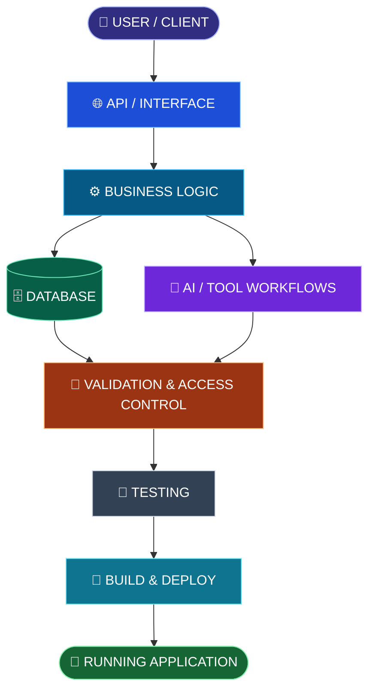

 =========================================================
     ARAVINDAN S | ANIMATED ENGINEERING PORTFOLIO
     GitHub Profile: Aravindan-001
========================================================== 

 

  

### ⚡ I BUILD SYSTEMS THAT CONNECT SOFTWARE, DATA & INTELLIGENCE.

**Backend Engineering** · **AI & Agent Engineering** · **Cloud & DevOps**

*From API design and database architecture to AI-powered workflows and deployment.*

---

## 🌐 THE ENGINEERING CONTROL ROOM

<table>
<tr>
<td align="center" width="25%">

### ⚙️

**BACKEND**

APIs · Services  
Data Flow · Auth

</td>
<td align="center" width="25%">

### 🧠

**AI SYSTEMS**

Agents · RAG  
Tools · Retrieval

</td>
<td align="center" width="25%">

### ☁️

**CLOUD**

Containers · CI/CD  
Deployment

</td>
<td align="center" width="25%">

### 🔐

**QUALITY**

Testing · RBAC  
Secure Defaults

</td>
</tr>
</table>

---

## 🎨 TECH STACK — POWERED BY TECHNOLOGY

### 💻 `01 / LANGUAGES`

### 🖥️ `02 / WEB & MOBILE`

### ⚙️ `03 / BACKEND`

### 🗄️ `04 / DATABASES & STORAGE`

### ☁️ `05 / CLOUD & DEVOPS`

### 🤖 `06 / AI & AUTOMATION`

<b>🔬 Full technology map</b>

| Area | Technologies |
|---|---|
| Languages | Python, TypeScript, JavaScript, C, PHP, Dart |
| Web | Next.js, React, SvelteKit, Tailwind CSS |
| Mobile | Flutter |
| Backend | FastAPI, Node.js, Laravel, REST APIs |
| Databases | PostgreSQL, MySQL, MongoDB, Redis |
| Cloud & deployment | AWS fundamentals, Docker, Nginx, Cloudflare, Vercel, Render |
| AI & retrieval | AI agents, RAG, LangGraph, pgvector, Neo4j |
| Automation | n8n, Zapier, Google Apps Script |
| Quality | pytest, Playwright, TypeScript, build validation |
| Security | Authentication, authorization, RBAC, RLS |

---

## 🚀 PROJECT UNIVERSE

<table>
<tr>
<td width="50%" valign="top">

### 🧠 NORA

**AI Operations & Knowledge Platform**

A modular platform concept for agency operations, connected knowledge, and AI-assisted workflows.

- 🐍 FastAPI
- 🗄️ PostgreSQL + pgvector
- 🕸️ LangGraph
- 🎨 SvelteKit
- 🏗️ Router → Service → Repository

`AI` `RAG` `Knowledge Systems`

</td>
<td width="50%" valign="top">

### ☁️ Svaraa Jewels

**Web Application & Deployment**

A backend-focused web project with deployment-oriented tooling.

- 🐘 Laravel / PHP
- 🗄️ MySQL + Redis
- 🐳 Docker
- 🌐 Nginx
- 🛠️ Filament

`Backend` `Database` `DevOps`

</td>
</tr>
<tr>
<td width="50%" valign="top">

### 📱 iCore ESS

**Employee Self-Service Application**

Mobile application work involving enterprise integration.

- 📱 Flutter / Dart
- 🔗 SOAP / XML
- 🔥 Firebase

[**↗ Open public repository**](https://github.com/Aravindan-001/icore-ess)

</td>
<td width="50%" valign="top">

### 📸 PYP — Pick Your Photographer

**Photography Marketplace · In Development**

A booking workflow designed around photographer acceptance, payment, and confirmation.

- 📱 Flutter
- 🗄️ Supabase / PostgreSQL
- 🔐 Row-Level Security
- 💳 Payment workflow
- 💬 Controlled chat access

`Marketplace` `Security` `Payments`

</td>
</tr>
<tr>
<td width="50%" valign="top">

### 📊 Client CRM

**Sales Workflow Interface**

A responsive CRM interface project focused on lead management and interaction quality.

- ⚛️ Next.js / React
- 🎨 Tailwind CSS
- 🧪 Playwright
- ✅ TypeScript and build validation

</td>
<td width="50%" valign="top">

### 🧪 PerceptionIQ

**Hackathon Engineering Project**

Frontend/backend integration and QA-focused engineering.

- 🔌 API integration
- 🧪 Quality validation
- 🛠️ Debugging
- 🚀 Delivery-focused development

</td>
</tr>
</table>

---

## 🧬 SYSTEM ARCHITECTURE

### 🧠 AI Agent Lifecycle

`👤 INPUT` ➜ `🧠 REASON` ➜ `📚 RETRIEVE` ➜ `🛠️ USE TOOLS` ➜ `✅ RESPOND`

- **Retrieval:** fetch relevant information from connected data sources.
- **Tool execution:** connect models with APIs and controlled application functions.
- **Security:** validate inputs and enforce permissions in the application.
- **Quality:** test important workflows and verify expected outcomes.

---

## ☁️ CLOUD & DEVOPS PIPELINE

### 🎯 Engineering principles

| 🔐 Security | 🧪 Quality | 🏗️ Architecture | 🚀 Delivery |
|---|---|---|---|
| Least privilege | Automated tests | Modular services | Repeatable builds |
| Role-based access | Type checking | Clear API boundaries | Containerization |
| Secure defaults | Regression checks | Explicit data flow | Deployment workflows |

[**☁️ Explore Cloud & DevOps repository**](https://github.com/Aravindan-001/cloud-devops-platform)

---

## 📊 GITHUB ANALYTICS

  

  

Stats are generated by third-party services and may be cached or temporarily unavailable. The language chart measures repository code, not overall proficiency.

---

## 🏆 CERTIFICATIONS & LEARNING

- 🕸️ Neo4j graph data concepts
- 🤖 Agentic AI and Model Context Protocol
- 🔗 OpenAI Responses API and Agents SDK
- ☁️ OCI Enterprise AI
- 🧠 AI Database and Vector Search
- 🌩️ AWS cloud fundamentals

---

## 🌱 CURRENT DIRECTION

- 🔭 Building backend-heavy applications and product workflows.
- 🧠 Exploring AI agents, RAG, and knowledge systems.
- ☁️ Developing practical cloud and DevOps capabilities.
- 🔐 Improving application security and testing.
- 🚀 Building products and client solutions through **Nexora Labs**.

---

## 🤝 CONNECT & COLLABORATE

### Have an idea worth building?

**AI Applications · Backend Systems · Websites · Mobile Apps · SaaS · Automation**

  

**⚡ THINK CLEARLY · BUILD CAREFULLY · SHIP CONSISTENTLY**

Backend Engineering • AI & Agent Engineering • Cloud & DevOps

