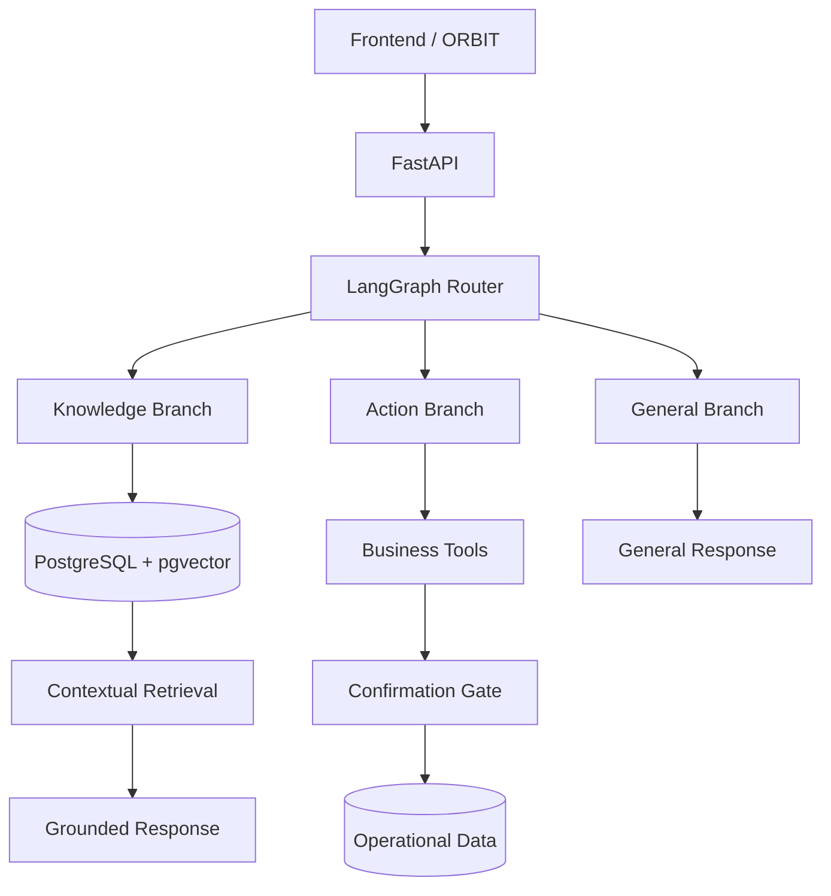
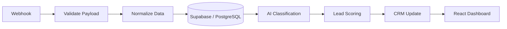

 <div align="center">

<a href="https://github.com/Aravindan-001">
  
</a>

<br/>


<br/><br/>

<a href="https://github.com/Aravindan-001">
  
</a>
<a href="https://www.linkedin.com/in/aravindansingaram">
  
</a>
<a href="mailto:aravindansingaram@gmail.com">
  
</a>
<a href="https://www.instagram.com/nexoralabs_tech/">
  
</a>

<br/><br/>


<br/><br/>

### `ENGINEER • EXPERIMENT • BUILD • IMPROVE`

</div>

---

## `01` — Engineering Profile

I'm **Aravindan Singaram**, a B.Tech Information Technology undergraduate at **NPR College of Engineering and Technology**, focused on Cloud & Data Engineering, Backend Systems, AI & Agent Engineering, and Mobile Application Development.

I enjoy working beyond individual features — understanding system boundaries, designing database schemas, building APIs, integrating intelligent workflows, testing critical paths, and preparing applications for deployment.

<table>
<tr>
<td width="50%" valign="top">

### ☁️ Cloud & Data Engineering

- Relational and vector databases
- ETL / ELT and event-driven pipelines
- Docker-based environments
- Cloud storage and deployment
- Database design and migrations

</td>
<td width="50%" valign="top">

### 🧠 AI & Agent Engineering

- Retrieval-Augmented Generation
- LangGraph workflow routing
- Tool calling and agent workflows
- Context-aware conversations
- Grounded AI responses

</td>
</tr>
<tr>
<td width="50%" valign="top">

### ⚙️ Backend Engineering

- REST API development
- Service and repository patterns
- Authentication and authorization
- Background jobs and webhooks
- Automated testing

</td>
<td width="50%" valign="top">

### 📱 Product Engineering

- Flutter and cross-platform apps
- Next.js and React applications
- Enterprise service integrations
- Responsive UI and user workflows
- Build and release preparation

</td>
</tr>
</table>

```text
                    ENGINEERING WORKFLOW

   Problem Definition
          │
          ▼
   Architecture & Design
          │
          ▼
   ┌──────┼──────────┐
   ▼      ▼          ▼
Backend  Data      Frontend
   │      │          │
   └──────┼──────────┘
          ▼
     AI & Automation
          │
          ▼
   Testing & Security
          │
          ▼
   Deployment & Iteration
```

---

## `02` — Technology Stack

<div align="center">

### The tools I use to build software systems

*Official documentation and technology websites are linked through the logos wherever practical.*

</div>

### 01. Programming Languages

<div align="center">

<a href="https://www.python.org/"></a>
<a href="https://www.typescriptlang.org/"></a>
<a href="https://developer.mozilla.org/en-US/docs/Web/JavaScript"></a>
<a href="https://www.php.net/"></a>
<a href="https://dart.dev/"></a>
<a href="https://en.cppreference.com/w/c"></a>

<br/>


</div>

### 02. Backend & API Engineering

<div align="center">

<a href="https://fastapi.tiangolo.com/"></a>
<a href="https://nodejs.org/"></a>
<a href="https://expressjs.com/"></a>
<a href="https://laravel.com/"></a>
<a href="https://flask.palletsprojects.com/"></a>

</div>

| Technology | Engineering application |
|---|---|
| **FastAPI** | Python APIs, dependency injection, request validation |
| **Pydantic** | Data contracts, schemas, and validation |
| **SQLAlchemy 2.x** | ORM, database sessions, and persistence |
| **Alembic** | Version-controlled database migrations |
| **Laravel 12 / Eloquent** | PHP application workflows and relational data |
| **Node.js / Express** | JavaScript backend services |
| **REST APIs** | Resource-oriented application interfaces |
| **Webhooks** | Event ingestion and external service integration |
| **JWT / RBAC** | Authentication and role-based authorization |
| **Supervisor** | Background process management |

### 03. Databases & Data Engineering

<div align="center">

<a href="https://www.postgresql.org/"></a>
<a href="https://www.mysql.com/"></a>
<a href="https://www.mongodb.com/"></a>
<a href="https://redis.io/"></a>
<a href="https://supabase.com/"></a>
<a href="https://firebase.google.com/"></a>
<a href="https://neo4j.com/"></a>

</div>

<div align="center">


</div>

**Data engineering capabilities**

- Relational schema design and query development
- PostgreSQL indexing and data integrity
- pgvector embedding storage and similarity search
- ETL / ELT concepts and data normalization
- Database migrations and schema evolution
- Redis-backed caching and job-processing workflows
- Supabase Row-Level Security and authentication
- Graph and document database fundamentals

### 04. AI, LLMs & Agentic Engineering

<div align="center">

<a href="https://www.langchain.com/"></a>
<a href="https://www.langchain.com/langgraph"></a>
<a href="https://platform.openai.com/"></a>
<a href="https://ai.google.dev/"></a>
<a href="https://www.anthropic.com/"></a>
<a href="https://modelcontextprotocol.io/"></a>

</div>

| Tool / concept | Application |
|---|---|
| LangGraph | State-based workflows and intent routing |
| LangChain | LLM application components and retrieval integrations |
| RAG | Context retrieval and grounded responses |
| OpenAI APIs | Structured generation and model-powered features |
| Google Gemini | Classification and AI-assisted generation |
| Claude | LLM integration and application experimentation |
| MCP | Standardized AI-to-tool connectivity |
| OpenAI Agents SDK | Agent orchestration and tool-use workflows |
| Embeddings / pgvector | Semantic retrieval and knowledge search |
| n8n / Zapier | Workflow automation and system integrations |

**Agent engineering:** tool calling · state transitions · conversational memory · entity-aware follow-ups · structured outputs · provider abstraction · source metadata · confirmation-gated actions · prompt engineering.

### 05. Frontend & Web Engineering

<div align="center">

<a href="https://nextjs.org/"></a>
<a href="https://react.dev/"></a>
<a href="https://svelte.dev/"></a>
<a href="https://tailwindcss.com/"></a>
<a href="https://threejs.org/"></a>
<a href="https://vite.dev/"></a>

</div>

`Next.js` · `React` · `TypeScript` · `SvelteKit` · `Svelte 5` · `Tailwind CSS` · `shadcn/ui` · `Three.js` · `React Three Fiber` · `Framer Motion` · `Vite` · `Responsive Design` · `SSR / SSG`

### 06. Mobile Engineering

<div align="center">

<a href="https://flutter.dev/"></a>
<a href="https://dart.dev/"></a>
<a href="https://reactnative.dev/"></a>
<a href="https://expo.dev/"></a>
<a href="https://developer.android.com/studio"></a>

</div>

`Flutter` · `Dart` · `Provider` · `Repository Pattern` · `React Native` · `Expo` · `Secure Storage` · `GPS / Geofencing` · `SOAP / XML` · `Android Build & Release`

### 07. Cloud, DevOps & Infrastructure

<div align="center">

<a href="https://www.docker.com/"></a>
<a href="https://aws.amazon.com/"></a>
<a href="https://www.cloudflare.com/"></a>
<a href="https://nginx.org/"></a>
<a href="https://www.linux.org/"></a>
<a href="https://git-scm.com/"></a>
<a href="https://github.com/features/actions"></a>

</div>

<div align="center">


</div>

`Docker Compose` · `AWS S3` · `Render` · `Cloudflare DNS / CDN` · `Nginx` · `Linux` · `Git` · `GitHub Actions` · `Environment Configuration` · `CSP` · `Security Headers` · `Deployment Debugging`

### 08. Testing & Quality Engineering

<div align="center">

<a href="https://pytest.org/"></a>
<a href="https://www.postman.com/"></a>
<a href="https://playwright.dev/"></a>
<a href="https://www.npmjs.com/"></a>

</div>

`Pytest` · `HTTPX` · `Flutter Test` · `Flutter Analyze` · `Postman` · `Playwright` · `API Testing` · `Integration Testing` · `Type Checking` · `Linting` · `Production Builds`

### 09. Search, Payments & Integrations

<div align="center">


</div>

`Razorpay Webhooks` · `Laravel Scout` · `Meilisearch` · `Firebase Analytics` · `Google Analytics 4` · `Crashlytics` · `WhatsApp API` · `Business Workflow Integrations`

---

## `03` — Featured Projects

### 🧠 NORA — AI Agency Operations & Knowledge Platform

**Focus:** Backend architecture · Agentic AI · RAG · PostgreSQL · LangGraph

- FastAPI with SQLAlchemy 2.x, Pydantic, and Alembic.
- PostgreSQL and pgvector for operational data and semantic retrieval.
- LangGraph intent routing across Knowledge, Action, and General branches.
- Persistent conversational context and entity-aware follow-up resolution.
- Grounded generation with source metadata.
- Operational tools with confirmation-gated mutations.
- SvelteKit / Svelte 5 interface and ORBIT conversational experience.
- Reported test suite: **303 tests**.



**Stack:** `Python` `FastAPI` `PostgreSQL` `pgvector` `LangGraph` `SQLAlchemy` `Alembic` `SvelteKit` `Pytest`

### 📱 ebaConnect / iCore ESS — Employee Self-Service

**Focus:** Flutter · Enterprise integrations · Location-aware workflows

- Employee-oriented mobile workflows.
- GPS attendance and 50-metre geofence validation.
- Location-accuracy checks and mock-location detection.
- SOAP/XML enterprise integration architecture.
- Secure session storage and structured error handling.
- Dev / UAT / Production configuration.
- Android release preparation and R8 / ProGuard configuration.
- Reported validation: **42/42 Flutter tests passing**.

**Repository:** [iCore ESS](https://github.com/Aravindan-001/icore-ess)

**Stack:** `Flutter` `Dart` `SOAP/XML` `Secure Storage` `Android`

### 💎 Svaraa Jewels — E-commerce & Operations

**Focus:** Backend systems · Payments · DevOps · Search

- Laravel 12, PHP 8.2+, and MySQL 8.
- Razorpay webhook payment confirmation.
- Invoice generation and Filament administration.
- Redis-backed background processing with Supervisor.
- Dockerized application, database, and Redis services.
- Nginx, Render deployment, AWS S3, and Cloudflare.
- Laravel Scout and Meilisearch integration.
- Security headers and Content Security Policy considerations.

**Repository:** [Svaraa Jewels](https://github.com/nexoralabs-website/svaraa-jewels)

**Stack:** `Laravel` `PHP` `MySQL` `Redis` `Docker` `Nginx` `Filament` `Razorpay` `AWS S3`

### 📊 MeMotion — AI-Assisted Brand Analytics

- FastAPI service architecture and structured API endpoints.
- SQLAlchemy 2.x, PostgreSQL, and Alembic.
- Pydantic Settings for configuration.
- Gemini-assisted report generation.
- Pytest-based API and data validation.
- SvelteKit frontend integration.

**Stack:** `FastAPI` `PostgreSQL` `SQLAlchemy` `Gemini` `SvelteKit` `Pytest`

### 🔄 WhatsApp Lead Engagement & CRM Pipeline



- Webhook-driven lead ingestion.
- Payload validation and normalized persistence.
- AI-assisted classification and scoring.
- CRM updates and dashboard integration.
- Error-handling and alerting considerations.

**Stack:** `n8n` `Webhooks` `Supabase` `PostgreSQL` `Gemini` `React`

### 🌐 Nexora Labs — Product Engineering Studio

A student-led product engineering initiative based in Dindigul, Tamil Nadu.

- Web applications, mobile apps, SaaS, AI, Agentic AI, and automation.
- Next.js, React, and TypeScript application development.
- Three.js / React Three Fiber interactive experiences.
- Responsive UI and motion-driven interactions.

**Connect:** [Nexora Labs Instagram](https://www.instagram.com/nexoralabs_tech/)

### 🎓 CampusIQ — Placement Readiness Platform

- React Native and Expo.
- Supabase Auth, PostgreSQL, Row-Level Security, and storage.
- Resume skill extraction and gap identification.
- Placement readiness scoring concept from 0–100.
- Eligibility prediction and realtime data integration.

### 💍 Shri Vishwakarma Matrimony

- Flutter, Dart, Provider, and Repository Pattern.
- PHP / MySQL backend integration through REST APIs.
- Tamil / English application experience.
- Profile discovery, membership, and interest workflows.
- JWT authentication and role-based access control.

---

## `04` — Engineering Principles

| Area | Engineering approach |
|---|---|
| Architecture | Separate routes, services, repositories, and external integrations |
| Data | Validate inputs, manage migrations, and preserve data integrity |
| AI | Retrieve context, structure outputs, and control tool execution |
| Security | Enforce server-side authorization and protect sensitive workflows |
| Testing | Validate APIs, business logic, and important user journeys |
| Deployment | Use environment-specific configuration and reproducible builds |
| Maintainability | Prefer explicit boundaries, meaningful errors, and clear documentation |

---

## `05` — GitHub Analytics

<div align="center">


<br/><br/>


<br/><br/>


</div>

---

## `06` — Certifications & Learning

| Credential | Focus |
|---|---|
| Neo4j Certified Professional | Graph databases and graph data modeling |
| MongoDB Basics for Students | Document databases and NoSQL fundamentals |
| Prompt Engineering with GitHub Copilot | Prompt design and AI-assisted development |
| Oracle Agentic AI Foundations | Agentic AI and Oracle AI ecosystem |

*Ensure credential titles and completion status match the certificates actually issued.*

---

## `07` — Leadership & Collaboration

- Participated in Smart India Hackathon internal selection and project development activities.
- Contributed to college technical coordination, incubation, and IPR-related activities.
- Helped junior developers with React Native, Laravel, and Supabase integration concepts.
- Worked across application, backend, data, and AI workflow implementation.
- Focused on technical documentation and reproducible development practices.

---

<div align="center">

## `08` — LET'S BUILD SOMETHING USEFUL

### Engineering with intent. Building with curiosity. Improving through iteration.

**Interested in:** Cloud & Data Engineering · Backend Systems · Agentic AI · Mobile Applications · Product Collaborations

<br/>

<a href="mailto:aravindansingaram@gmail.com">
  
</a>
<a href="https://www.linkedin.com/in/aravindansingaram">
  
</a>
<a href="https://github.com/Aravindan-001">
  
</a>
<a href="https://www.instagram.com/nexoralabs_tech/">
  
</a>

<br/><br/>


</div>
