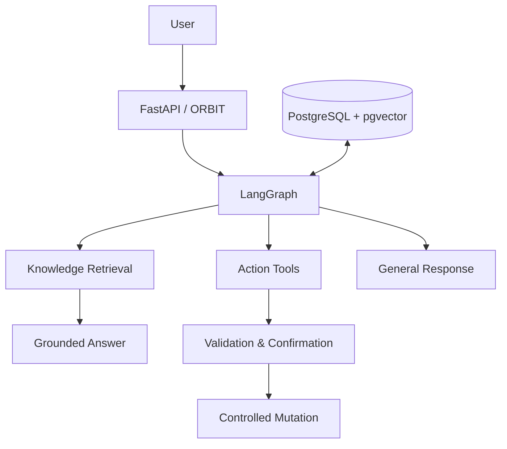
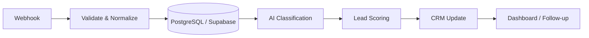

 <div align="center">


<br/>

<a href="https://github.com/Aravindan-001"></a>
<a href="https://www.linkedin.com/in/aravindansingaram"></a>
<a href="mailto:aravindansingaram@gmail.com"></a>
<a href="https://www.instagram.com/nexoralabs_tech/"></a>

<br/><br/>


### ENGINEERING • AUTOMATION • INTELLIGENCE

*Building backend systems, cloud-ready applications, AI workflows, and useful digital products.*

**B.Tech Information Technology | NPR College of Engineering and Technology | 2024–2028**

</div>

---

## `$ whoami`

I'm an Information Technology engineering student focused on **Backend Engineering, Cloud & DevOps, Data Engineering, and AI & Agent Engineering**.

I enjoy designing systems that bring APIs, databases, automation, mobile applications, and intelligent workflows together. Through personal projects and Nexora Labs, I explore the engineering decisions behind turning an idea into a maintainable software product.

- Backend APIs, service architecture, database modeling, and integrations.
- AI agents, RAG pipelines, vector search, and structured LLM workflows.
- Cloud deployment, Docker, Nginx, AWS services, and DevOps practices.
- SQL, PostgreSQL, data processing, search, and database optimization.
- Flutter applications, web platforms, dashboards, and automation.
- Testing, secure access control, migrations, and release verification.

```text
ARAVINDAN SINGARAM
│
├── BACKEND ENGINEERING
│   ├── APIs, Services & Integrations
│   ├── Authentication & Authorization
│   └── Databases & Testing
│
├── AI & AGENT ENGINEERING
│   ├── RAG & Vector Search
│   ├── Stateful Agent Workflows
│   └── Tool Calling & Automation
│
├── CLOUD & DATA ENGINEERING
│   ├── Docker & Deployment
│   ├── PostgreSQL & Data Pipelines
│   └── Infrastructure & Operations
│
└── PRODUCT ENGINEERING
    ├── Flutter & Mobile Apps
    ├── Web Platforms & SaaS
    └── Nexora Labs
```

---

## `$ github --analytics`

<div align="center">

<a href="https://github.com/Aravindan-001">

</a>
<a href="https://github.com/Aravindan-001">

</a>

<br/><br/>


<br/><br/>


</div>

### Profile summary cards

<div align="center">


</div>

> These cards are generated by third-party services. Their metrics may differ, may not include private activity, and can be temporarily unavailable. Language percentages indicate repository code composition, not overall engineering proficiency.

---

## `$ git contribution-calendar`

### My contribution grid

<div align="center">

<a href="https://github.com/Aravindan-001">

</a>

[Open my GitHub contribution overview →](https://github.com/Aravindan-001?tab=overview)

</div>

### Animated contribution snake

The workflow in `.github/workflows/snake.yml` generates these SVG animations and publishes them to the `output` branch.

<div align="center">

<picture>
  <source media="(prefers-color-scheme: dark)" srcset="https://raw.githubusercontent.com/Aravindan-001/Aravindan-001/output/github-contribution-grid-snake-dark.svg"/>
  <source media="(prefers-color-scheme: light)" srcset="https://raw.githubusercontent.com/Aravindan-001/Aravindan-001/output/github-contribution-grid-snake.svg"/>
  
</picture>

</div>

*The animation will appear after the GitHub Actions workflow runs successfully and publishes the SVG files.*

---

## `$ tech-stack --all`

### 01. Programming languages

<div align="center">


</div>

### 02. Backend & API engineering

<div align="center">


<br/><br/>


</div>

**Core concepts:** Router–service–repository architecture, API validation, authentication, authorization, webhooks, structured error handling, background jobs, integrations, and testing.

### 03. Databases, storage & search

<div align="center">


<br/><br/>


</div>

**Core concepts:** Relational modeling, SQL, indexing, query optimization, database migrations, PostgreSQL Row-Level Security, vector retrieval, Redis caching, document databases, and data ingestion.

### 04. AI, LLMs & agentic systems

<div align="center">


<br/><br/>


</div>

**Core concepts:** RAG, embeddings, semantic retrieval, grounded generation, structured outputs, tool calling, stateful workflows, multi-turn context, human-confirmation gates, and workflow automation.

### 05. Frontend & web platforms

<div align="center">


</div>

**Core concepts:** TypeScript, responsive design, dashboards, API integration, reusable components, SvelteKit, Svelte 5, Next.js, React, Tailwind CSS, and interactive interfaces.

### 06. Mobile application engineering

<div align="center">


</div>

**Core concepts:** Flutter, Dart, Material 3, state management, repository pattern, REST/SOAP integrations, GPS and geofencing, secure session handling, and Android release configuration.

### 07. Cloud, DevOps & deployment

<div align="center">


<br/><br/>


</div>

**Core concepts:** Containerization, environment configuration, deployment pipelines, reverse proxies, cloud object storage, DNS/CDN, CI workflows, Android build optimization, and operational debugging.

### 08. Testing & developer tools

<div align="center">


<br/><br/>


</div>

---

## `$ projects --featured`

### 01 / NORA — AI Agency Operations Platform

**Backend engineering · RAG · Stateful agents · Knowledge retrieval**

A modular operations platform designed around clients, leads, projects, tasks, and an AI assistant for knowledge retrieval and controlled actions.

- FastAPI backend with router, service, and repository layers.
- PostgreSQL and pgvector for application data and semantic retrieval.
- LangGraph branches for knowledge, action, and general requests.
- Entity-aware context resolution for follow-up questions.
- Structured generation and source-aware responses.
- Confirmation-gated mutations for controlled action execution.
- Alembic migrations and automated backend/API testing.

**Stack:** Python · FastAPI · PostgreSQL · pgvector · SQLAlchemy · Alembic · LangGraph · OpenAI · SvelteKit



*Project repository link can be added when the project is public.*

### 02 / iCore ESS — Employee Self-Service Mobile App

**Mobile engineering · Enterprise integration · Release reliability**

A Flutter mobile application built around employee self-service workflows and enterprise service integrations.

- Flutter/Dart application architecture.
- SOAP/XML integration approach.
- Firebase integration.
- GPS attendance and geofencing-oriented validation.
- Secure session handling and structured error management.
- Environment-specific configuration and Android release preparation.

**Stack:** Flutter · Dart · Firebase · SOAP/XML · Android

[Explore repository →](https://github.com/Aravindan-001/icore-ess)

### 03 / Svaraa Jewels — E-commerce Platform

**Backend · Payments · Infrastructure**

A Laravel-based e-commerce implementation combining database services, payment workflows, administration, search, and deployment configuration.

- Laravel 12 and PHP backend.
- MySQL persistence and Redis-backed workflows.
- Razorpay webhook-oriented payment confirmation.
- Filament administration and catalog management.
- Laravel Scout and Meilisearch integration.
- Docker, Nginx, deployment configuration, AWS S3, and Cloudflare.

**Stack:** Laravel · PHP · MySQL · Redis · Docker · Nginx · Filament · Meilisearch · Razorpay

[Explore repository →](https://github.com/nexoralabs-website/svaraa-jewels)

### 04 / MeMotion — AI-Assisted Analytics

**API engineering · Data workflows · AI reporting**

A platform concept for social and brand analytics with AI-assisted report generation.

- FastAPI service architecture.
- SQLAlchemy 2.x and PostgreSQL.
- Alembic migration management.
- Gemini integration for AI-assisted reporting.
- SvelteKit frontend.
- Backend and data-workflow testing.

**Stack:** Python · FastAPI · PostgreSQL · SQLAlchemy · Alembic · Gemini · SvelteKit

### 05 / WhatsApp Lead Engagement & CRM Pipeline

**Automation · Data processing · Business workflows**

An automation-oriented pipeline for processing lead events, persisting normalized records, classifying leads, and updating CRM workflows.



**Stack:** n8n · Supabase · PostgreSQL · WhatsApp API integration · Gemini · React

### 06 / Nexora Labs — Product Engineering Studio

**Web · Apps · SaaS · AI · Agentic AI · Automation**

A student-led product engineering studio focused on practical digital products, business workflows, and AI-enabled software.

- Web platforms and business applications.
- Mobile app engineering.
- Backend services and integrations.
- AI agents and automation workflows.
- Deployment-oriented product delivery.

[Instagram → @nexoralabs_tech](https://www.instagram.com/nexoralabs_tech/)

### 07 / Shri Vishwakarma Matrimony

**Mobile product · API integration · Access control**

A matrimony application concept featuring profile discovery, membership workflows, and multilingual user experiences.

- Flutter/Dart and Provider.
- PHP/MySQL and REST APIs.
- Tamil and English support.
- Profile search and interest workflows.
- JWT/RBAC-oriented access control.

### 08 / CampusIQ — Placement Readiness

**Student analytics · Skill gaps · Eligibility workflows**

A placement-readiness platform concept designed to help students evaluate their skills and identify improvement areas.

- Resume skill extraction and gap identification.
- Placement-readiness scoring concept.
- Eligibility prediction workflows.
- Supabase authentication and data access controls.

**Stack:** React Native · Expo · Supabase · PostgreSQL

---

## `$ engineering-principles`

| Principle | Implementation mindset |
|---|---|
| API contracts | Typed inputs, validation, predictable responses |
| Security | Authentication, authorization, least privilege, server-side checks |
| Data integrity | Constraints, migrations, indexing, transactions |
| Testing | Unit, integration, API, and regression tests |
| AI safety | Validated tool arguments and confirmation for sensitive actions |
| Reproducibility | Version-controlled configuration and repeatable builds |
| Maintainability | Separation of concerns and explicit module boundaries |
| Verification | Build checks, tests, and deployment validation |

---

## `$ certifications --learning`

<div align="center">


</div>

- Neo4j Certified Professional.
- MongoDB Basics for Students.
- Prompt Engineering with GitHub Copilot.
- Oracle Agentic AI Foundations and related agent-development learning.

*Ensure each credential's displayed status matches the certificate or course record you hold.*

---

## `$ beyond-the-code`

- Student-led product development through Nexora Labs.
- College innovation and incubation activities.
- Technical event coordination and student collaboration.
- Hackathon participation and prototype development.
- Continuous exploration of cloud, backend, AI, and mobile engineering.

---

## `$ current-direction`

<div align="center">


</div>

My goal is to become an engineer who can design and deliver reliable systems—from database architecture and backend services to AI workflows, cloud deployment, and production verification.

---

## `$ connect`

<div align="center">

<a href="https://github.com/Aravindan-001"></a>
<a href="https://www.linkedin.com/in/aravindansingaram"></a>
<a href="mailto:aravindansingaram@gmail.com"></a>
<a href="https://www.instagram.com/nexoralabs_tech/"></a>

<br/><br/>

**Curiosity → Engineering → Iteration → Delivery**


<sub>Built with curiosity. Improved through iteration.</sub>

</div>
