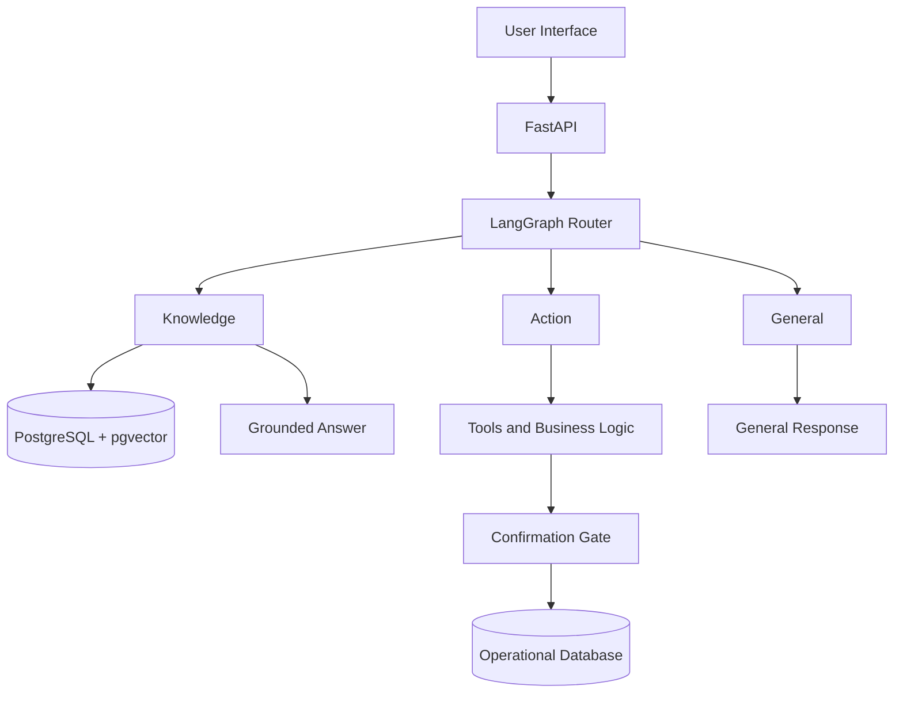
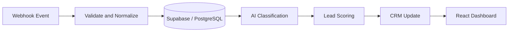

 <div align="center">

<a href="https://github.com/Aravindan-001">
  
</a>

<br/>


<br/><br/>

<a href="https://github.com/Aravindan-001">
  
</a>
<a href="https://www.linkedin.com/in/aravindansingaram">
  
</a>
<a href="mailto:aravindansingaram@gmail.com">
  
</a>
<a href="https://www.instagram.com/nexoralabs_tech/">
  
</a>

<br/><br/>


</div>

---

<div align="center">

# `01` — ABOUT ME

### Building beyond the interface.

**Cloud & Data Engineering · Backend Engineering · Mobile Engineering · AI & Agent Engineering**

</div>

I'm **Aravindan Singaram**, a B.Tech Information Technology undergraduate at NPR College of Engineering and Technology, focused on designing and implementing reliable software systems.

I work across backend APIs, databases, AI-powered workflows, mobile applications, data pipelines, and cloud deployment. My approach emphasizes clear architecture, validated data flows, automated testing, security-aware implementation, and maintainable code.

```text
IDEA
 │
 ▼
SYSTEM DESIGN
 │
 ▼
BACKEND + DATA + INTEGRATIONS
 │
 ▼
AI / AUTOMATION / APPLICATION LOGIC
 │
 ▼
TESTING + SECURITY
 │
 ▼
DEPLOYMENT + ITERATION
```

- **Backend:** API design, service layers, database integration, and application workflows.
- **Data:** relational databases, vector search, schema migrations, and event-driven pipelines.
- **AI:** RAG, LangGraph, tool calling, conversational context, and controlled agent workflows.
- **Cloud & DevOps:** Docker, deployment configuration, object storage, reverse proxies, and security headers.
- **Mobile:** Flutter, Dart, enterprise integrations, location-aware workflows, and Android release preparation.
- **Product engineering:** web interfaces, SaaS workflows, business automation, and full-stack implementation.

---

<div align="center">

# `02` — TECH STACK & TOOLING

### The tools behind the systems I build.

*Technology logos below are loaded from Skill Icons and Simple Icons. Availability and logo rendering depend on the external services.*

</div>

## 01. Programming languages

<div align="center">

<a href="https://www.python.org/"></a>
<a href="https://www.typescriptlang.org/"></a>
<a href="https://developer.mozilla.org/en-US/docs/Web/JavaScript"></a>
<a href="https://www.php.net/"></a>
<a href="https://dart.dev/"></a>
<a href="https://en.cppreference.com/w/c"></a>
<a href="https://www.gnu.org/software/bash/"></a>

<br/>


</div>

## 02. Backend engineering & API development

<div align="center">

<a href="https://fastapi.tiangolo.com/"></a>
<a href="https://nodejs.org/"></a>
<a href="https://expressjs.com/"></a>
<a href="https://laravel.com/"></a>
<a href="https://flask.palletsprojects.com/"></a>

<br/>


</div>

| Tool / framework | Engineering use |
|---|---|
| FastAPI | Python APIs, request validation, dependency injection, async endpoints |
| Pydantic / Pydantic Settings | Data validation and environment-driven configuration |
| SQLAlchemy 2.x | ORM, database sessions, and persistence layers |
| Alembic | Version-controlled database schema migrations |
| Laravel 12 / Eloquent | PHP application architecture and database workflows |
| Node.js / Express | JavaScript backend services and API endpoints |
| REST APIs / Webhooks | Service integration, event ingestion, and system communication |
| JWT / RBAC | Authentication, role-aware access, and authorization workflows |
| Supervisor | Background process management for supported deployments |

## 03. Databases, storage & data engineering

<div align="center">

<a href="https://www.postgresql.org/"></a>
<a href="https://www.mysql.com/"></a>
<a href="https://www.mongodb.com/"></a>
<a href="https://redis.io/"></a>
<a href="https://supabase.com/"></a>
<a href="https://firebase.google.com/"></a>
<a href="https://neo4j.com/"></a>

<br/>


</div>

**Database and data tools**

- **PostgreSQL:** relational modeling, transactions, indexing, and query design.
- **pgvector:** embedding storage and similarity-based retrieval.
- **MySQL:** application schemas, relational queries, and data integrity.
- **MongoDB:** document-oriented data modeling and NoSQL fundamentals.
- **Redis:** caching and background-processing support.
- **Supabase:** PostgreSQL, authentication, storage, and Row-Level Security.
- **Firebase:** application services and mobile integration.
- **Neo4j:** graph data modeling and graph database concepts.
- **ETL / ELT:** ingestion, normalization, transformation, validation, and persistence.
- **Migrations:** repeatable schema evolution using Alembic and framework migrations.

## 04. AI engineering, LLMs & agentic systems

<div align="center">

<a href="https://www.langchain.com/"></a>
<a href="https://www.langchain.com/langgraph"></a>
<a href="https://platform.openai.com/"></a>
<a href="https://ai.google.dev/"></a>
<a href="https://www.anthropic.com/"></a>

<br/><br/>

<a href="https://modelcontextprotocol.io/"></a>
<a href="https://platform.openai.com/docs/guides/agents"></a>
<a href="https://n8n.io/"></a>
<a href="https://zapier.com/"></a>

</div>

| Technology | What I use it for |
|---|---|
| LangGraph | State-based agent workflows, routing, and controlled transitions |
| LangChain | LLM application components and retrieval integrations |
| RAG | Retrieve relevant information and provide grounded responses |
| OpenAI APIs | Structured generation and model-powered application features |
| Google Gemini | Classification, generation, and AI-assisted workflows |
| Claude | LLM application exploration and integration |
| MCP | Standardized connections between AI applications and tools |
| OpenAI Agents SDK | Agent and tool orchestration concepts |
| n8n / Zapier | Event-driven integrations and workflow automation |
| Embeddings / pgvector | Semantic retrieval and knowledge search |

**AI workflow concepts:** intent routing · retrieval pipelines · conversational context · entity-aware follow-ups · tool calling · structured output · source metadata · confirmation-gated actions · provider abstraction · prompt engineering.

## 05. Frontend & web application development

<div align="center">

<a href="https://nextjs.org/"></a>
<a href="https://react.dev/"></a>
<a href="https://svelte.dev/"></a>
<a href="https://tailwindcss.com/"></a>
<a href="https://threejs.org/"></a>
<a href="https://vite.dev/"></a>

<br/>


</div>

`Next.js App Router` · `React 19` · `SvelteKit` · `Svelte 5` · `TypeScript` · `Tailwind CSS` · `shadcn/ui` · `Three.js` · `React Three Fiber` · `Framer Motion` · `Vite` · `Responsive UI` · `SSR / SSG`

## 06. Mobile engineering

<div align="center">

<a href="https://flutter.dev/"></a>
<a href="https://dart.dev/"></a>
<a href="https://reactnative.dev/"></a>
<a href="https://expo.dev/"></a>
<a href="https://developer.android.com/studio"></a>

</div>

- Flutter and Dart application development.
- Provider state management and Repository Pattern.
- React Native and Expo application workflows.
- Secure session storage and authentication flows.
- GPS-based attendance and geofencing concepts.
- SOAP/XML enterprise integration architecture.
- Android build, release configuration, R8, and ProGuard.

## 07. Cloud, DevOps & infrastructure

<div align="center">

<a href="https://www.docker.com/"></a>
<a href="https://aws.amazon.com/"></a>
<a href="https://www.cloudflare.com/"></a>
<a href="https://nginx.org/"></a>
<a href="https://www.linux.org/"></a>
<a href="https://git-scm.com/"></a>
<a href="https://github.com/features/actions"></a>

<br/>


</div>

`Docker` · `Docker Compose` · `AWS S3` · `Cloudflare DNS / CDN` · `Nginx` · `Render` · `GitHub Actions` · `Linux` · `Environment Configuration` · `CSP` · `Security Headers` · `Release Engineering`

## 08. Testing, API tools & quality engineering

<div align="center">

<a href="https://pytest.org/"></a>
<a href="https://www.postman.com/"></a>
<a href="https://playwright.dev/"></a>
<a href="https://www.npmjs.com/"></a>

</div>

- `Pytest` and `HTTPX` for backend and API testing.
- `Flutter Test` and `Flutter Analyze` for mobile validation.
- `Postman` for API exploration and verification.
- `Playwright` for browser automation and end-to-end testing.
- Type checking, linting, production builds, and regression checks.

## 09. Search, payments & business integrations

<div align="center">


</div>

`Razorpay Webhooks` · `Laravel Scout` · `Meilisearch` · `Firebase Analytics` · `Google Analytics 4` · `Google Ads` · `Crashlytics` · `WhatsApp API Integration`

---

<div align="center">

# `03` — FEATURED PROJECTS

*Engineering is more than a stack. It's how the pieces work together.*

</div>

## 🧠 NORA — AI Agency Operations & Knowledge Platform

**Focus:** Backend architecture · Agentic AI · RAG · PostgreSQL · Workflow orchestration

- FastAPI backend with SQLAlchemy 2.x, Pydantic, and Alembic.
- PostgreSQL and pgvector for operational data and semantic retrieval.
- LangGraph routing across Knowledge, Action, and General branches.
- Persistent conversational context and entity-aware follow-ups.
- Grounded generation with response source metadata.
- CRUD tools with confirmation-gated mutations.
- SvelteKit / Svelte 5 interface and ORBIT conversational experience.
- Reported project test suite: **303 tests**.



**Stack:** `Python` `FastAPI` `PostgreSQL` `pgvector` `LangGraph` `SQLAlchemy` `Alembic` `SvelteKit` `Pytest`

## 📱 ebaConnect / iCore ESS — Employee Self-Service App

**Focus:** Flutter · Enterprise integrations · Location-aware workflows

- Employee-oriented mobile workflow architecture.
- GPS attendance and 50-metre geofence validation.
- Location accuracy checks and mock-location detection.
- SOAP/XML enterprise integration architecture.
- Secure session storage and structured error handling.
- Dev / UAT / Production configuration.
- Android release preparation, R8 shrinking, and ProGuard.
- Reported validation: **42/42 Flutter tests passing**.

**Repository:** [iCore ESS](https://github.com/Aravindan-001/icore-ess)

**Stack:** `Flutter` `Dart` `SOAP/XML` `Secure Storage` `Android`

## 💎 Svaraa Jewels — E-commerce & Operations Platform

**Focus:** Backend systems · Payments · DevOps · Search

- Laravel 12, PHP 8.2+, and MySQL 8.
- Razorpay webhook payment confirmation.
- Invoice generation and Filament administration.
- Redis background processing with Supervisor.
- Dockerized application, database, and Redis services.
- Nginx, Render deployment, AWS S3, and Cloudflare.
- Laravel Scout and Meilisearch integration.
- Security headers and Content Security Policy considerations.

**Repository:** [Svaraa Jewels](https://github.com/nexoralabs-website/svaraa-jewels)

**Stack:** `Laravel` `PHP` `MySQL` `Redis` `Docker` `Nginx` `Filament` `Razorpay` `AWS S3`

## 📊 MeMotion — AI-Assisted Brand Analytics

- FastAPI service architecture.
- SQLAlchemy 2.x, PostgreSQL, and Alembic.
- Pydantic Settings for configuration.
- Gemini-assisted report generation.
- Pytest-based API and data validation.
- SvelteKit frontend integration.

**Stack:** `FastAPI` `PostgreSQL` `SQLAlchemy` `Gemini` `SvelteKit` `Pytest`

## 🔄 WhatsApp Lead Engagement & CRM Data Pipeline

**Focus:** Event-driven architecture · AI classification · Automation



- Webhook-driven lead ingestion.
- Payload validation and normalized persistence.
- AI-assisted classification and scoring.
- CRM updates and dashboard integration.
- Error handling and alerting considerations.

**Stack:** `n8n` `Supabase` `PostgreSQL` `Gemini` `React` `Webhooks`

## 🌐 Nexora Labs — Product Engineering Studio

- Student-led engineering initiative based in Dindigul, Tamil Nadu.
- Web applications, mobile apps, SaaS, AI, Agentic AI, and automation.
- Next.js / React / TypeScript application development.
- Interactive Three.js / React Three Fiber experience.
- Responsive UI and motion-driven interactions.

**Connect:** [Nexora Labs Instagram](https://www.instagram.com/nexoralabs_tech/)

## 🎓 CampusIQ — Placement Readiness Platform

- React Native and Expo.
- Supabase Auth, PostgreSQL, RLS, and storage.
- Resume skill extraction and skill-gap identification.
- Placement readiness score concept from 0–100.
- Eligibility prediction and realtime data integration.

## 💍 Shri Vishwakarma Matrimony

- Flutter, Dart, Provider, and Repository Pattern.
- PHP / MySQL backend with REST API integration.
- Tamil / English application experience.
- Profile discovery, membership, and interest workflows.
- JWT authentication and role-based access control.

---

<div align="center">

# `04` — ENGINEERING PRINCIPLES

</div>

| Principle | Implementation mindset |
|---|---|
| Clear architecture | Separate routes, services, repositories, and integrations |
| Data integrity | Validate inputs, model relationships, and manage migrations |
| AI reliability | Retrieve context, structure outputs, and control tool execution |
| Security awareness | Enforce server-side authorization and protect sensitive workflows |
| Testability | Validate APIs, business logic, and important user journeys |
| Deployability | Use environment-based configuration and reproducible builds |
| Maintainability | Prefer explicit boundaries, useful errors, and documented workflows |

---

<div align="center">

# `05` — GITHUB ANALYTICS

*Live cards depend on external GitHub statistics services.*


<br/><br/>


<br/><br/>


</div>

---

<div align="center">

# `06` — CERTIFICATIONS & LEARNING

</div>

| Certification / learning | Focus |
|---|---|
| Neo4j Certified Professional | Graph databases and graph data modeling |
| MongoDB Basics for Students | Document-oriented databases |
| Prompt Engineering with GitHub Copilot | Prompt design and AI-assisted development |
| Oracle Agentic AI Foundations | Agentic AI and Oracle AI ecosystem |

*Keep the exact credential names and completion status aligned with your issued certificates.*

---

<div align="center">

# `07` — LEADERSHIP & COLLABORATION

</div>

- Participated in Smart India Hackathon internal selection and project development activities.
- Contributed to college technical coordination, incubation, and IPR-related activities.
- Helped junior developers with React Native, Laravel, and Supabase integration concepts.
- Worked across application, backend, data, and AI workflow implementation.
- Value clear technical documentation and reproducible development practices.

---

<div align="center">

# `08` — LET'S BUILD SOMETHING USEFUL

### Engineering with intent. Building with curiosity. Improving through iteration.

**Interested in:** Cloud & Data Engineering · Backend Systems · Agentic AI · Mobile Apps · Product Collaborations

<br/>

<a href="mailto:aravindansingaram@gmail.com">
  
</a>
<a href="https://www.linkedin.com/in/aravindansingaram">
  
</a>
<a href="https://github.com/Aravindan-001">
  
</a>
<a href="https://www.instagram.com/nexoralabs_tech/">
  
</a>

<br/><br/>


</div>
