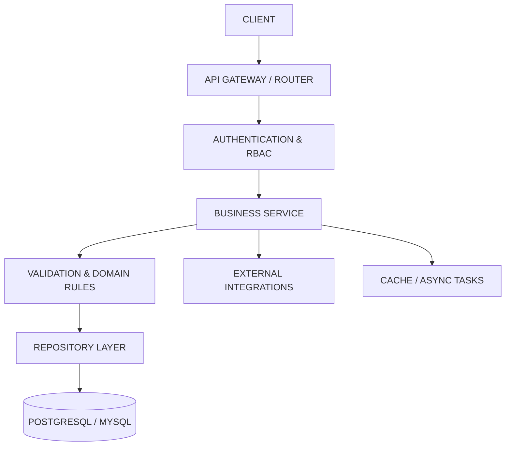
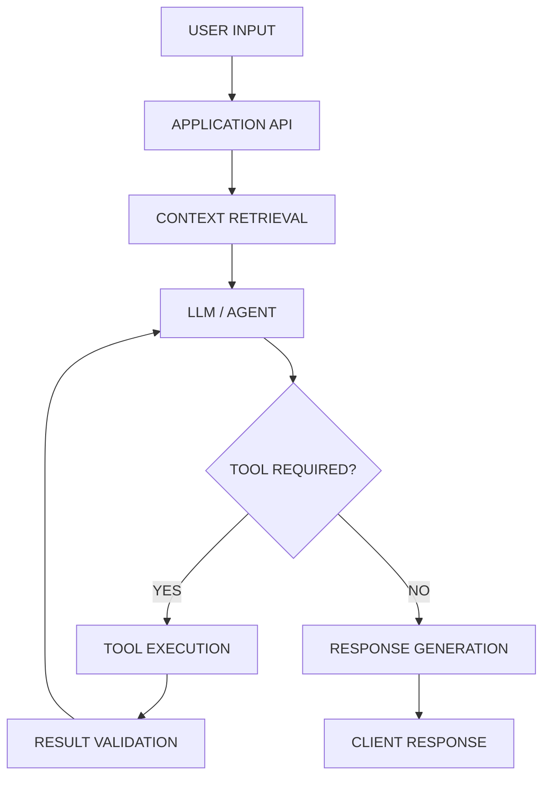

 <div align="center">


+Building+AI+agents+and+RAG+workflows;>+Engineering+secure+data+and+API+layers;>+Automating+cloud+and+deployment+workflows;>+Building+products+with+Nexora+Labs" alt="Terminal-style engineering introduction"/>

<br/>


<br/><br/>

<a href="https://github.com/Aravindan-001"></a>
<a href="https://www.instagram.com/nexoralabs_tech/"></a>
<a href="https://wa.me/917339559072"></a>

<br/><br/>


**Information Technology Student · Software Engineering · AI Systems**

`BUILD` → `TEST` → `SECURE` → `DEPLOY` → `IMPROVE`

</div>

---

## `00` / SYSTEM OVERVIEW

<table>
<tr>
<td width="58%" valign="top">

### Engineering profile

I focus on the engineering behind applications: API architecture, database systems, AI-powered workflows, access control, automated testing and deployment.

My projects span backend services, mobile applications, business workflows and AI-oriented product development.

**Primary domains**

- Backend and API engineering
- Agentic AI, RAG and MCP
- Relational, graph and vector databases
- Cloud infrastructure and DevOps
- Application security and quality engineering
- Product development through Nexora Labs

</td>
<td width="42%" valign="top">

### Engineering index

| System | Focus |
|---|---|
| `SYS-01` | Backend APIs |
| `SYS-02` | AI & agent workflows |
| `SYS-03` | Data engineering |
| `SYS-04` | Cloud & deployment |
| `SYS-05` | Security & QA |
| `SYS-06` | Product engineering |

</td>
</tr>
</table>

```python
class Aravindan:
    role = "Information Technology Student"

    engineering_domains = [
        "Backend Engineering",
        "AI & Agent Engineering",
        "Cloud & DevOps",
        "Application Security",
    ]

    philosophy = (
        "Build reliable systems, "
        "verify behaviour, "
        "secure critical boundaries."
    )
```

---

## `01` / TECHNOLOGY MATRIX

<sub>TECHNOLOGY MAP · ORGANIZED BY ENGINEERING LAYER</sub>

### A — Languages & runtime

<div align="center">


</div>

| Layer | Technologies |
|---|---|
| Programming | Python, JavaScript, TypeScript, Dart, PHP, C |
| Web | Next.js, React, Tailwind CSS |
| Mobile | Flutter |
| Backend | FastAPI, Node.js, Laravel |

### B — Data infrastructure

<div align="center">


</div>

| Data layer | Technologies |
|---|---|
| Relational | PostgreSQL, MySQL |
| Document / platform services | MongoDB, Firebase, Supabase |
| Caching | Redis |
| Graph | Neo4j |
| Vector search | pgvector |
| Data concepts | Schema design, indexing, access policies, data integrity |

### C — AI & agent systems

<div align="center">


</div>

| System component | Engineering focus |
|---|---|
| Retrieval | Embeddings, context retrieval and vector search |
| Agents | Tool calling and multi-step workflows |
| Integration | Model APIs and external tools |
| Protocols | Model Context Protocol |
| Orchestration | LangGraph-oriented workflows |

### D — Cloud & infrastructure

<div align="center">


</div>

| Infrastructure layer | Technologies |
|---|---|
| Cloud | AWS |
| Containers | Docker |
| Web infrastructure | Nginx, Cloudflare |
| Version control | Git, GitHub |
| CI/CD | GitHub Actions |
| Automation | n8n, workflow integrations |

### E — Testing & engineering tools

<div align="center">


</div>

`PYTEST` · `PLAYWRIGHT` · `API TESTING` · `REGRESSION TESTING` · `BUILD VALIDATION`

<sub>Stack entries describe technologies used across projects and technical exploration; inclusion does not imply equal proficiency or usage in every project.</sub>

---

## `02` / FEATURED SYSTEMS

<sub>SELECTED PROJECTS · ARCHITECTURE · IMPLEMENTATION</sub>

<table>
<tr>
<td width="50%" valign="top">

### `SYS-01` NORA

**AI Operations & Knowledge Platform**

`FASTAPI` `POSTGRESQL` `PGVECTOR` `LANGGRAPH` `SVELTEKIT`

- Layered router, service and repository architecture.
- Client, lead, project and task modules.
- Vector-enabled knowledge retrieval.
- AI workflow design.

**Engineering focus:** Backend architecture, data and AI workflows.

</td>
<td width="50%" valign="top">

### `SYS-02` PYP

**Pick Your Photographer Marketplace**

`FLUTTER` `SUPABASE` `POSTGRESQL` `FIREBASE`

- Photographer booking and acceptance lifecycle.
- Confirmation and payment-state handling.
- Commission calculation and invoice workflows.
- Role-based access and portfolio storage policies.
- Security and regression tests.

**Engineering focus:** Mobile, transactional workflows and security.

</td>
</tr>
<tr>
<td width="50%" valign="top">

### `SYS-03` Svaraa Jewels

**E-Commerce Engineering**

`LARAVEL` `MYSQL` `REDIS` `DOCKER` `NGINX`

- Backend and database integration.
- Administrative workflows with Filament.
- Infrastructure configuration.
- Deployment-oriented development.

**Engineering focus:** Backend and infrastructure.

</td>
<td width="50%" valign="top">

### `SYS-04` iCore ESS

**Employee Self-Service Application**

`FLUTTER` `SOAP/XML` `FIREBASE`

- Mobile application workflows.
- SOAP/XML integration.
- Firebase-connected application functionality.

[**View source →**](https://github.com/Aravindan-001/icore-ess)

**Engineering focus:** Mobile and enterprise integration.

</td>
</tr>
<tr>
<td width="50%" valign="top">

### `SYS-05` Client CRM

**Sales & Lead Management**

`NEXT.JS` `REACT` `TYPESCRIPT` `PLAYWRIGHT`

- Lead and contact management.
- Responsive business interface.
- Browser-based regression testing.
- Build and type-check validation.

**Engineering focus:** Full-stack engineering and QA.

</td>
<td width="50%" valign="top">

### `SYS-06` PerceptionIQ

**Hackathon Engineering**

`AI PRODUCT` `INTEGRATION` `QA`

- Rapid product prototyping.
- Backend and frontend integration.
- Test and integration troubleshooting.
- External data-source constraints.

**Engineering focus:** Product engineering and integration.

</td>
</tr>
</table>

<div align="center">

### `ORG-01` / NEXORA LABS

**Student-led Product Engineering Studio**

`WEB` · `MOBILE` · `SAAS` · `AGENTIC AI` · `AUTOMATION`

<a href="https://www.instagram.com/nexoralabs_tech/"></a>
<a href="https://github.com/Aravindan-001?tab=repositories"></a>

</div>

---

## `03` / ARCHITECTURE LAB

### Backend request pipeline



### Agent execution pipeline



### Engineering quality gates

| Stage | Verification |
|---|---|
| `01 / DESIGN` | Architecture, data models and API contracts |
| `02 / SECURITY` | Input validation, permissions and database policies |
| `03 / TEST` | Unit, integration and regression tests |
| `04 / RELEASE` | Build validation, environment configuration and deployment readiness |

<sub>These diagrams represent general engineering patterns, not a claim that all components exist in each project.</sub>

---

## `04` / CONTRIBUTION INTELLIGENCE

<sub>GITHUB ACTIVITY · CONTRIBUTION HISTORY · REPOSITORY COMPOSITION</sub>

<div align="center">

### Contribution heatmap


<br/>

### Developer statistics

<a href="https://github.com/Aravindan-001">

</a>
<a href="https://github.com/Aravindan-001">

</a>

<br/><br/>

### Contribution consistency


<br/><br/>

### Activity timeline


</div>

<sub>These charts are rendered by external services and may be temporarily unavailable. Contribution totals depend on GitHub attribution and visibility; language distribution reflects repository code, not skill level.</sub>

### Contribution snake

Configure a GitHub Actions workflow to publish generated SVGs to the `output` branch before enabling the animation.

```html
<picture>
  <source
    media="(prefers-color-scheme: dark)"
    srcset="https://raw.githubusercontent.com/Aravindan-001/Aravindan-001/output/github-contribution-grid-snake-dark.svg"
  />
  <source
    media="(prefers-color-scheme: light)"
    srcset="https://raw.githubusercontent.com/Aravindan-001/Aravindan-001/output/github-contribution-grid-snake.svg"
  />
  
</picture>
```

Workflow source: [Platane/snk](https://github.com/Platane/snk)

---

## `05` / ENGINEERING PRINCIPLES

<table>
<tr>
<td width="50%" valign="top">

**01 — Separation of concerns**

Keep routing, business logic and persistence independently organised.

**02 — Security boundaries**

Enforce authentication, authorisation and validation at the correct layer.

**03 — Data integrity**

Protect important state transitions and enforce appropriate database constraints.

</td>
<td width="50%" valign="top">

**04 — Verifiable behaviour**

Use tests to check critical business and security rules.

**05 — Deployment awareness**

Treat configuration, migrations and secrets as part of the engineering process.

**06 — Honest documentation**

Separate implemented features from planned work and known limitations.

</td>
</tr>
</table>

---

## `06` / CERTIFICATIONS & LEARNING

<table>
<tr>
<td width="50%" valign="top">

### Neo4j

**Neo4j Certified Professional**

Graph database concepts and graph-based data modelling.

</td>
<td width="50%" valign="top">

### Oracle

**Oracle Agentic AI Foundations 2026**

Completed learning covering agentic AI, MCP, OpenAI Responses API and Agents SDK, OCI Enterprise AI, and Oracle AI Database / Vector Search.

</td>
</tr>
<tr>
<td colspan="2">

### AWS Skill Builder

Cloud fundamentals and AWS service concepts, including compute, load balancing and messaging.

</td>
</tr>
</table>

---

## `07` / CONNECT

<div align="center">

**ENGINEER SYSTEMS · EXPLORE IDEAS · BUILD PRODUCTS**

<a href="https://github.com/Aravindan-001"></a>
<a href="https://www.instagram.com/nexoralabs_tech/"></a>
<a href="https://wa.me/917339559072"></a>

<br/><br/>

<sub>DESIGNED FOR RELIABILITY · BUILT WITH PURPOSE · ALWAYS ITERATING</sub>


</div>
