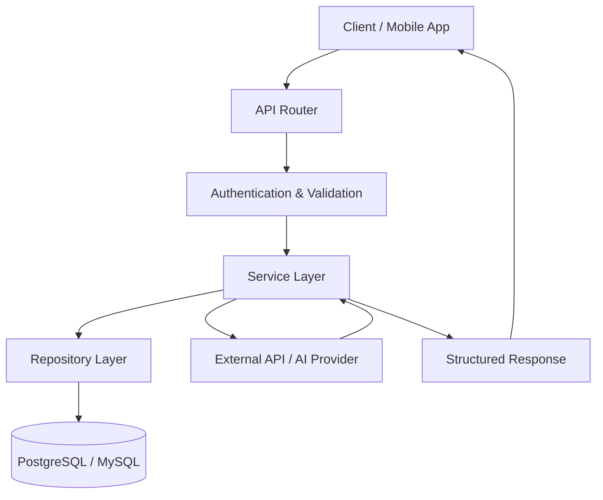
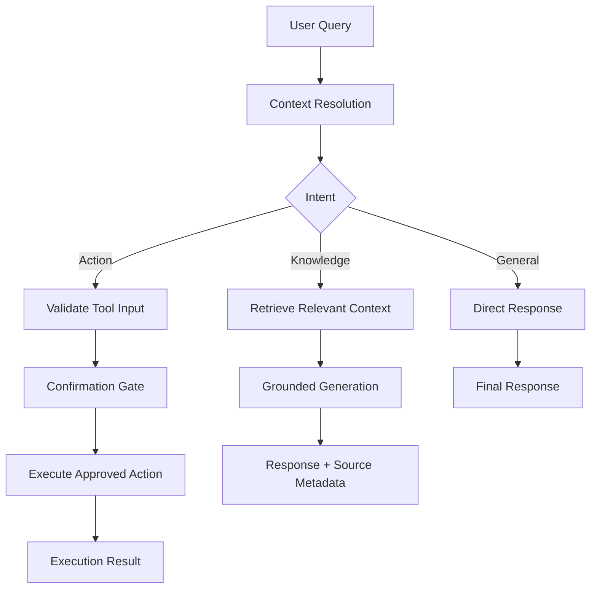
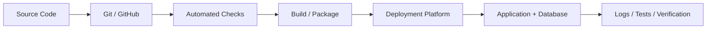

# ⚡ ARAVINDAN SINGARAM — GitHub Profile README

<div align="center">


<br/>

<a href="https://github.com/Aravindan-001">
  
</a>
<a href="https://www.linkedin.com/in/aravindansingaram">
  
</a>
<a href="mailto:aravindansingaram@gmail.com">
  
</a>
<a href="https://www.instagram.com/nexoralabs_tech/">
  
</a>

<br/><br/>


### Engineering systems. Connecting intelligence. Shipping products.

**B.Tech Information Technology · NPR College of Engineering and Technology · 2024–2028**

</div>

---

## `01` — Engineering Profile

I'm an Information Technology engineering student focused on building software that connects **backend systems, cloud infrastructure, data platforms, mobile applications, and AI-powered workflows**.

My engineering interests extend from API design, authentication, database architecture, and automated testing to retrieval-augmented generation, agentic workflows, deployment, and production-oriented operations.

I also build through **Nexora Labs**, a student-led product engineering studio focused on web platforms, mobile apps, SaaS, AI, agentic AI, and automation.

- **Backend engineering:** APIs, service architecture, authentication, database design, integrations, and testing.
- **AI & agent engineering:** RAG, vector search, LangGraph, tool calling, structured generation, and workflow automation.
- **Cloud & DevOps:** Docker, deployment workflows, Nginx, AWS services, Cloudflare, and environment configuration.
- **Data engineering:** SQL, PostgreSQL, data modeling, ingestion pipelines, search, and database performance.
- **Mobile & web:** Flutter, Dart, React, Next.js, SvelteKit, and responsive product interfaces.
- **Engineering quality:** security-first design, reproducible testing, migrations, observability, and reliable releases.

```text
ARAVINDAN SINGARAM
├── Backend Engineering
│   ├── API Design & Service Architecture
│   ├── Authentication, RBAC & Security
│   └── Database Design & Integrations
├── AI & Agent Engineering
│   ├── RAG & Vector Retrieval
│   ├── Stateful Agent Workflows
│   └── Tool Calling & Automation
├── Cloud & Data Engineering
│   ├── Docker & Deployment
│   ├── PostgreSQL & Data Pipelines
│   └── Cloud Infrastructure & Operations
└── Product Engineering
    ├── Flutter & Mobile Applications
    ├── Web Platforms & Dashboards
    └── Nexora Labs
```

---

## `02` — Live GitHub Statistics

<div align="center">

<a href="https://github.com/Aravindan-001">
  
</a>
<a href="https://github.com/Aravindan-001">
  
</a>

<br/>


<br/>


</div>

### More contribution analytics

<div align="center">

<a href="https://github.com/Aravindan-001">
  
</a>

<br/>


<br/>


</div>

> **How to read these stats:** GitHub contribution counts depend on GitHub's contribution rules and the repositories included. Language cards measure detected repository code, not necessarily time spent or overall expertise. Third-party cards can be temporarily unavailable, and private contributions may not appear as expected.

---

## `03` — Contribution Calendar & Activity

<div align="center">

<a href="https://github.com/Aravindan-001?tab=overview&from=2026-01-01&to=2026-12-31">
  
</a>

**Explore the source of truth:** [GitHub contribution overview](https://github.com/Aravindan-001)

</div>

### Contribution activity, beyond a single streak

- **Contribution calendar:** daily contribution pattern across GitHub.
- **Activity graph:** contribution history visualized over time.
- **Streak analytics:** consecutive contribution days recognized by the streak provider.
- **Profile summary:** overview of commits, repositories, and language distribution.
- **Repository insights:** language and project details from individual repositories.

#### Optional: Animated contribution snake

Want the contribution calendar transformed into an animated snake? GitHub needs a workflow to generate and publish the SVG first. Once the workflow is configured, uncomment the image below.

```html
<!-- Enable this image after configuring a snake-generation GitHub Action.

<p align="center">
  
</p>

-->
```

---

## `04` — Technology Universe

### Languages

<p align="center">
  
</p>

### Backend engineering & APIs

<p align="center">
  
</p>

**Engineering focus:** REST APIs · Request validation · Service/repository architecture · Dependency injection · Authentication · RBAC · Webhooks · Background jobs · API error handling · Integration testing.

### Databases, data & search

<p align="center">
  
</p>

**Engineering focus:** PostgreSQL · SQL · Relational modeling · Migrations · Indexing · Query optimization · Row-Level Security · pgvector · Vector search · Redis caching · MongoDB · Data ingestion · ETL-oriented workflows.

### AI, agents & retrieval

<p align="center">
  
</p>

<p align="center">
  
  
  
  
  
  
  
  
</p>

**Engineering focus:** RAG pipelines · Embeddings · Context retrieval · Grounded answers · Structured output · Stateful workflows · Tool execution · Human confirmation for sensitive mutations · Multi-turn context · Provider abstractions · AI-assisted reporting.

### Frontend & web

<p align="center">
  
</p>

**Engineering focus:** Next.js · React · TypeScript · SvelteKit · Svelte 5 · Tailwind CSS · Responsive UI · Dashboards · Form validation · API integration · Accessible component patterns.

### Mobile engineering

<p align="center">
  
</p>

**Engineering focus:** Flutter · Dart · Material 3 · State management · Repository pattern · REST/SOAP integration · GPS and geofencing · Secure session storage · Android release builds · Mobile testing.

### Cloud, DevOps & infrastructure

<p align="center">
  
</p>

<p align="center">
  
  
  
</p>

**Engineering focus:** Dockerized services · Environment management · Nginx reverse proxy · Deployment configuration · Cloud object storage · DNS/CDN configuration · CI workflows · Android build optimization · Release configuration · Operational debugging.

### Testing, tools & integrations

<p align="center">
  
</p>

<p align="center">
  
  
  
  
  
  
</p>

---

## `05` — Featured Engineering Projects

<div align="center">

### Selected work

*Backend systems · Enterprise mobile · E-commerce infrastructure · AI platforms · Product engineering*

</div>

### 01. NORA — AI Agency Operations & Knowledge Platform

**Focus:** Backend engineering · RAG · Agentic workflows · Knowledge graphs

A modular operations platform designed around clients, leads, projects, tasks, and an AI assistant that can retrieve relevant knowledge and execute controlled actions.

**Architecture and engineering highlights**

- FastAPI backend organized into router, service, and repository layers.
- PostgreSQL with pgvector for structured data and semantic retrieval.
- LangGraph workflow branches for knowledge retrieval, action execution, and general responses.
- Entity-aware context resolution for follow-up questions.
- Structured model output and source-aware response handling.
- Confirmation-gated action execution for controlled mutations.
- Alembic database migrations and automated API/backend tests.

**Technology:** Python · FastAPI · PostgreSQL · pgvector · SQLAlchemy · Alembic · LangGraph · OpenAI · SvelteKit · Svelte 5

```text
User Request
     │
     ▼
API / ORBIT Interface
     │
     ▼
LangGraph Workflow
     ├── Knowledge ──► Retrieval ──► Grounded Answer
     ├── Action ─────► Tool Validation ──► Confirmation
     │                                      │
     │                                      ▼
     │                              Controlled Mutation
     └── General ────► Direct Response

PostgreSQL + pgvector ◄── Application Data & Retrieval
```

*Repository visibility: development project; add a public repository link here when it is published.*

---

### 02. iCore ESS — Enterprise Employee Self-Service

**Repository:** [Aravindan-001/icore-ess](https://github.com/Aravindan-001/icore-ess)

**Focus:** Mobile engineering · Enterprise integrations · Reliability

A Flutter-based employee self-service application integrating enterprise service workflows and mobile-specific functionality.

- Flutter and Dart application architecture.
- SOAP/XML integration approach for enterprise services.
- Firebase integration.
- GPS attendance and geofencing-oriented validation.
- Secure session handling and structured error management.
- Separate development, UAT, and production configuration.
- Android release-build configuration and resource optimization.

**Technology:** Flutter · Dart · Firebase · SOAP/XML · Android tooling

---

### 03. Svaraa Jewels — E-commerce Platform

**Repository:** [Svaraa Jewels](https://github.com/nexoralabs-website/svaraa-jewels)

**Focus:** Backend engineering · Payments · Cloud & DevOps

An e-commerce implementation combining a Laravel application, database services, payment integration, background processing, and deployment infrastructure.

- Laravel 12 and PHP backend.
- MySQL data persistence and Redis-backed workflows.
- Razorpay payment integration with webhook-based confirmation.
- Filament administration and catalog management.
- Laravel Scout and Meilisearch-oriented search.
- Docker-based application and service setup.
- Nginx, deployment configuration, AWS S3, and Cloudflare integration.

**Technology:** Laravel · PHP · MySQL · Redis · Docker · Nginx · Filament · Meilisearch · Razorpay · AWS S3

---

### 04. MeMotion — AI-Powered Analytics

**Focus:** AI-assisted reporting · API engineering · Data processing

A platform concept focused on social and brand analytics, data-backed insights, and AI-generated reporting.

- FastAPI service layer with typed settings and request validation.
- SQLAlchemy 2.x and PostgreSQL persistence.
- Alembic migration management.
- Gemini integration for AI-assisted report generation.
- SvelteKit frontend architecture.
- Automated tests for backend and data workflows.

**Technology:** Python · FastAPI · PostgreSQL · SQLAlchemy · Alembic · Gemini · SvelteKit · Pytest

*Repository visibility: add the public repository URL if and when available.*

---

### 05. WhatsApp Lead Engagement & CRM Pipeline

**Focus:** Workflow automation · Data pipelines · Lead operations

An automation-oriented pipeline designed to move lead information from incoming events to structured records, classification, and CRM workflows.

```text
Incoming Webhook
       │
       ▼
Validation & Normalization
       │
       ▼
PostgreSQL / Supabase
       │
       ▼
AI-Assisted Classification
       │
       ▼
Lead Scoring & CRM Update
       │
       ▼
Dashboard / Follow-up Workflow
```

**Technology:** n8n · Supabase · PostgreSQL · WhatsApp API integration · Gemini · React

---

### 06. Nexora Labs — Product Engineering Studio

**Instagram:** [@nexoralabs_tech](https://www.instagram.com/nexoralabs_tech/)

**Focus:** Product engineering · AI applications · Web platforms

A student-led product engineering initiative exploring business-oriented software, mobile applications, SaaS, AI-powered products, and automation.

- Web application and product UI engineering.
- Mobile application development.
- Backend APIs and integrations.
- AI agents and automation workflows.
- Deployment-oriented implementation.
- Client-focused product discovery and delivery.

**Studio positioning:** Web · Apps · SaaS · AI · Agentic AI · Automation

---

### 07. Shri Vishwakarma Matrimony

**Focus:** Mobile product development · API integration · User workflows

A matrimony application concept centered on profile discovery, membership workflows, user interactions, and multilingual accessibility.

- Flutter and Dart application development.
- Provider-based state management and repository pattern.
- PHP/MySQL and REST API integration.
- Tamil and English interface support.
- Profile search, membership, and interest workflows.
- JWT/RBAC-oriented access-control design.

**Technology:** Flutter · Dart · Provider · PHP · MySQL · REST APIs

---

### 08. CampusIQ — Placement Readiness Platform

**Focus:** Student analytics · AI-assisted evaluation · Data modeling

A placement-readiness platform concept designed to help students understand skills, identify gaps, and evaluate job eligibility.

- Resume skill extraction and skill-gap identification.
- Placement readiness scoring concept.
- Eligibility prediction workflows.
- Supabase authentication and data access controls.
- Realtime-oriented application architecture.

**Technology:** React Native · Expo · Supabase · PostgreSQL · NLP-oriented workflows

---

## `06` — Engineering Patterns I Work With

### Backend request lifecycle



### AI retrieval and controlled actions



### Deployment workflow



---

## `07` — My Engineering Principles

| Principle | What it means in practice |
|---|---|
| API contracts first | Clear request schemas, validation, and consistent responses |
| Secure by default | Authentication, authorization, least privilege, and server-side validation |
| Database integrity | Explicit migrations, constraints, indexes, and transaction boundaries |
| Test what matters | Unit tests, integration tests, API tests, and regression coverage |
| Control AI actions | Validate tool arguments and require confirmation for sensitive mutations |
| Reproducible delivery | Version-controlled configuration and repeatable build/deployment steps |
| Observable systems | Useful logs, actionable errors, and verification after changes |
| Maintainable architecture | Separation of concerns and explicit module boundaries |

---

## `08` — Certifications & Professional Development

<div align="center">

<a href="https://neo4j.com/">
  
</a>
<a href="https://www.mongodb.com/">
  
</a>
<a href="https://education.oracle.com/">
  
</a>

</div>

- **Neo4j Certified Professional** — graph database concepts and Cypher.
- **MongoDB Basics for Students** — document database fundamentals.
- **Prompt Engineering with GitHub Copilot** — prompt-driven development workflows.
- **Oracle Agentic AI Foundations** — agentic AI, MCP, agent development concepts, and Oracle AI ecosystem learning.

*Keep certification names and completion status aligned with the certificates actually issued to you.*

---

## `09` — Beyond the Code

- Student-led product development through Nexora Labs.
- College incubation and innovation activities.
- Technical event coordination and student collaboration.
- Hackathon participation and prototype development.
- Continuous exploration of backend architecture, AI systems, cloud engineering, and mobile applications.

---

## `10` — Current Engineering Direction

<div align="center">


</div>

My goal is to grow into an engineer who can design and deliver **complete, reliable systems**—from data models and backend services to AI workflows, cloud deployment, and production verification.

---

## `11` — Let's Connect

<div align="center">

<a href="https://github.com/Aravindan-001">
  
</a>
<a href="https://www.linkedin.com/in/aravindansingaram">
  
</a>
<a href="mailto:aravindansingaram@gmail.com">
  
</a>
<a href="https://www.instagram.com/nexoralabs_tech/">
  
</a>

<br/><br/>

**Open to learning, engineering collaboration, meaningful projects, and building useful technology.**

<br/>


<sub>Designed with curiosity, built with code, improved through iteration.</sub>

</div>

---

<!--
MAINTENANCE NOTES

1. Keep project descriptions aligned with the actual implementation.
2. Add repository links only after making those repositories public.
3. GitHub stats, streak, language, and activity widgets are third-party services.
   They can be rate-limited, unavailable, or show incomplete data.
4. The contribution snake requires a separate GitHub Actions workflow
   that generates the SVG and publishes it to the output branch.
5. Do not treat language percentages, streaks, or contribution counts as
   a measure of engineering skill.
6. Update certification wording when an official certificate is issued.
-->
