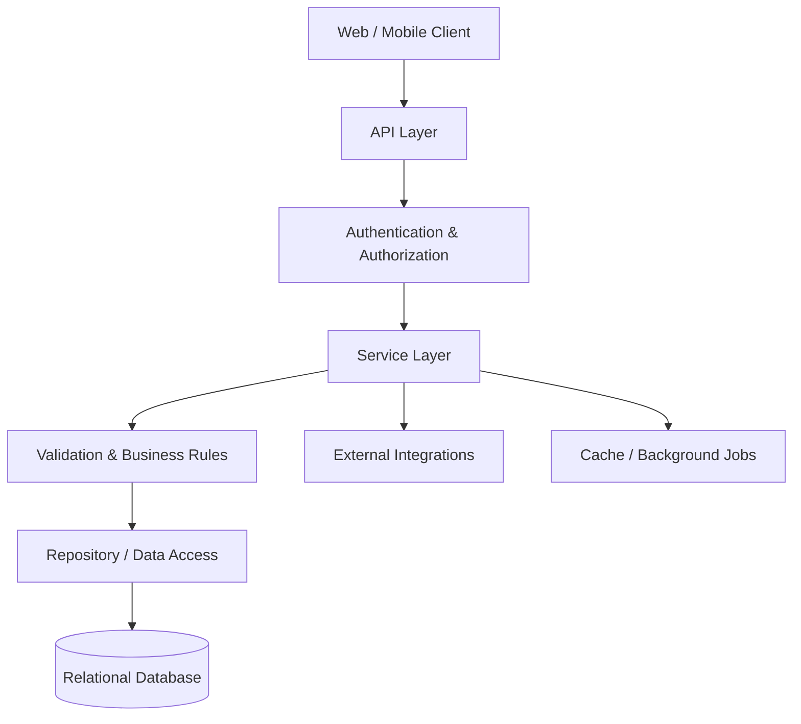
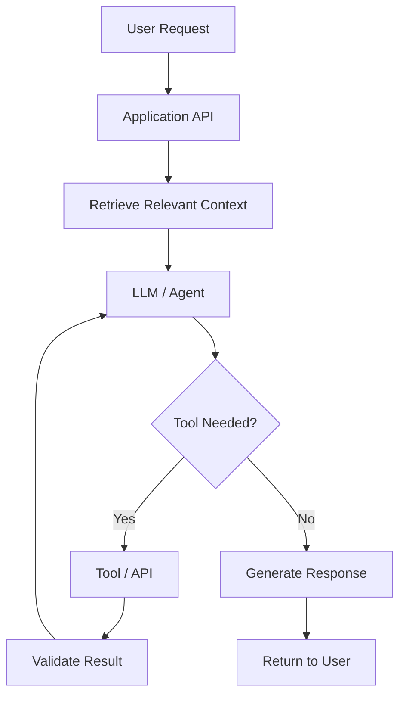

 <div align="center">


<br/>


<br/><br/>

<a href="https://github.com/Aravindan-001"></a>
<a href="https://www.instagram.com/nexoralabs_tech/"></a>
<a href="https://wa.me/917339559072"></a>

**Information Technology Student · Backend Engineering · AI Agents · Cloud & DevOps**

*Building practical software with an emphasis on architecture, security, testing and deployment.*

</div>

---

<div align="center">

### ENGINEERING NAVIGATION

[01 · Profile](#01--engineering-profile) · [02 · Tech Stack](#02--technology-universe) · [03 · Projects](#03--featured-projects) · [04 · Architecture](#04--system-design) · [05 · Contributions](#05--contribution-command-center) · [06 · Analytics](#06--github-analytics) · [07 · Credentials](#07--certifications--learning) · [08 · Connect](#08--connect)

</div>

## `01` / ENGINEERING PROFILE

<table>
<tr>
<td width="62%" valign="top">

### Building beyond the interface

I'm an Information Technology student interested in designing and developing reliable software systems across backend engineering, AI applications and cloud infrastructure.

My work spans APIs, database-driven applications, mobile workflows, AI-assisted systems and deployment-oriented engineering.

**Primary engineering interests**

- Backend APIs and service architecture
- Agentic AI, RAG, vector search and MCP
- Database design, integrity and access control
- Cloud infrastructure and DevOps
- Application security and automated testing
- SaaS and product engineering

</td>
<td width="38%" valign="top">

### Engineering identity

| Attribute | Focus |
|---|---|
| Core | Backend |
| Intelligence | AI Agents |
| Infrastructure | Cloud & DevOps |
| Data | SQL & Vector Search |
| Quality | Testing & Security |
| Products | Nexora Labs |

</td>
</tr>
</table>

```python
class EngineeringMindset:
    domains = [
        "Backend Systems",
        "AI & Agent Engineering",
        "Cloud & DevOps",
        "Application Security",
    ]

    principles = [
        "Design before implementation",
        "Validate before trusting",
        "Test before deployment",
        "Document what is implemented",
    ]
```

> Build useful systems. Make them reliable. Secure them by design.

---

## `02` / TECHNOLOGY UNIVERSE

<div align="center">

### `01` — Programming Languages


### `02` — Web & Mobile Engineering


### `03` — Backend Engineering


### `04` — Databases & Data Platforms


### `05` — Cloud, DevOps & Infrastructure


### `06` — Development & Quality Tools


</div>

### AI, Agents, Data & Automation

<div align="center">


</div>

### Stack at a glance

| Engineering domain | Technologies |
|---|---|
| Languages | Python, JavaScript, TypeScript, Dart, PHP, C |
| Frontend | Next.js, React, Tailwind CSS |
| Mobile | Flutter |
| Backend | FastAPI, Node.js, Laravel |
| Relational data | PostgreSQL, MySQL |
| NoSQL & platform services | MongoDB, Firebase, Supabase, Redis |
| Graph & vector data | Neo4j, pgvector |
| AI engineering | LangChain, LangGraph, RAG, MCP |
| Cloud & infrastructure | AWS, Docker, Nginx, Cloudflare |
| Automation & QA | n8n, GitHub Actions, Playwright, Postman |
| Analytics | Power BI |

<sub>This matrix describes the broader toolkit across projects and exploration. It does not imply that every technology is used in every application or that all tools have equal proficiency.</sub>

---

## `03` / FEATURED PROJECTS

<table>
<tr>
<td width="50%" valign="top">

### 🧠 NORA

**AI Operations & Knowledge Platform**

`FASTAPI` `POSTGRESQL` `PGVECTOR` `LANGGRAPH` `SVELTEKIT`

- Layered backend architecture
- Client, lead, project and task modules
- Vector-enabled knowledge retrieval
- AI workflow design

**Engineering focus:** Backend architecture, AI and data systems.

</td>
<td width="50%" valign="top">

### 📸 PYP

**Pick Your Photographer Marketplace**

`FLUTTER` `DART` `SUPABASE` `FIREBASE`

- Photographer booking lifecycle
- Acceptance and confirmation workflows
- Payment and commission state handling
- Access control, invoices and storage security

**Engineering focus:** Mobile, marketplace workflows and security.

</td>
</tr>
<tr>
<td width="50%" valign="top">

### 💎 Svaraa Jewels

**E-Commerce Engineering**

`LARAVEL` `PHP` `MYSQL` `REDIS` `DOCKER` `NGINX`

- Backend and database integration
- Administrative workflows with Filament
- Container and deployment configuration
- Infrastructure-oriented development

**Engineering focus:** Backend, infrastructure and deployment.

</td>
<td width="50%" valign="top">

### 📱 iCore ESS

**Employee Self-Service Application**

`FLUTTER` `DART` `SOAP/XML` `FIREBASE`

- Mobile application workflows
- SOAP/XML service integration
- Firebase integration

[Explore repository →](https://github.com/Aravindan-001/icore-ess)

**Engineering focus:** Mobile engineering and enterprise integration.

</td>
</tr>
<tr>
<td width="50%" valign="top">

### 📊 Client CRM

**Sales & Lead Management**

`NEXT.JS` `REACT` `TYPESCRIPT` `PLAYWRIGHT`

- Lead management and contact workflows
- Responsive UI development
- Browser-based regression testing
- Type checking and production-build validation

**Engineering focus:** Full-stack development and QA.

</td>
<td width="50%" valign="top">

### 🤖 PerceptionIQ

**Hackathon Project**

`PRODUCT ENGINEERING` `INTEGRATION` `QA`

- AI-oriented product prototyping
- Backend/frontend integration
- Test-driven troubleshooting
- External data integration constraints

**Engineering focus:** Rapid prototyping and integration.

</td>
</tr>
</table>

<div align="center">

### 🚀 Nexora Labs

**Student-led Product Engineering Studio**

Web Applications · Mobile Apps · SaaS · AI · Agentic AI · Automation

<a href="https://www.instagram.com/nexoralabs_tech/"></a>
<a href="https://github.com/Aravindan-001?tab=repositories"></a>

</div>

---

## `04` / SYSTEM DESIGN

### Backend architecture



### Agentic AI workflow



### Engineering quality gates

<table>
<tr>
<td align="center" width="25%">


**Architecture**

Layering, contracts and data models

</td>
<td align="center" width="25%">


**Protection**

Validation, permissions and policies

</td>
<td align="center" width="25%">


**Verification**

Regression and integration tests

</td>
<td align="center" width="25%">


**Delivery**

Configuration and build validation

</td>
</tr>
</table>

<sub>Architecture diagrams illustrate common design patterns and are conceptual, not a claim that every featured project implements every component.</sub>

---

## `05` / CONTRIBUTION COMMAND CENTER

<div align="center">

### Your coding activity, visualized


<sub>Contribution calendar · Activity shown according to GitHub's contribution data.</sub>

<br/><br/>

<a href="https://github.com/Aravindan-001">

</a>
<a href="https://github.com/Aravindan-001">

</a>

<br/><br/>


<br/><br/>


</div>

### Contribution snake

Once the GitHub Actions workflow is configured and publishes both SVGs to the `output` branch, activate the animated contribution snake:

<div align="center">


</div>

**Setup checklist**

- [ ] Configure a contribution-snake GitHub Actions workflow.
- [ ] Verify the workflow completes successfully.
- [ ] Confirm the generated SVG files exist in the `output` branch.
- [ ] Enable the dark/light SVG block in the README if both versions are available.

Workflow reference: [Platane/snk](https://github.com/Platane/snk)

<sub>Stats and graphs depend on third-party services. They can be delayed, temporarily unavailable, or affected by repository visibility and contribution attribution. Language charts represent repository composition, not skill level.</sub>

---

## `06` / GITHUB ANALYTICS & ENGINEERING SIGNALS

<table>
<tr>
<td width="50%" valign="top">

### Repository engineering

- Readable project documentation
- Clear folder and module boundaries
- API and database design
- Integration testing
- Deployment configuration
- Security-aware implementation

</td>
<td width="50%" valign="top">

### Contribution quality

- Consistent and descriptive commits
- Documented architectural decisions
- Reproducible development setup
- Regression-test coverage
- Explicit limitations and setup requirements
- Maintainable project structure

</td>
</tr>
</table>

### Explore the actual source

<div align="center">

<a href="https://github.com/Aravindan-001?tab=repositories"></a>

</div>

---

## `07` / CERTIFICATIONS & LEARNING

<table>
<tr>
<td width="50%" valign="top">

### 🏅 Neo4j

**Neo4j Certified Professional**

Graph database concepts and graph-based data modelling.

</td>
<td width="50%" valign="top">

### 🧠 Oracle

**Oracle Agentic AI Foundations 2026**

Completed learning covering agentic AI, MCP, OpenAI Responses API and Agents SDK, OCI Enterprise AI, and Oracle AI Database / Vector Search.

</td>
</tr>
<tr>
<td colspan="2" valign="top">

### ☁️ AWS Skill Builder

Cloud fundamentals and AWS service concepts, including compute, load balancing and messaging.

</td>
</tr>
</table>

<sub>Completed credentials and learning activities are listed separately from employment and professional experience.</sub>

---

## `08` / CONNECT & COLLABORATE

<div align="center">

**Have an engineering idea, product concept or collaboration opportunity?**

Let's build something useful.

<br/>

<a href="https://github.com/Aravindan-001"></a>
<a href="https://www.instagram.com/nexoralabs_tech/"></a>
<a href="https://wa.me/917339559072"></a>

<br/><br/>

*Design thoughtfully. Build reliably. Keep improving.*


</div>
