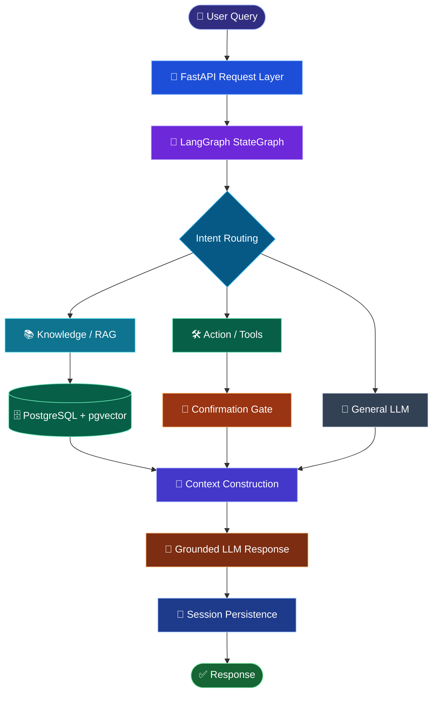

<!-- ============================================================
     ARAVINDAN SINGARAM | ENGINEERING PORTFOLIO
     Backend • Cloud & Data • Mobile • AI & Agent Engineering
============================================================= -->

<div align="center">


<br/>

<a href="https://github.com/Aravindan-001">

</a>
<a href="https://www.linkedin.com/in/aravindansingaram">

</a>
<a href="mailto:aravindansingaram@gmail.com">

</a>
<a href="https://www.instagram.com/nexoralabs_tech/">

</a>

<br/><br/>


### ⚡ Engineering systems that connect data, intelligence, and real-world workflows.

**Cloud & Data Engineering** · **Backend Engineering** · **Mobile Engineering** · **AI & Agent Engineering**

</div>

---

## 🧬 ENGINEERING AT A GLANCE

<div align="center">

<table>
<tr>
<td align="center" width="25%">

### 🧠

**AI & AGENTS**

RAG · LangGraph  
Tool orchestration  
Conversational memory

</td>
<td align="center" width="25%">

### 🗄️

**DATA ENGINEERING**

PostgreSQL · pgvector  
ETL / ELT  
Data ingestion

</td>
<td align="center" width="25%">

### ⚙️

**BACKEND SYSTEMS**

FastAPI · Laravel  
REST APIs · RBAC  
Service architecture

</td>
<td align="center" width="25%">

### ☁️

**CLOUD & DEVOPS**

Docker · Nginx  
AWS S3 · Cloudflare  
Deployment workflows

</td>
</tr>
</table>

</div>

### 👨‍💻 About me

I'm a B.Tech Information Technology student at NPR College of Engineering and Technology, building backend systems, data-driven applications, AI agent workflows, and cross-platform mobile apps.

My engineering work spans the full application lifecycle — from relational schema design and API development to vector retrieval, agent orchestration, frontend integration, automated testing, and cloud deployment.

- 🧠 Built **NORA**, an AI operations platform with RAG, LangGraph routing, persistent conversational memory, and a reported 303-test integration suite.
- 📱 Engineered **ebaConnect**, an employee self-service Flutter application with GPS-based attendance, geofencing, secure session handling, and 42/42 passing tests.
- ☁️ Developed **Svaraa Jewels**, a containerised Laravel e-commerce platform with Docker, Nginx, Redis, AWS S3, and Cloudflare integration.
- 🔄 Designed an event-driven ETL workflow connecting WhatsApp lead ingestion, AI classification, and CRM updates.
- 🔐 Focus on secure access control, testable architecture, reliable data workflows, and deployment-aware engineering.

**Engineering philosophy:** build beyond the demo — clear architecture, validated workflows, meaningful tests, and maintainable systems.

---

## 📊 ENGINEERING DASHBOARD

<div align="center">

<a href="https://github.com/Aravindan-001">

</a><a href="https://github.com/Aravindan-001">

</a>

<br/><br/>

<a href="https://github.com/Aravindan-001">

</a>

<br/><br/>

<a href="https://github.com/Aravindan-001">

</a>

</div>

> Stats are fetched from external services and may be cached or temporarily unavailable. Language charts reflect detected repository code, not overall engineering proficiency.

---

## 🛠️ TECHNOLOGY CONSTELLATION

<div align="center">

### 💻 Languages


### ⚙️ Backend & APIs


### 🌐 Frontend & Mobile


### 🗄️ Databases & Data Systems


### ☁️ Cloud, DevOps & Delivery


### 🤖 AI, Agent Engineering & Automation


### 🧪 Testing & Quality


</div>

<details>
<summary><b>🔬 Detailed technical skills</b></summary>

| Engineering area | Skills and technologies |
|---|---|
| Languages | Python, SQL, JavaScript, TypeScript, PHP, Dart, C |
| Backend | FastAPI, Laravel, Node.js, Express.js, Flask, REST APIs, Pydantic |
| Architecture | Router → Service → Repository, Repository Pattern, service abstraction |
| Data engineering | ETL / ELT, ingestion, transformation, validation, indexing, query optimisation |
| Relational databases | PostgreSQL, MySQL, foreign keys, transactions, relational modelling |
| Vector and graph data | pgvector, vector search, embeddings, Neo4j |
| NoSQL and caching | MongoDB, Redis, Firebase, Supabase |
| Python data access | SQLAlchemy 2.x, Alembic, Psycopg, PyMongo |
| PHP data access | Laravel Eloquent ORM, Laravel Scout |
| Frontend | SvelteKit, Svelte 5, Next.js, React, Tailwind CSS, Vite |
| Mobile | Flutter, Dart, Provider, Material 3, Expo / React Native |
| AI | LangGraph, LangChain, RAG, tool calling, structured generation, MCP |
| Cloud & DevOps | Docker, Render, AWS S3, Cloudflare, Nginx, GitHub Actions |
| Security | Authentication, RBAC, RLS, CSP, secure session storage |
| Testing | Pytest, HTTPX, Flutter Test, Flutter Analyze, Playwright |
| Integrations | Webhooks, SOAP / XML architecture, Razorpay integration, Firebase Analytics |

</details>

---

# 🚀 SELECTED ENGINEERING PROJECTS

<div align="center">


</div>

## 01 · 🧠 NORA

### Agency Operations, Knowledge Graph & AI Agent Platform

<sub>Python · FastAPI · PostgreSQL · pgvector · LangGraph · SvelteKit</sub>

<div align="center">


</div>

NORA is a full-stack agency operations platform connecting client, lead, project, and task workflows with AI-powered knowledge retrieval and tool execution.

**Backend architecture**

- Designed relational entities for Clients → Leads → Projects → Tasks using PostgreSQL, foreign keys, cascading deletion, and REST APIs.
- Implemented a layered **Router → Service → Repository** backend using SQLAlchemy 2.x, Pydantic, Pydantic Settings, and Alembic migrations.
- Expanded the Pytest / HTTPX integration suite from 134 to **303 reported passing tests**, covering APIs, schema validation, session persistence, retrieval, tools, confirmations, and workflow scenarios.

**Knowledge intelligence — RAG + pgvector**

- Implemented semantic retrieval using PostgreSQL pgvector.
- Designed entity-aware knowledge indexing for Clients, Leads, Projects, and Tasks.
- Added idempotent re-indexing, similarity scoring, and an EmbeddingProvider abstraction.
- Built the RAG flow: retrieval → entity-aware context → structured LLM generation → grounded answer with source metadata.
- Included no-context fallback and provider error handling.

**LangGraph and conversational memory**

- Implemented a typed `OrbitState` StateGraph with three branches:
  - 📚 Knowledge / RAG
  - 🛠️ Action / Tool
  - 💬 General LLM
- Added Client, Lead, Project, and Task tools.
- Implemented confirmation-gated mutations using an `action_id` confirmation workflow.
- Built bounded multi-turn memory, PostgreSQL-backed session persistence, and entity-aware follow-up resolution such as ordinal and contextual references.

**Core stack**

`FastAPI` `PostgreSQL` `pgvector` `SQLAlchemy` `Alembic` `LangGraph` `OpenAI` `SvelteKit` `Svelte 5` `TypeScript` `Pytest` `HTTPX`

---

## 02 · 📱 ebaConnect

### Employee Self-Service Mobile Application

<sub>Flutter · Dart · Material 3 · Secure Storage · GPS / Geofencing</sub>

<div align="center">


</div>

A Flutter employee self-service application built with feature-based architecture and a repository abstraction for backend integration.

**Mobile engineering highlights**

- Implemented GPS-based attendance with a **50-metre geofence**, location-accuracy tracking, and mock-location detection.
- Designed a structured `AttendanceRequest` model capturing latitude, longitude, accuracy, and mock-location metadata.
- Built a SOAP / XML integration boundary with `SoapClient` and `SoapEssRepository`, configurable for Development, UAT, and Production.
- Implemented secure session storage using `flutter_secure_storage` and a dedicated `SessionManager`.
- Standardised network, server, authentication, and SOAP-fault error handling.
- Added loading and error-state feedback for application workflows.
- Configured Android release engineering with R8 minification, resource shrinking, ProGuard rules, release-signing preparation, native splash screens, and launcher icons.
- Reported **42/42 passing Flutter tests** and a clean `flutter analyze`.

**Repository**

[**↗ Open iCore ESS public repository**](https://github.com/Aravindan-001/icore-ess)

`Flutter` `Dart` `GPS` `Geofencing` `Secure Storage` `SOAP / XML Architecture`

---

## 03 · ☁️ Svaraa Jewels

### Containerised E-commerce Platform

<sub>Laravel 12 · PHP 8.2+ · MySQL 8 · Redis · Docker · Render</sub>

<div align="center">


</div>

A full e-commerce platform combining backend workflows, administration, background processing, search, storage, and deployment infrastructure.

**Application engineering**

- Built product catalogue, cart, order management, inventory, coupons, reviews, invoice generation, and payment-related workflows.
- Integrated Razorpay payment confirmation using webhook-based processing.
- Used Redis-backed queues and Supervisor for background job processing.
- Developed a Filament 5 admin panel with bulk product upload and PDF catalogue import.
- Integrated Laravel Scout with Meilisearch for search workflows.
- Tuned MySQL schema and query performance.

**Cloud and deployment engineering**

- Containerised the application stack using Docker.
- Configured Nginx as the web server and deployed the application to Render.
- Integrated AWS S3 for object storage and Cloudflare for DNS, CDN / proxy, and web security.
- Implemented security headers and Content Security Policy.
- Debugged deployment environment and storage / filesystem issues.

**Stack**

`Laravel 12` `PHP 8.2+` `MySQL 8` `Redis` `Filament 5` `Razorpay` `Docker` `Nginx` `Supervisor` `Render` `AWS S3` `Cloudflare` `Meilisearch`

[**↗ View Svaraa Jewels repository**](https://github.com/nexoralabs-website/svaraa-jewels)

---

## 04 · 🔄 WhatsApp Lead Engagement & CRM Data Pipeline

### Event-Driven ETL + AI Classification

<sub>n8n · Supabase · PostgreSQL · WhatsApp API · Google Gemini · React</sub>

<div align="center">


</div>

Designed an event-driven pipeline for capturing, normalising, classifying, and tracking leads from WhatsApp-driven workflows.

**Pipeline design**

1. 📥 **Ingest:** capture incoming leads through webhook events.
2. 🧹 **Transform:** normalise fields and validate structured payloads.
3. 🗄️ **Store:** persist records in PostgreSQL through Supabase.
4. 🧠 **Classify:** use Google Gemini for AI-assisted lead classification.
5. 📈 **Score:** calculate lead scores and update CRM records.
6. 🔔 **Automate:** trigger CRM updates and event-driven alerts.
7. 📊 **Monitor:** surface pipeline activity through a React dashboard.

**Engineering focus**

- Structured ingestion and schema validation.
- Reliable webhook-to-database processing.
- AI-integrated data transformation.
- CRM workflow automation and pipeline visibility.

`ETL / ELT` `Webhooks` `PostgreSQL` `Gemini` `n8n` `React`

---

## 05 · 🧠 MeMotion

### AI-Powered Social & Brand Intelligence Platform

<sub>FastAPI · PostgreSQL 18 · SQLAlchemy 2.x · Google Gemini · SvelteKit</sub>

Developed a backend for social and brand analytics, integrating AI-assisted report generation and content intelligence.

- Built REST APIs with FastAPI and Uvicorn.
- Integrated Google Gemini for AI-driven reporting.
- Designed the PostgreSQL data layer with SQLAlchemy 2.x and Psycopg.
- Managed schema changes using Alembic migrations.
- Used Pydantic Settings for environment configuration.
- Configured CORS and FastAPI-to-SvelteKit integration.
- Created Pytest coverage for API and data-layer behaviour.

`FastAPI` `PostgreSQL` `Gemini` `Alembic` `SvelteKit` `Pytest`

---

## 06 · 💍 Shri Vishwakarma Matrimony

### Bilingual Flutter Application

<sub>Flutter · Dart · PHP · MySQL · REST APIs · Material 3</sub>

Developed a matrimonial mobile application with profile management, search and filters, membership tiers, premium flows, chat restrictions, and interest workflows.

- Built a bilingual Tamil / English Material 3 interface.
- Implemented a PHP / MySQL REST API backend.
- Applied JWT authentication and a dedicated business logic layer.
- Designed role-based access control for protected workflows.
- Used Provider and Repository Pattern to structure application state and data access.

`Flutter` `PHP` `MySQL` `JWT` `RBAC`

---

## 07 · 🌌 Nexora Labs

### Interactive Digital Agency Platform

<sub>Next.js · React · TypeScript · Three.js · React Three Fiber · Framer Motion</sub>

Engineered an interactive web experience for a digital product engineering studio.

- Built a scroll-driven 3D scene with a camera journey through city, studio, entrance, and interior environments.
- Used procedural geometry and architectural lighting for the interactive environment.
- Developed responsive information panels and glassmorphism UI layers.
- Used Tailwind CSS and Framer Motion for interface styling and animation.
- Balanced visual quality against rendering performance.

**Product engineering focus**

`Next.js` `React` `Three.js` `R3F` `TypeScript` `Tailwind CSS` `Framer Motion`

[**↗ Connect with Nexora Labs**](https://www.instagram.com/nexoralabs_tech/)

---

## 08 · 🎯 CampusIQ

### AI-Powered Placement Readiness System

<sub>React Native / Expo · Supabase · PostgreSQL · NLP</sub>

Built a placement-readiness concept to help students evaluate resume skills and identify skill gaps.

- Designed a readiness scoring model from 0–100.
- Implemented resume skill extraction and skill-gap analysis.
- Developed company-eligibility prediction logic.
- Designed PostgreSQL tables with Row-Level Security.
- Integrated Supabase Auth, file storage, and realtime synchronisation.

`React Native` `Expo` `Supabase` `PostgreSQL` `RLS` `NLP`

---

# 🧩 ARCHITECTURE & ENGINEERING INFOGRAPHICS

## 🔀 NORA — AI Request Lifecycle

<div align="center">



</div>

## ☁️ Deployment lifecycle

<div align="center">

`💻 CODE` ➜ `🧪 TEST` ➜ `📦 BUILD` ➜ `🐳 CONTAINERISE` ➜ `☁️ DEPLOY` ➜ `🔍 VERIFY`

</div>

## 📊 Data engineering lifecycle

<div align="center">

`📥 INGEST` ➜ `🧹 NORMALISE` ➜ `✅ VALIDATE` ➜ `🗄️ STORE` ➜ `🧠 TRANSFORM` ➜ `📈 USE`

</div>

---

# 🔐 SECURITY, TESTING & RELIABILITY

<div align="center">

| 🔐 Security | 🧪 Testing | 🗄️ Data | 🚀 Delivery |
|:---:|:---:|:---:|:---:|
| JWT / RBAC | Pytest / HTTPX | Relational modelling | Docker |
| RLS | Flutter Test | pgvector retrieval | Nginx |
| Secure sessions | Flutter Analyze | Alembic migrations | Render |
| CSP / headers | Build verification | Schema validation | AWS S3 |
| Mock-location checks | Regression tests | Idempotent indexing | Cloudflare |

</div>

### Reported project verification

| Project | Verification |
|---|---|
| NORA | 303 reported passing Pytest / HTTPX tests |
| ebaConnect | 42/42 reported passing Flutter tests |
| ebaConnect | Clean `flutter analyze` reported |
| ebaConnect | Debug and release APK builds reported verified |
| Svaraa Jewels | Containerised deployment and production debugging work |

<sub>Verification counts and outcomes are based on the project details documented here. They should be updated whenever the current codebase or test suite changes.</sub>

---

# 🏆 CERTIFICATIONS & CONTINUOUS LEARNING

<div align="center">


</div>

- 🕸️ Neo4j Certified Professional
- 🍃 MongoDB Basics for Students
- 🧑‍💻 Prompt Engineering with GitHub Copilot
- 🤖 Oracle Agentic AI Foundations — in progress, as stated in my resume
- ☁️ AWS cloud fundamentals and deployment concepts

---

# 🎓 EDUCATION

### B.Tech — Information Technology

**NPR College of Engineering and Technology, Tamil Nadu**

- Duration: 2024–2028
- Current semester: 5th semester
- Affiliation: Anna University

---

# 🌟 LEADERSHIP & TECHNICAL ACHIEVEMENTS

- 🏅 **Smart India Hackathon:** participated in developing an AI- and automation-oriented solution for a real-world problem statement.
- 🚀 **Hackathons:** worked on AI classification, backend APIs, mobile applications, and workflow automation.
- 🧑‍🏫 **Peer mentoring:** supported junior students with React Native, Laravel, and Supabase integration, including authentication, database design, and APIs.
- 🔧 **Engineering collaboration:** maintained project repositories, technical documentation, and collaborative development workflows.
- 🌐 **Product engineering:** building web, mobile, AI, and automation solutions through Nexora Labs.

---

# 🎯 ENGINEERING DIRECTION

<div align="center">


</div>

My focus is on building production-oriented applications that combine reliable backend services, well-designed data systems, intelligent workflows, and deployable infrastructure.

**Areas of continued growth**

- Cloud infrastructure and deployment engineering
- Data pipelines, relational databases, and vector retrieval
- AI agent architecture and tool orchestration
- Mobile application architecture and secure sessions
- Automated testing and production reliability

---

# 🤝 LET'S BUILD SOMETHING MEANINGFUL

<div align="center">


### Open to engineering opportunities and meaningful collaborations.

**Cloud & Data · Backend APIs · Mobile Apps · AI Agents · SaaS · Automation**

<a href="mailto:aravindansingaram@gmail.com">

</a>

<a href="https://www.linkedin.com/in/aravindansingaram">

</a>

<a href="https://github.com/Aravindan-001">

</a>

<a href="https://www.instagram.com/nexoralabs_tech/">

</a>

<br/><br/>


**⚡ THINK CLEARLY · ENGINEER DEEPLY · SHIP RELIABLY**

<sub>Cloud & Data Engineering • Backend Engineering • Mobile Engineering • AI & Agent Engineering</sub>

</div>
```
