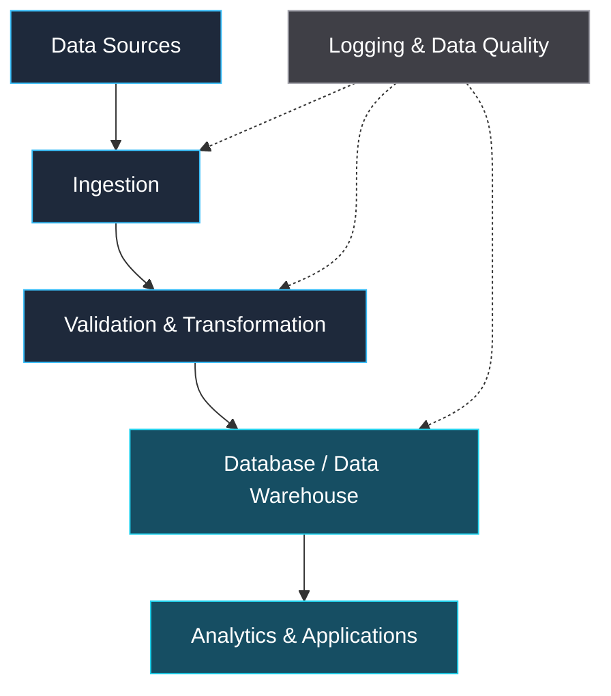

# ARAVINDAN S
### Cloud & DevOps • Data Engineering • Backend Systems • AI Agents

  

  
  
  

---

## `01 / ENGINEERING PROFILE`

I'm an Information Technology engineering student interested in building **reliable software systems that connect applications, data, infrastructure, and intelligent automation.**

My engineering focus is on backend development, cloud infrastructure, DevOps workflows, database systems, and AI-powered applications. I enjoy taking projects beyond the UI — designing APIs, structuring data, implementing access controls, testing workflows, and preparing applications for deployment.

- ☁️ **Cloud & DevOps** — deployment workflows, containers, environment configuration, and infrastructure fundamentals.
- 🗄️ **Data Engineering** — SQL, data modeling, database integration, and exploring reliable data workflows.
- ⚙️ **Backend Engineering** — APIs, authentication, business logic, database-backed applications, and testing.
- 🤖 **AI & Agent Engineering** — LLM integrations, RAG concepts, tool calling, and agent workflows.
- 🧪 **Engineering Quality** — security checks, regression testing, CI/CD concepts, and maintainable architecture.

> **My approach:** Build it. Test it. Secure it. Deploy it. Improve it.

## `02 / TECHNOLOGY MAP`

  
   
  LANGUAGES

  
   
  BACKEND & APPLICATION DEVELOPMENT

  
   
  DATABASES & BACKEND PLATFORMS

  
   
  CLOUD, DEVOPS & VERSION CONTROL

  
   
  WEB PLATFORMS & UI WORKFLOWS

| Domain | Technologies and areas |
|---|---|
| **Cloud & Infrastructure** | AWS fundamentals, S3, Docker, Nginx, Linux, deployment configuration |
| **Data & Storage** | PostgreSQL, MySQL, MongoDB, Redis, Neo4j, pgvector |
| **Backend & APIs** | FastAPI, Node.js, Laravel, REST API design, authentication, authorization |
| **AI & Agents** | OpenAI APIs, Gemini, Claude, LangChain, LangGraph, MCP, RAG |
| **Automation** | n8n, Zapier, Google Apps Script |
| **Testing & Quality** | pytest, Flutter testing, Playwright, static analysis, regression testing |
| **Analytics** | Power BI, SQL-based data exploration |

## `03 / SELECTED PROJECTS`

### 01 — NORA
**AI Agency Operations & Knowledge Platform**

A platform concept combining agency operations, structured business data, and AI-assisted knowledge workflows.

- Backend architecture organized around **Router → Service → Repository** layers.
- PostgreSQL data model with pgvector for vector-based retrieval workflows.
- LangGraph-based orchestration concepts for RAG, tool execution, and general assistant flows.
- SvelteKit and Svelte 5 application interface.
- pytest-based backend verification.

`FastAPI` `PostgreSQL` `pgvector` `LangGraph` `SvelteKit`

---

### 02 — Pick Your Photographer (PYP)
**Photographer Booking Marketplace**

A Flutter marketplace designed around customer requests, photographer acceptance, booking confirmation, and controlled communication.

- Flutter application integrated with Supabase-backed workflows.
- Booking and payment-state handling designed around explicit status transitions.
- Role-based access and protected administrative operations.
- Portfolio storage policies and photographer publication controls.
- Invoice PDF generation and booking-related regression tests.
- Chat and contact access designed around booking confirmation rules.

`Flutter` `Dart` `Supabase` `PostgreSQL` `Firebase`

**Repository:** [PYP-NEXORA-CLIENT](https://github.com/Aravindan-001/PYP-NEXORA-CLIENT)

---

### 03 — Svaraa Jewels
**Database-Driven Web Application**

A web application project emphasizing backend functionality, operational configuration, and deployment-oriented development.

- Laravel application structure and server-side business logic.
- MySQL persistence and Redis integration.
- Docker and Nginx deployment configuration.
- Security-conscious web configuration, including Content Security Policy considerations.
- Git-based development and deployment workflow.

`Laravel` `PHP` `MySQL` `Redis` `Docker` `Nginx`

---

### 04 — ARAM Industries Sales CRM
**Customer Relationship Management Interface**

A CRM interface project focused on lead management workflows, responsive layouts, and repeatable UI verification.

- Next.js and React application architecture.
- Tailwind CSS styling and reusable interface components.
- Lead-management screens using sample CRM data.
- Playwright-based browser testing across desktop and smaller viewports.
- TypeScript, linting, and production-build validation.

`Next.js` `React` `TypeScript` `Tailwind CSS` `Playwright`

---

### 05 — iCore ESS
**Employee Self-Service Application**

A Flutter application integrating with existing enterprise-style services.

- Flutter and Dart application development.
- SOAP/XML service integration.
- Firebase integration for supported application services.

`Flutter` `Dart` `SOAP/XML` `Firebase`

**Repository:** [icore-ess](https://github.com/Aravindan-001/icore-ess)

---

### 06 — PerceptionIQ
**AI-Focused Hackathon Project**

A collaborative project involving application development, backend integration, frontend verification, and troubleshooting external data extraction constraints.

`AI Application Development` `Backend Integration` `Testing` `Debugging`

---

## `04 / CLOUD & DEVOPS WORKFLOW`

I approach deployment as an engineering workflow rather than a final button click.

**Areas I work with and explore:**

- Version control and structured Git workflows.
- Environment variables and application configuration.
- Docker-based application packaging.
- Backend deployment and web server configuration.
- Database migrations and schema changes.
- Automated tests and build validation.
- Security policies, access control, and storage permissions.
- Cloud fundamentals and deployment architecture.

## `05 / DATA ENGINEERING DIRECTION`

My interest in Data Engineering comes from understanding how application data moves, changes, and becomes useful.

Core areas of focus:

- SQL querying and relational data modeling.
- Database design, constraints, and migrations.
- Data validation and consistent application states.
- API-based data ingestion and integration.
- Data quality, logging, and error handling.
- Cloud data services and pipeline architecture fundamentals.
- Analytics and reporting with Power BI.

## `06 / AI & AUTOMATION`

I also build and explore AI-enabled workflows that connect models with applications, tools, and structured data.

- **LLM integration:** Connecting model APIs to application workflows.
- **RAG concepts:** Retrieving relevant information from structured and unstructured sources.
- **Agent orchestration:** Exploring LangGraph, tool execution, and multi-step workflows.
- **MCP:** Understanding how AI applications connect to external tools and resources.
- **Automation:** Connecting APIs, events, and repeatable business processes.

The goal is practical integration: useful outputs, controlled access, observable behavior, and predictable failure handling.

## `07 / CERTIFICATIONS & LEARNING`

- **Neo4j Certified Professional**
- **Oracle Agentic AI Foundations — 2026**
- **AWS Skill Builder** — cloud fundamentals and core service concepts

I use these learning paths to strengthen my understanding of cloud architecture, graph databases, AI application development, and modern infrastructure.

## `08 / ENGINEERING PRINCIPLES`

| Principle | How I apply it |
|---|---|
| **Maintainability** | Clear separation of concerns and readable code |
| **Security** | Least privilege, role checks, and controlled access to data |
| **Reliability** | Explicit state transitions, validation, and error handling |
| **Verification** | Tests, static analysis, and build checks |
| **Deployment readiness** | Environment configuration and repeatable workflows |
| **Continuous improvement** | Documenting decisions and improving based on test results |

## `09 / GITHUB ACTIVITY`

  
  

  

## `10 / BEYOND THE CODE`

I contribute to **Nexora Labs**, a student-led product engineering studio working across web applications, mobile apps, SaaS concepts, AI, and automation.

I also participate in college technical activities, project development, and collaborative engineering initiatives.

  
  

---

  <b>Build thoughtfully. Ship reliably. Keep improving.</b>
   
  Cloud • Data • Backend • AI

