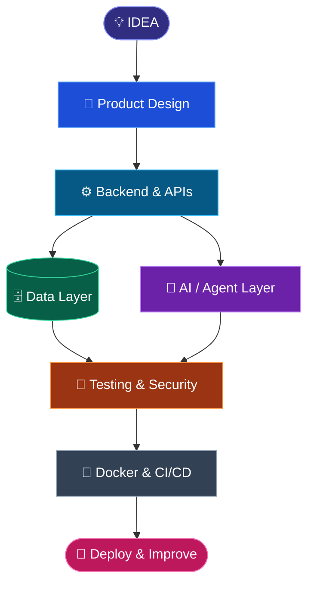
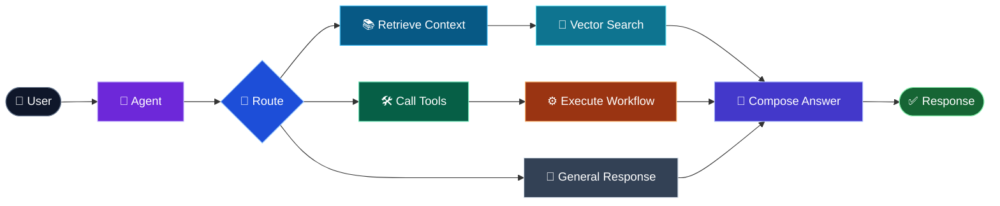

<!-- ========================================================= -->
<!--             ARAVINDAN S — GITHUB PROFILE                 -->
<!-- ========================================================= -->

<div align="center">


<br/>

<a href="https://github.com/Aravindan-001">
  
</a>
<a href="https://www.instagram.com/nexoralabs_tech/">
  
</a>


<br/><br/>

**Engineering reliable backends, intelligent AI workflows, and deployable products.**

`Backend Engineering` · `AI & Agent Engineering` · `Cloud & DevOps`

</div>

---

## 🪐 ENGINEERING UNIVERSE

<div align="center">

<table>
<tr>
<td align="center" width="33%">


### ⚙️ BACKEND

API design  
Business logic  
Database systems  
Authentication

</td>
<td align="center" width="33%">


### 🧠 AI ENGINEERING

AI agents  
RAG pipelines  
Tool orchestration  
Knowledge systems

</td>
<td align="center" width="33%">


### ☁️ CLOUD & DEVOPS

Docker  
CI/CD workflows  
Cloud deployment  
Infrastructure

</td>
</tr>
</table>

</div>

## 🧬 HOW I BUILD

<div align="center">



</div>

> My approach: build the core system first, make the data flow reliable, test important paths, then deploy and iterate.

---

## 🎨 TECHNOLOGY CONSTELLATION

<div align="center">

### 💻 Languages


### 🧱 Backend & Application Engineering


### 🗄️ Databases & Data Systems


### ☁️ Cloud, DevOps & Deployment


### 🤖 AI, Agents & Automation


</div>

<details>
<summary><b>🔬 Explore the engineering stack</b></summary>

| Domain | Technologies & Focus |
|---|---|
| Languages | Python, TypeScript, JavaScript, C, PHP, Dart |
| Backend | FastAPI, Node.js, Laravel, REST APIs |
| Frontend & Apps | Next.js, React, Flutter, SvelteKit |
| Data | PostgreSQL, MySQL, MongoDB, Redis |
| AI & Retrieval | LLM applications, RAG, LangGraph, pgvector, Neo4j |
| Cloud & Delivery | AWS, Docker, Nginx, Cloudflare, Vercel, Render |
| Automation | n8n, Zapier, Google Apps Script |
| Testing | pytest, Playwright, type checking, build validation |
| Security | Authentication, authorization, RBAC, RLS, security reviews |

</details>

---

## 🚀 PROJECT GALAXY

<div align="center">


</div>

### 01 · 🧠 NORA — AI Operations & Knowledge Platform


A modular platform concept for agency operations, connected knowledge, and AI-assisted workflows.

- **Backend:** FastAPI
- **Data:** PostgreSQL, pgvector
- **AI orchestration:** LangGraph
- **Interface:** SvelteKit / Svelte 5
- **Architecture:** Router → Service → Repository

`AI Workflows` `Knowledge Graphs` `RAG` `Backend Architecture`

<br clear="right"/>

---

### 02 · ☁️ Svaraa Jewels — Cloud-Ready Web Platform


A web application project focused on structured backend development and deployment workflows.

- **Backend:** Laravel 12 / PHP
- **Database:** MySQL
- **Infrastructure:** Docker, Nginx
- **Additional tooling:** Redis, Filament
- **Focus:** Configuration, deployment, and maintainability

`Laravel` `MySQL` `Docker` `Nginx` `DevOps`

<br clear="right"/>

---

### 03 · 📱 iCore ESS — Employee Self-Service


A mobile application project exploring employee self-service workflows and enterprise integrations.

- **Application:** Flutter / Dart
- **Integration:** SOAP / XML
- **Services:** Firebase
- **Focus:** Mobile workflows and enterprise connectivity

🔗 **[View repository →](https://github.com/Aravindan-001/icore-ess)**

`Flutter` `Dart` `SOAP` `XML` `Firebase`

<br clear="right"/>

---

### 04 · 📸 PYP — Pick Your Photographer


A photographer marketplace in development, designed around a controlled booking and confirmation lifecycle.

- **Application:** Flutter
- **Backend services:** Supabase / PostgreSQL
- **Security:** Row-Level Security and role-aware access
- **Workflow:** Request → Photographer acceptance → Payment → Confirmation
- **Marketplace rules:** Server-side fee calculation and controlled chat access

`Marketplace` `Flutter` `Supabase` `RLS` `Payments`

<br clear="right"/>

---

### 05 · 📊 Client CRM — Sales Workflow Interface


A CRM interface project focused on lead management, sales workflows, and responsive UI quality.

- **Frontend:** Next.js / React
- **Styling:** Tailwind CSS
- **Quality checks:** Playwright, TypeScript, lint and build validation
- **Focus:** Lead views, responsive behavior, and interaction testing

`Next.js` `React` `Tailwind CSS` `Playwright`

<br clear="right"/>

---

### 06 · 🧪 PerceptionIQ — Hackathon Project


A hackathon project involving frontend/backend integration and quality validation.

- **Focus:** Application workflows and integration
- **Testing:** Backend and frontend QA
- **Engineering:** Debugging, API integration, and practical delivery constraints

`Hackathon` `Integration` `QA` `Problem Solving`

<br clear="right"/>

<div align="center">

<a href="https://github.com/Aravindan-001?tab=repositories">

</a>

</div>

---

## ⚡ AI AGENT WORKFLOW

<div align="center">



</div>

**Areas of interest**

- Agentic AI and tool-using systems
- Retrieval-Augmented Generation (RAG)
- Vector search and knowledge retrieval
- Model Context Protocol (MCP)
- API-driven workflow automation
- Human-readable logs, testing, and controlled execution

---

## 📈 GITHUB ACTIVITY CENTER

<div align="center">

<a href="https://github.com/Aravindan-001">

</a>

<a href="https://github.com/Aravindan-001">

</a>

<br/>

<a href="https://git.io/streak-stats">

</a>

<br/><br/>


</div>

<sub>Note: GitHub stats and third-party graph services may have caching, availability, or counting limitations. Language charts reflect repository code, not necessarily overall proficiency.</sub>

---

## 🏅 LEARNING & CREDENTIALS

<div align="center">


</div>

**Learning areas**

- Neo4j and graph-based data concepts
- Oracle Agentic AI Foundations
- Model Context Protocol (MCP)
- OpenAI Responses API and Agents SDK
- OCI Enterprise AI
- Oracle AI Database and Vector Search
- AWS cloud fundamentals

---

## 🛡️ ENGINEERING PRINCIPLES

<div align="center">

| 🔐 Security | 🧪 Quality | 🏗️ Architecture | ☁️ Delivery |
|:---:|:---:|:---:|:---:|
| Least privilege | Automated tests | Clear boundaries | Repeatable builds |
| Role-aware access | Type checking | Modular services | Containerization |
| Secure defaults | Regression checks | Explicit data flow | Deployment workflows |
| Validate inputs | Build validation | Maintainable APIs | Observability mindset |

</div>

I aim to make projects more than demos: understandable code, clear responsibilities, meaningful tests, and deployment-aware design.

---

## 🌌 CURRENT ENGINEERING DIRECTION

<div align="center">


</div>

- 🔭 Building backend-heavy applications and product workflows.
- 🧠 Exploring AI agents, RAG, and connected knowledge systems.
- ☁️ Developing practical cloud and DevOps skills.
- 🔐 Improving authorization, testing, and secure application design.
- 🚀 Turning ideas into usable software through **Nexora Labs**.

---

## 🤝 CONNECT & COLLABORATE

<div align="center">

### Have an idea worth building?

**AI applications · Backend systems · Web & mobile apps · SaaS · Automation**

<br/>

<a href="https://github.com/Aravindan-001">

</a>
<a href="https://www.instagram.com/nexoralabs_tech/">

</a>

<br/><br/>


**`Code with purpose. Engineer with clarity. Ship with confidence.`**

<sub>Designed with Markdown, SVG-based visuals, Mermaid diagrams, and GitHub-compatible embeds.</sub>

</div>
```
